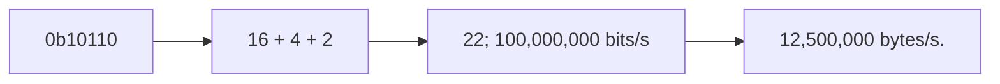

# A01.01 · binary and units

[Phase index](../README.md) · [Foundation] · 25–40 minutes

Prerequisite [Stage 0](../../../00-stage-0-diagnostic/README.md) · Next [A01.02](A01.02.md)

## 1. The problem & why it exists

An uploader estimates that a 100 Mb/s connection transfers 1 GiB in 10 seconds. Convert everything to bytes and seconds before estimating. A measured rate is needed if compression or protocol overhead matters.

## 2. Visual mental model



```text
[01] 0b10110
[02] 16 + 4 + 2
[03] 22; 100,000,000 bits/s
[04] 12,500,000 bytes/s.
```

Read the trace from the first state to the last. Each box labels an observation or a model state. Timing and resource use on a specific host require separate measurements.

## 3. Step-by-step mechanism & minimal dry-run

Each set bit contributes its positional weight. SI kilo is 1000 and IEC kibi is 1024. Wire rates generally count bits per second.

**Trace.** 0b10110 -> 16 + 4 + 2 -> 22; 100,000,000 bits/s -> 12,500,000 bytes/s.

**Boundary case.** Treating the numerical rate as bytes/s predicts 10.74 s, an 8× error. Normalize at parsing and carry the unit into the report.

## 4. Formal rigor & quantitative math

For B bytes and r bits/s, ideal time is 8B/r. At 100 Mb/s, 1 GiB takes 85.90 s. A k-bit positional scan costs O(k) steps and constant accumulator count.

Use the modeled numbers first, then check your prediction with the [runnable example](../examples/A01.01.py). Where the example observes the OS, compare direction and units across three repetitions and keep the raw values. Treat any modeled latency as a worked input.

Check the arithmetic with NumPy after `uv sync --locked --extra math`.

```python
import numpy as np

actual = 8 * np.array(2**30) / 100_000_000
np.testing.assert_allclose(actual, 85.89934592)
print(actual)
```

## 5. Progressive design

| Approach | Latency or output | Memory | Implementation effort | Cost | Failure to watch |
| --- | --- | --- | --- | --- | --- |
| Baseline experiment | Failure control in section 6 | Bounded fixture | Change one input or policy | Local CPU time | Treating the numerical rate as bytes/s predicts 10.74 s, an 8× error |
| Corrected experiment | Normal control in section 6 | Same fixture unless documented | Make the specific boundary explicit | Local CPU time | Validate the boundary again after deployment |

Read the two code paths in the [example](../examples/A01.01.py). Identify the state that differs and compare the output. Convert everything to bytes and seconds before estimating. A measured rate is needed if compression or protocol overhead matters.

## 6. Safe local lab & controlled failure injection

Predict both modes on paper, then run from the repository root.

```sh
uv run python "01-architecture-A01-to-A20/A01-computer-systems-and-os/examples/A01.01.py"
uv run python "01-architecture-A01-to-A20/A01-computer-systems-and-os/examples/A01.01.py" --break
```

**Observe.** Expect 85.90 s versus 10.74 s.

**Diagnose.** Identify the first divergent state in the trace. Treating the numerical rate as bytes/s predicts 10.74 s, an 8× error. Normalize at parsing and carry the unit into the report.

**Repair.** Rerun the normal control, then change only the deciding input or branch in a scratch copy and rerun both modes.

**Extend.** Replace 2**30 with 10**9 and compare SI and IEC estimates.

**Cleanup.** The example exits on its own and cleans up any temporary files or handles. Remove the scratch copy after recording evidence.

## 7. Production & multi-cloud bridge

A FastAPI upload limit must use explicit bytes even when dashboards report SI network rates. Convert observed load balancer byte rates before comparing ALB, Azure Application Gateway and Google Cloud Load Balancing.

**Interview.** Why can observed transfer take longer?

<details>
<summary>Reveal Principal Answer & Trade-Offs</summary>

Retransmissions, headers, contention, and application pacing reduce payload throughput.

</details>

## 8. Memory hook & mastery checkpoint

**Recall.** Each set bit contributes its positional weight. Use the boundary case in section 3 to explain where the simple explanation stops.

1. How many bytes in 4 KiB?
2. How long for 100 MB at 40 Mb/s?
3. What is binary 1101?
4. What evidence should differ between normal and failure mode?
5. What is the experiment variation, and what must be held constant?

<details>
<summary>Check answers after attempting all five</summary>

1. 4096
2. 20 s
3. 13
4. 85.90 s versus 10.74 s
5. Replace 2**30 with 10**9 and compare SI and IEC estimates. Hold the runtime, input fixture and measurement method constant except for the stated change.

</details>
