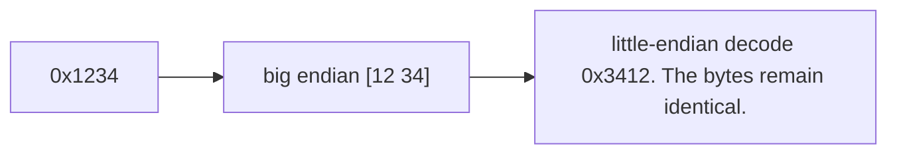

# A01.02 · bits/bytes/words

[Phase index](../README.md) · [Foundation] · 25–40 minutes

Prerequisite [A01.01](A01.01.md) · Next [A01.03](A01.03.md)

## 1. The problem & why it exists

A parser uses the native CPU word width to read a two-byte wire field. Use an explicitly sized field and specify byte order. One-byte fields need no byte-order conversion.

## 2. Visual mental model



```text
[01] 0x1234
[02] big endian [12 34]
[03] little-endian decode 0x3412. The bytes remain identical.
```

Read the trace from the first state to the last. Each box labels an observation or a model state. Timing and resource use on a specific host require separate measurements.

## 3. Step-by-step mechanism & minimal dry-run

An octet has eight bits. A machine word is an ISA convention. Endianness orders bytes in a multi-byte representation.

**Trace.** 0x1234 -> big endian [12 34] -> little-endian decode 0x3412. The bytes remain identical.

**Boundary case.** Implicit native decoding gives 13330 instead of 4660 in this trace. Use a fixed width and check input length before conversion.

## 4. Formal rigor & quantitative math

For an unsigned width w, range is 0 to 2^w−1. Two octets give 65536 values. Reading n bytes is O(n).

Use the modeled numbers first, then check your prediction with the [runnable example](../examples/A01.02.py). Where the example observes the OS, compare direction and units across three repetitions and keep the raw values. Treat any modeled latency as a worked input.

Check the arithmetic with NumPy after `uv sync --locked --extra math`.

```python
import numpy as np

actual = 2 ** (8 * np.array(2))
np.testing.assert_allclose(actual, 65536)
print(actual)
```

## 5. Progressive design

| Approach | Latency or output | Memory | Implementation effort | Cost | Failure to watch |
| --- | --- | --- | --- | --- | --- |
| Baseline experiment | Failure control in section 6 | Bounded fixture | Change one input or policy | Local CPU time | Implicit native decoding gives 13330 instead of 4660 in this trace |
| Corrected experiment | Normal control in section 6 | Same fixture unless documented | Make the specific boundary explicit | Local CPU time | Validate the boundary again after deployment |

Read the two code paths in the [example](../examples/A01.02.py). Identify the state that differs and compare the output. Use an explicitly sized field and specify byte order. One-byte fields need no byte-order conversion.

## 6. Safe local lab & controlled failure injection

Predict both modes on paper, then run from the repository root.

```sh
uv run python "01-architecture-A01-to-A20/A01-computer-systems-and-os/examples/A01.02.py"
uv run python "01-architecture-A01-to-A20/A01-computer-systems-and-os/examples/A01.02.py" --break
```

**Observe.** Expect 4660 versus 13330.

**Diagnose.** Identify the first divergent state in the trace. Implicit native decoding gives 13330 instead of 4660 in this trace. Use a fixed width and check input length before conversion.

**Repair.** Rerun the normal control, then change only the deciding input or branch in a scratch copy and rerun both modes.

**Extend.** Change the payload to 01 00 and reverse the byte order.

**Cleanup.** The example exits on its own and cleans up any temporary files or handles. Remove the scratch copy after recording evidence.

## 7. Production & multi-cloud bridge

Use fixed widths for binary payloads going through a Python API or into a storage format. Interoperability across EC2, Azure VMs and Compute Engine depends on the serialization contract across node types.

**Interview.** When is a native format safe?

<details>
<summary>Reveal Principal Answer & Trade-Offs</summary>

Inside an explicitly versioned same-ABI boundary, with width, alignment and padding checked.

</details>

## 8. Memory hook & mastery checkpoint

**Recall.** An octet has eight bits. Use the boundary case in section 3 to explain where the simple explanation stops.

1. What is the width of three octets?
2. Does a 64-bit OS fix protocol word sizes?
3. Decode 01 00 as little endian.
4. What evidence should differ between normal and failure mode?
5. What is the experiment variation, and what must be held constant?

<details>
<summary>Check answers after attempting all five</summary>

1. 24 bits
2. No
3. 1
4. 4660 versus 13330
5. Change the payload to 01 00 and reverse the byte order. Hold the runtime, input fixture and measurement method constant except for the stated change.

</details>
