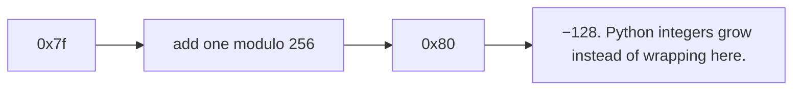

# A01.03 · signed integer encoding

[Phase index](../README.md) · [Foundation] · 25–40 minutes

Prerequisite [A01.02](A01.02.md) · Next [A01.04](A01.04.md)

## 1. The problem & why it exists

An eight-bit counter encoding 127 becomes negative after an increment. Use a sufficiently wide signed type or checked arithmetic for business counters.

## 2. Visual mental model



```text
[01] 0x7f
[02] add one modulo 256
[03] 0x80
[04] −128. Python integers grow instead of wrapping here.
```

Read the trace from the first state to the last. Each box labels an observation or a model state. Timing and resource use on a specific host require separate measurements.

## 3. Step-by-step mechanism & minimal dry-run

Two's complement gives the top bit negative weight. Interpreting an unsigned pattern u with its top bit set subtracts the modulus.

**Trace.** 0x7f -> add one modulo 256 -> 0x80 -> −128. Python integers grow instead of wrapping here.

**Boundary case.** Masking silently maps 128 to −128. A range check before encoding turns silent corruption into a localized error.

## 4. Formal rigor & quantitative math

With width w, negative weights extend the range down to −2^(w−1). At w=8 the range is −128 through 127. A fixed-width decode is O(1).

Use the modeled numbers first, then check your prediction with the [runnable example](../examples/A01.03.py). Where the example observes the OS, compare direction and units across three repetitions and keep the raw values. Treat any modeled latency as a worked input.

Check the arithmetic with NumPy after `uv sync --locked --extra math`.

```python
import numpy as np

actual = np.array([0x80, 0xFF], dtype=np.uint8).view(np.int8)
np.testing.assert_allclose(actual, [-128, -1])
print(actual)
```

## 5. Progressive design

| Approach | Latency or output | Memory | Implementation effort | Cost | Failure to watch |
| --- | --- | --- | --- | --- | --- |
| Baseline experiment | Failure control in section 6 | Bounded fixture | Change one input or policy | Local CPU time | Masking silently maps 128 to −128 |
| Corrected experiment | Normal control in section 6 | Same fixture unless documented | Make the specific boundary explicit | Local CPU time | Validate the boundary again after deployment |

Read the two code paths in the [example](../examples/A01.03.py). Identify the state that differs and compare the output. Use a sufficiently wide signed type or checked arithmetic for business counters.

## 6. Safe local lab & controlled failure injection

Predict both modes on paper, then run from the repository root.

```sh
uv run python "01-architecture-A01-to-A20/A01-computer-systems-and-os/examples/A01.03.py"
uv run python "01-architecture-A01-to-A20/A01-computer-systems-and-os/examples/A01.03.py" --break
```

**Observe.** Expect 7f versus range error.

**Diagnose.** Identify the first divergent state in the trace. Masking silently maps 128 to −128. A range check before encoding turns silent corruption into a localized error.

**Repair.** Rerun the normal control, then change only the deciding input or branch in a scratch copy and rerun both modes.

**Extend.** Try −128 and −129 as well as 127 and 128.

**Cleanup.** The example exits on its own and cleans up any temporary files or handles. Remove the scratch copy after recording evidence.

## 7. Production & multi-cloud bridge

Specify a signed range where Python crosses a PostgreSQL column or packed binary field. Apply the same range tests on Lambda, Azure Functions and Cloud Run.

**Interview.** How should a storage migration handle widening?

<details>
<summary>Reveal Principal Answer & Trade-Offs</summary>

Define decoding under the old schema before re-encoding, and test sign boundaries.

</details>

## 8. Memory hook & mastery checkpoint

**Recall.** Two's complement gives the top bit negative weight. Use the boundary case in section 3 to explain where the simple explanation stops.

1. Decode 0xff as signed 8-bit.
2. Encode −2 at 8 bits in hex.
3. What is the signed 16-bit minimum?
4. What evidence should differ between normal and failure mode?
5. What is the experiment variation, and what must be held constant?

<details>
<summary>Check answers after attempting all five</summary>

1. −1
2. fe
3. −32768
4. 7f versus range error
5. Try −128 and −129 as well as 127 and 128. Hold the runtime, input fixture and measurement method constant except for the stated change.

</details>

## Standards and implementation notes

The 8-bit integer range follows from one sign bit and seven lower weights. Python can represent larger integers but its fixed-width encoding rejects out-of-range inputs.

- [Python built-in types](https://docs.python.org/3/library/stdtypes.html)
