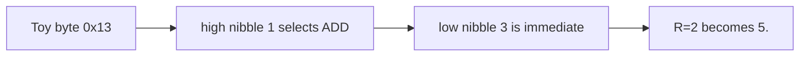

# A01.04 · CPU instruction sets

[Phase index](../README.md) · [Foundation] · 25–40 minutes

Prerequisite [A01.03](A01.03.md) · Next [A01.05](A01.05.md)

## 1. The problem & why it exists

The same binary fails on a host with a different processor architecture. Keep source portable and publish a native build for each target. A toy instruction set is enough to study decoding.

## 2. Visual mental model



```text
[01] Toy byte 0x13
[02] high nibble 1 selects ADD
[03] low nibble 3 is immediate
[04] R=2 becomes 5.
```

Read the trace from the first state to the last. Each box labels an observation or a model state. Timing and resource use on a specific host require separate measurements.

## 3. Step-by-step mechanism & minimal dry-run

An ISA specifies instruction encodings, architectural registers, and observable effects. An ABI adds calling and binary interface rules.

**Trace.** Toy byte 0x13 -> high nibble 1 selects ADD -> low nibble 3 is immediate -> R=2 becomes 5.

**Boundary case.** Guessing an unknown opcode creates wrong state. Dispatch only supported opcodes and report the offending byte.

## 4. Formal rigor & quantitative math

For an operation field with b bits there are at most 2^b opcode patterns. Four bits allow 16. A fixed-width decoder has O(1) work per instruction.

Use the modeled numbers first, then check your prediction with the [runnable example](../examples/A01.04.py). Where the example observes the OS, compare direction and units across three repetitions and keep the raw values. Treat any modeled latency as a worked input.

Check the arithmetic with NumPy after `uv sync --locked --extra math`.

```python
import numpy as np

actual = np.divmod(0x13, 16)
np.testing.assert_allclose(actual, [1, 3])
print(actual)
```

## 5. Progressive design

| Approach | Latency or output | Memory | Implementation effort | Cost | Failure to watch |
| --- | --- | --- | --- | --- | --- |
| Baseline experiment | Failure control in section 6 | Bounded fixture | Change one input or policy | Local CPU time | Guessing an unknown opcode creates wrong state |
| Corrected experiment | Normal control in section 6 | Same fixture unless documented | Make the specific boundary explicit | Local CPU time | Validate the boundary again after deployment |

Read the two code paths in the [example](../examples/A01.04.py). Identify the state that differs and compare the output. Keep source portable and publish a native build for each target. A toy instruction set is enough to study decoding.

## 6. Safe local lab & controlled failure injection

Predict both modes on paper, then run from the repository root.

```sh
uv run python "01-architecture-A01-to-A20/A01-computer-systems-and-os/examples/A01.04.py"
uv run python "01-architecture-A01-to-A20/A01-computer-systems-and-os/examples/A01.04.py" --break
```

**Observe.** Expect 5 versus unsupported opcode.

**Diagnose.** Identify the first divergent state in the trace. Guessing an unknown opcode creates wrong state. Dispatch only supported opcodes and report the offending byte.

**Repair.** Rerun the normal control, then change only the deciding input or branch in a scratch copy and rerun both modes.

**Extend.** Try 0x10 and 0x1f, then add another valid opcode.

**Cleanup.** The example exits on its own and cleans up any temporary files or handles. Remove the scratch copy after recording evidence.

## 7. Production & multi-cloud bridge

Native dependencies in a FastAPI wheel must match the deployment platform. Validate target machine architecture on EC2, Azure VMs and Compute Engine before rollout.

**Interview.** Does matching ISA ensure a binary runs?

<details>
<summary>Reveal Principal Answer & Trade-Offs</summary>

OS ABI, dynamic libraries, and ISA extensions can still differ.

</details>

## 8. Memory hook & mastery checkpoint

**Recall.** An ISA specifies instruction encodings, architectural registers, and observable effects. Use the boundary case in section 3 to explain where the simple explanation stops.

1. How many opcodes with 6 bits?
2. Does ISA fix cache size?
3. What specifies argument registers?
4. What evidence should differ between normal and failure mode?
5. What is the experiment variation, and what must be held constant?

<details>
<summary>Check answers after attempting all five</summary>

1. 64
2. No
3. The platform ABI
4. 5 versus unsupported opcode
5. Try 0x10 and 0x1f, then add another valid opcode. Hold the runtime, input fixture and measurement method constant except for the stated change.

</details>

## Standards and implementation notes

The miniature ADD decoder is a teaching ISA. Real ISA manuals specify instruction encodings, register effects and exceptional behavior. The OS binary format and ABI determine how a compiled program is loaded and how calls interoperate.

- [Arm A-profile architecture](https://developer.arm.com/Architectures/A-Profile%20Architecture)
- [Intel architecture manuals](https://www.intel.com/content/www/us/en/developer/articles/technical/intel-sdm.html)
