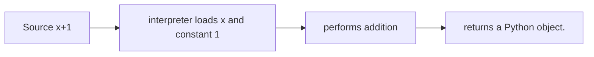

# A01.05 · machine code vs source vs bytecode

[Phase index](../README.md) · [Foundation] · 25–40 minutes

Prerequisite [A01.04](A01.04.md) · Next [A01.06](A01.06.md)

## 1. The problem & why it exists

An engineer sees a Python bytecode instruction and assumes it is a CPU instruction. Use source-level inspection for ordinary application debugging and disassembly for a diagnosed layer-specific question.

## 2. Visual mental model



```text
[01] Source x+1
[02] interpreter loads x and constant 1
[03] performs addition
[04] returns a Python object.
```

Read the trace from the first state to the last. Each box labels an observation or a model state. Timing and resource use on a specific host require separate measurements.

## 3. Step-by-step mechanism & minimal dry-run

CPython compiles Python source to code objects containing bytecode. The interpreter executes native instructions to implement that bytecode.

**Trace.** Source x+1 -> interpreter loads x and constant 1 -> performs addition -> returns a Python object.

**Boundary case.** Assuming a stable opcode list across Python versions breaks analysis tools. Inspect bytecode with the same interpreter version.

## 4. Formal rigor & quantitative math

For n dynamic bytecode operations and mean interpreter cost c ns, dispatch accounts for nc ns in a simple model. 500×50 ns is 25 µs. Work can differ per opcode.

Use the modeled numbers first, then check your prediction with the [runnable example](../examples/A01.05.py). Where the example observes the OS, compare direction and units across three repetitions and keep the raw values. Treat any modeled latency as a worked input.

Check the arithmetic with NumPy after `uv sync --locked --extra math`.

```python
import numpy as np

actual = np.array(500) * 50 / 1000
np.testing.assert_allclose(actual, 25)
print(actual)
```

## 5. Progressive design

| Approach | Latency or output | Memory | Implementation effort | Cost | Failure to watch |
| --- | --- | --- | --- | --- | --- |
| Baseline experiment | Failure control in section 6 | Bounded fixture | Change one input or policy | Local CPU time | Assuming a stable opcode list across Python versions breaks analysis tools |
| Corrected experiment | Normal control in section 6 | Same fixture unless documented | Make the specific boundary explicit | Local CPU time | Validate the boundary again after deployment |

Read the two code paths in the [example](../examples/A01.05.py). Identify the state that differs and compare the output. Use source-level inspection for ordinary application debugging and disassembly for a diagnosed layer-specific question.

## 6. Safe local lab & controlled failure injection

Predict both modes on paper, then run from the repository root.

```sh
uv run python "01-architecture-A01-to-A20/A01-computer-systems-and-os/examples/A01.05.py"
uv run python "01-architecture-A01-to-A20/A01-computer-systems-and-os/examples/A01.05.py" --break
```

**Observe.** Expect bytecode listing versus rejected source.

**Diagnose.** Identify the first divergent state in the trace. Assuming a stable opcode list across Python versions breaks analysis tools. Inspect bytecode with the same interpreter version.

**Repair.** Rerun the normal control, then change only the deciding input or branch in a scratch copy and rerun both modes.

**Extend.** Disassemble x * 2 and compare stack operands with x + 1.

**Cleanup.** The example exits on its own and cleans up any temporary files or handles. Remove the scratch copy after recording evidence.

## 7. Production & multi-cloud bridge

Profile FastAPI in the actual interpreter version before attributing work to a specific bytecode path. Pin compatible runtime images or runtimes for Lambda, Azure Functions and Cloud Run.

**Interview.** Why does one addition have variable cost?

<details>
<summary>Reveal Principal Answer & Trade-Offs</summary>

Operand representation, overloaded methods, and specialization affect the path.

</details>

## 8. Memory hook & mastery checkpoint

**Recall.** CPython compiles Python source to code objects containing bytecode. Use the boundary case in section 3 to explain where the simple explanation stops.

1. Does dis show native machine code?
2. Is one opcode necessarily one operation on hardware?
3. Which component executes native code?
4. What evidence should differ between normal and failure mode?
5. What is the experiment variation, and what must be held constant?

<details>
<summary>Check answers after attempting all five</summary>

1. No
2. No
3. The CPU
4. bytecode listing versus rejected source
5. Disassemble x * 2 and compare stack operands with x + 1. Hold the runtime, input fixture and measurement method constant except for the stated change.

</details>
