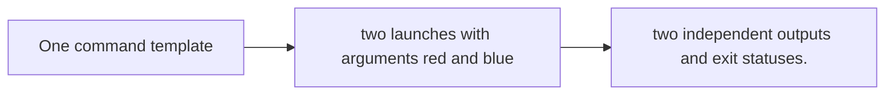

# A01.06 · what a program is

[Phase index](../README.md) · [Foundation] · 25–40 minutes

Prerequisite [A01.05](A01.05.md) · Next [A01.07](A01.07.md)

## 1. The problem & why it exists

A Python script appears untouched on disk even while two copies run with different configuration. Treat the program as instructions and data. Inspect a process for the live state of an execution.

## 2. Visual mental model



```text
[01] One command template
[02] two launches with arguments red and blue
[03] two independent outputs and exit statuses.
```

Read the trace from the first state to the last. Each box labels an observation or a model state. Timing and resource use on a specific host require separate measurements.

## 3. Step-by-step mechanism & minimal dry-run

The runtime loads code, reads environment and arguments, and executes inside an OS process with its own resource handles.

**Trace.** One command template -> two launches with arguments red and blue -> two independent outputs and exit statuses.

**Boundary case.** Using file contents as live state misses arguments and exit codes. Capture command, PID and completion status together.

## 4. Formal rigor & quantitative math

For p processes each with d private bytes, private usage is pd. Three at 20 MiB cost 60 MiB before shared mappings. Launching p instances entails O(p) launches.

Use the modeled numbers first, then check your prediction with the [runnable example](../examples/A01.06.py). Where the example observes the OS, compare direction and units across three repetitions and keep the raw values. Treat any modeled latency as a worked input.

Check the arithmetic with NumPy after `uv sync --locked --extra math`.

```python
import numpy as np

actual = 3 * np.array(20)
np.testing.assert_allclose(actual, 60)
print(actual)
```

## 5. Progressive design

| Approach | Latency or output | Memory | Implementation effort | Cost | Failure to watch |
| --- | --- | --- | --- | --- | --- |
| Baseline experiment | Failure control in section 6 | Bounded fixture | Change one input or policy | Local CPU time | Using file contents as live state misses arguments and exit codes |
| Corrected experiment | Normal control in section 6 | Same fixture unless documented | Make the specific boundary explicit | Local CPU time | Validate the boundary again after deployment |

Read the two code paths in the [example](../examples/A01.06.py). Identify the state that differs and compare the output. Treat the program as instructions and data. Inspect a process for the live state of an execution.

## 6. Safe local lab & controlled failure injection

Predict both modes on paper, then run from the repository root.

```sh
uv run python "01-architecture-A01-to-A20/A01-computer-systems-and-os/examples/A01.06.py"
uv run python "01-architecture-A01-to-A20/A01-computer-systems-and-os/examples/A01.06.py" --break
```

**Observe.** Expect red and blue with status 0 versus status 7.

**Diagnose.** Identify the first divergent state in the trace. Using file contents as live state misses arguments and exit codes. Capture command, PID and completion status together.

**Repair.** Rerun the normal control, then change only the deciding input or branch in a scratch copy and rerun both modes.

**Extend.** Pass a third color and compare stdout independently of exit status.

**Cleanup.** The example exits on its own and cleans up any temporary files or handles. Remove the scratch copy after recording evidence.

## 7. Production & multi-cloud bridge

A FastAPI worker is a live process with specific settings and lifecycle, even if workers use the same source. Compare replica lifecycle and restart evidence on EKS, AKS and GKE.

**Interview.** How do you roll out a program change?

<details>
<summary>Reveal Principal Answer & Trade-Offs</summary>

Replace running versions explicitly and observe readiness before retiring the old processes.

</details>

## 8. Memory hook & mastery checkpoint

**Recall.** The runtime loads code, reads environment and arguments, and executes inside an OS process with its own resource handles. Use the boundary case in section 3 to explain where the simple explanation stops.

1. Does reading source start a process?
2. Can copies share read-only pages?
3. What identifies one live execution?
4. What evidence should differ between normal and failure mode?
5. What is the experiment variation, and what must be held constant?

<details>
<summary>Check answers after attempting all five</summary>

1. No
2. Yes
3. A process identity
4. red and blue with status 0 versus status 7
5. Pass a third color and compare stdout independently of exit status. Hold the runtime, input fixture and measurement method constant except for the stated change.

</details>
