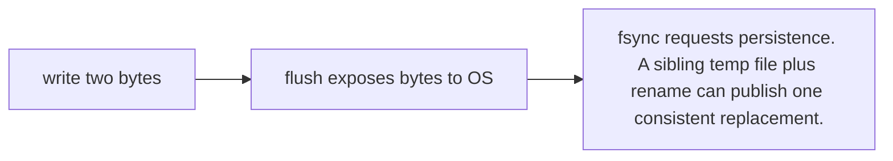

# A01.07 · files and persistent storage

[Phase index](../README.md) · [Foundation] · 25–40 minutes

Prerequisite [A01.06](A01.06.md) · Next [A01.08](A01.08.md)

## 1. The problem & why it exists

A service acknowledges a write before data reaches persistent storage. A temporary file is enough for scratch data. Define the durability boundary for acknowledged state.

## 2. Visual mental model



```text
[01] write two bytes
[02] flush exposes bytes to OS
[03] fsync requests persistence. A sibling temp file plus rename can publish one consistent replacement.
```

Read the trace from the first state to the last. Each box labels an observation or a model state. Timing and resource use on a specific host require separate measurements.

## 3. Step-by-step mechanism & minimal dry-run

Language buffering, kernel page cache and device persistence are separate. Flush the file object, sync the file, then use the filesystem protocol appropriate to the update.

**Trace.** write two bytes -> flush exposes bytes to OS -> fsync requests persistence. A sibling temp file plus rename can publish one consistent replacement.

**Boundary case.** Reading via another handle can succeed even when a crash could lose data. Test visibility separately from durability and sync directory entries where required.

## 4. Formal rigor & quantitative math

If s bytes are written at rate r B/s and sync costs latency L s, serial latency is approximately s/r+L. 4 KiB at 100 MiB/s plus 4 ms is about 4.04 ms.

Use the modeled numbers first, then check your prediction with the [runnable example](../examples/A01.07.py). Where the example observes the OS, compare direction and units across three repetitions and keep the raw values. Treat any modeled latency as a worked input.

Check the arithmetic with NumPy after `uv sync --locked --extra math`.

```python
import numpy as np

actual = 1000 * 4096 / (100 * 2**20) + np.array(4)
np.testing.assert_allclose(actual, 4.0390625)
print(actual)
```

## 5. Progressive design

| Approach | Latency or output | Memory | Implementation effort | Cost | Failure to watch |
| --- | --- | --- | --- | --- | --- |
| Baseline experiment | Failure control in section 6 | Bounded fixture | Change one input or policy | Local CPU time | Reading via another handle can succeed even when a crash could lose data |
| Corrected experiment | Normal control in section 6 | Same fixture unless documented | Make the specific boundary explicit | Local CPU time | Validate the boundary again after deployment |

Read the two code paths in the [example](../examples/A01.07.py). Identify the state that differs and compare the output. A temporary file is enough for scratch data. Define the durability boundary for acknowledged state.

## 6. Safe local lab & controlled failure injection

Predict both modes on paper, then run from the repository root.

```sh
uv run python "01-architecture-A01-to-A20/A01-computer-systems-and-os/examples/A01.07.py"
uv run python "01-architecture-A01-to-A20/A01-computer-systems-and-os/examples/A01.07.py" --break
```

**Observe.** Expect b'OK' versus b'' while writer is open.

**Diagnose.** Identify the first divergent state in the trace. Reading via another handle can succeed even when a crash could lose data. Test visibility separately from durability and sync directory entries where required.

**Repair.** Rerun the normal control, then change only the deciding input or branch in a scratch copy and rerun both modes.

**Extend.** Move the read after the writer closes and compare visibility.

**Cleanup.** The example exits on its own and cleans up any temporary files or handles. Remove the scratch copy after recording evidence.

## 7. Production & multi-cloud bridge

PostgreSQL commits depend on WAL durability, which is a different event from Python's buffered write. Check volume and durability assumptions on EBS, Azure Managed Disks and Persistent Disk.

**Interview.** How do databases amortize sync latency?

<details>
<summary>Reveal Principal Answer & Trade-Offs</summary>

Group commit combines several durable transactions under one flush with a queueing trade-off.

</details>

## 8. Memory hook & mastery checkpoint

**Recall.** Language buffering, kernel page cache and device persistence are separate. Use the boundary case in section 3 to explain where the simple explanation stops.

1. Does flush imply durable media?
2. What publishes an atomic same-filesystem replacement?
3. Does successful reread prove crash survival?
4. What evidence should differ between normal and failure mode?
5. What is the experiment variation, and what must be held constant?

<details>
<summary>Check answers after attempting all five</summary>

1. No
2. Rename
3. No
4. b'OK' versus b'' while writer is open
5. Move the read after the writer closes and compare visibility. Hold the runtime, input fixture and measurement method constant except for the stated change.

</details>

## Standards and implementation notes

Successful readback proves visibility. For a durable replacement, a program can need both a successful file fsync and an fsync of the containing directory after rename.

- [Linux fsync(2)](https://man7.org/linux/man-pages/man2/fsync.2.html)
