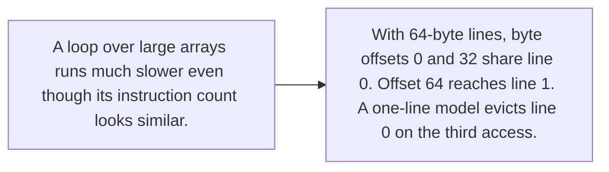

# A01.08 · RAM vs cache vs registers

[Phase index](../README.md) · [Foundation] · 25–40 minutes

Prerequisite [A01.07](A01.07.md) · Next [A01.09](A01.09.md)

## 1. The problem & why it exists

A loop over large arrays runs much slower even though its instruction count looks similar. Measure access locality before redesigning code. Small sequential reads need no custom cache strategy.

## 2. Visual mental model



```text
[01] With 64-byte lines, byte offsets 0 and 32 share line 0. Offset 64 reaches line 1. A one-line model evicts line 0 on the third access.
```

Read the trace from the first state to the last. Each box labels an observation or a model state. Timing and resource use on a specific host require separate measurements.

## 3. Step-by-step mechanism & minimal dry-run

Registers hold immediate CPU operands. Caches move data in lines near the CPU. RAM backs more data at higher latency.

**Trace.** With 64-byte lines, byte offsets 0 and 32 share line 0. Offset 64 reaches line 1. A one-line model evicts line 0 on the third access.

**Boundary case.** Scattered reads may consume a line for one field. Improve layout or process nearby elements together.

## 4. Formal rigor & quantitative math

For hit fraction h and total access latencies th and tm, mean is h·th+(1−h)·tm. At 90% hits, 4 and 80 ns give 11.6 ns.

Use the modeled numbers first, then check your prediction with the [runnable example](../examples/A01.08.py). Where the example observes the OS, compare direction and units across three repetitions and keep the raw values. Treat any modeled latency as a worked input.

Check the arithmetic with NumPy after `uv sync --locked --extra math`.

```python
import numpy as np

actual = np.dot([0.9, 0.1], [4, 80])
np.testing.assert_allclose(actual, 11.6)
print(actual)
```

## 5. Progressive design

| Approach | Latency or output | Memory | Implementation effort | Cost | Failure to watch |
| --- | --- | --- | --- | --- | --- |
| Baseline experiment | Failure control in section 6 | Bounded fixture | Change one input or policy | Local CPU time | Scattered reads may consume a line for one field |
| Corrected experiment | Normal control in section 6 | Same fixture unless documented | Make the specific boundary explicit | Local CPU time | Validate the boundary again after deployment |

Read the two code paths in the [example](../examples/A01.08.py). Identify the state that differs and compare the output. Measure access locality before redesigning code. Small sequential reads need no custom cache strategy.

## 6. Safe local lab & controlled failure injection

Predict both modes on paper, then run from the repository root.

```sh
uv run python "01-architecture-A01-to-A20/A01-computer-systems-and-os/examples/A01.08.py"
uv run python "01-architecture-A01-to-A20/A01-computer-systems-and-os/examples/A01.08.py" --break
```

**Observe.** Expect miss, hit, hit versus three misses.

**Diagnose.** Identify the first divergent state in the trace. Scattered reads may consume a line for one field. Improve layout or process nearby elements together.

**Repair.** Rerun the normal control, then change only the deciding input or branch in a scratch copy and rerun both modes.

**Extend.** Change line width to 32 B and explain the new hit count.

**Cleanup.** The example exits on its own and cleans up any temporary files or handles. Remove the scratch copy after recording evidence.

## 7. Production & multi-cloud bridge

Token or embedding processing can be limited by data access patterns even when arithmetic is cheap. Compare CPU topology and memory characteristics on EC2, Azure VMs and Compute Engine using matched workloads.

**Interview.** How do you prove cache impact?

<details>
<summary>Reveal Principal Answer & Trade-Offs</summary>

Compare identical work and control CPU placement, input size, and memory access counters.

</details>

## 8. Memory hook & mastery checkpoint

**Recall.** Registers hold immediate CPU operands. Use the boundary case in section 3 to explain where the simple explanation stops.

1. Lines for offsets 0,63,64 at 64 B?
2. Are registers ordinary RAM addresses?
3. Can sequential prefetch improve a traversal?
4. What evidence should differ between normal and failure mode?
5. What is the experiment variation, and what must be held constant?

<details>
<summary>Check answers after attempting all five</summary>

1. Two
2. No
3. Yes
4. miss, hit, hit versus three misses
5. Change line width to 32 B and explain the new hit count. Hold the runtime, input fixture and measurement method constant except for the stated change.

</details>
