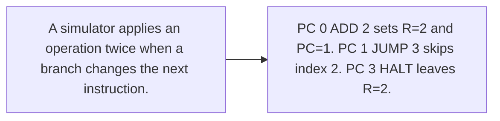

# A01.09 · fetch-decode-execute

[Phase index](../README.md) · [Foundation] · 25–40 minutes

Prerequisite [A01.08](A01.08.md) · Next [A01.10](A01.10.md)

## 1. The problem & why it exists

A simulator applies an operation twice when a branch changes the next instruction. Use an explicit transition function. A direct expression suffices when execution sequencing is irrelevant.

## 2. Visual mental model



```text
[01] PC 0 ADD 2 sets R=2 and PC=1. PC 1 JUMP 3 skips index 2. PC 3 HALT leaves R=2.
```

Read the trace from the first state to the last. Each box labels an observation or a model state. Timing and resource use on a specific host require separate measurements.

## 3. Step-by-step mechanism & minimal dry-run

Fetch reads instruction at PC. Decode interprets fields. Execute updates architectural state and selects the next PC.

**Trace.** PC 0 ADD 2 sets R=2 and PC=1. PC 1 JUMP 3 skips index 2. PC 3 HALT leaves R=2.

**Boundary case.** Incrementing PC after a taken branch lands at 4 instead of 3. Set next PC once per transition.

## 4. Formal rigor & quantitative math

For n committed steps, a sequential model takes O(n) work and O(1) mutable CPU state. At 2 GHz and one modeled cycle per step, 200 steps take 100 ns.

Use the modeled numbers first, then check your prediction with the [runnable example](../examples/A01.09.py). Where the example observes the OS, compare direction and units across three repetitions and keep the raw values. Treat any modeled latency as a worked input.

Check the arithmetic with NumPy after `uv sync --locked --extra math`.

```python
import numpy as np

actual = np.array(200) / 2
np.testing.assert_allclose(actual, 100)
print(actual)
```

## 5. Progressive design

| Approach | Latency or output | Memory | Implementation effort | Cost | Failure to watch |
| --- | --- | --- | --- | --- | --- |
| Baseline experiment | Failure control in section 6 | Bounded fixture | Change one input or policy | Local CPU time | Incrementing PC after a taken branch lands at 4 instead of 3 |
| Corrected experiment | Normal control in section 6 | Same fixture unless documented | Make the specific boundary explicit | Local CPU time | Validate the boundary again after deployment |

Read the two code paths in the [example](../examples/A01.09.py). Identify the state that differs and compare the output. Use an explicit transition function. A direct expression suffices when execution sequencing is irrelevant.

## 6. Safe local lab & controlled failure injection

Predict both modes on paper, then run from the repository root.

```sh
uv run python "01-architecture-A01-to-A20/A01-computer-systems-and-os/examples/A01.09.py"
uv run python "01-architecture-A01-to-A20/A01-computer-systems-and-os/examples/A01.09.py" --break
```

**Observe.** Expect HALT at PC 3 versus invalid PC 4.

**Diagnose.** Identify the first divergent state in the trace. Incrementing PC after a taken branch lands at 4 instead of 3. Set next PC once per transition.

**Repair.** Rerun the normal control, then change only the deciding input or branch in a scratch copy and rerun both modes.

**Extend.** Change branch target to 2 and predict the final register.

**Cleanup.** The example exits on its own and cleans up any temporary files or handles. Remove the scratch copy after recording evidence.

## 7. Production & multi-cloud bridge

A native runtime profile should tie executed instructions back to the actual build. Keep build identities with native profiles gathered on EC2, Azure VMs and Compute Engine.

**Interview.** Why does a pipeline violate simple timing without violating the model?

<details>
<summary>Reveal Principal Answer & Trade-Offs</summary>

Operations overlap, but committed architectural effects preserve ISA semantics.

</details>

## 8. Memory hook & mastery checkpoint

**Recall.** Fetch reads instruction at PC. Use the boundary case in section 3 to explain where the simple explanation stops.

1. Which stage interprets fields?
2. What decides which instruction is fetched next?
3. Can a modern CPU overlap multiple instructions?
4. What evidence should differ between normal and failure mode?
5. What is the experiment variation, and what must be held constant?

<details>
<summary>Check answers after attempting all five</summary>

1. Decode
2. The PC or a prediction thereof
3. Yes
4. HALT at PC 3 versus invalid PC 4
5. Change branch target to 2 and predict the final register. Hold the runtime, input fixture and measurement method constant except for the stated change.

</details>
