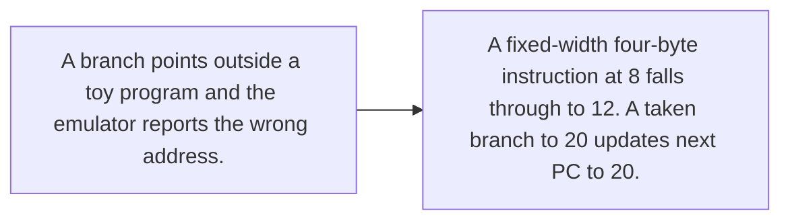

# A01.10 · CPU register and program counter

[Phase index](../README.md) · [Foundation] · 25–40 minutes

Prerequisite [A01.09](A01.09.md) · Next [A01.11](A01.11.md)

## 1. The problem & why it exists

A branch points outside a toy program and the emulator reports the wrong address. Report the current instruction address and next address separately. A language debugger is enough for ordinary stack traces.

## 2. Visual mental model



```text
[01] A fixed-width four-byte instruction at 8 falls through to 12. A taken branch to 20 updates next PC to 20.
```

Read the trace from the first state to the last. Each box labels an observation or a model state. Timing and resource use on a specific host require separate measurements.

## 3. Step-by-step mechanism & minimal dry-run

The PC identifies the instruction position in the architectural model. Registers hold values such as operands, results or saved return state.

**Trace.** A fixed-width four-byte instruction at 8 falls through to 12. A taken branch to 20 updates next PC to 20.

**Boundary case.** Applying a word index directly as a byte address can create misalignment. Validate alignment and address range for this toy ISA.

## 4. Formal rigor & quantitative math

For width w bytes and base b, aligned sequential address i is b+iw. With b=8 and w=4, i=3 lands at 20. Each advance is O(1).

Use the modeled numbers first, then check your prediction with the [runnable example](../examples/A01.10.py). Where the example observes the OS, compare direction and units across three repetitions and keep the raw values. Treat any modeled latency as a worked input.

Check the arithmetic with NumPy after `uv sync --locked --extra math`.

```python
import numpy as np

actual = 8 + 4 * np.array(3)
np.testing.assert_allclose(actual, 20)
print(actual)
```

## 5. Progressive design

| Approach | Latency or output | Memory | Implementation effort | Cost | Failure to watch |
| --- | --- | --- | --- | --- | --- |
| Baseline experiment | Failure control in section 6 | Bounded fixture | Change one input or policy | Local CPU time | Applying a word index directly as a byte address can create misalignment |
| Corrected experiment | Normal control in section 6 | Same fixture unless documented | Make the specific boundary explicit | Local CPU time | Validate the boundary again after deployment |

Read the two code paths in the [example](../examples/A01.10.py). Identify the state that differs and compare the output. Report the current instruction address and next address separately. A language debugger is enough for ordinary stack traces.

## 6. Safe local lab & controlled failure injection

Predict both modes on paper, then run from the repository root.

```sh
uv run python "01-architecture-A01-to-A20/A01-computer-systems-and-os/examples/A01.10.py"
uv run python "01-architecture-A01-to-A20/A01-computer-systems-and-os/examples/A01.10.py" --break
```

**Observe.** Expect 20 versus misalignment error.

**Diagnose.** Identify the first divergent state in the trace. Applying a word index directly as a byte address can create misalignment. Validate alignment and address range for this toy ISA.

**Repair.** Rerun the normal control, then change only the deciding input or branch in a scratch copy and rerun both modes.

**Extend.** Pass None for the target and check the fall-through.

**Cleanup.** The example exits on its own and cleans up any temporary files or handles. Remove the scratch copy after recording evidence.

## 7. Production & multi-cloud bridge

For native crashes in Python extensions, match symbols and relocated address ranges to the deployed build. Store symbols paired with the exact image across ECR, ACR and Artifact Registry.

**Interview.** Why do crash symbolizers need mapping bases?

<details>
<summary>Reveal Principal Answer & Trade-Offs</summary>

Code is relocated and the build ID ties addresses to the correct binary.

</details>

## 8. Memory hook & mastery checkpoint

**Recall.** The PC identifies the instruction position in the architectural model. Use the boundary case in section 3 to explain where the simple explanation stops.

1. Where is the next address after 20 at width 4?
2. Is instruction length always fixed across ISAs?
3. Why keep the current PC on an error?
4. What evidence should differ between normal and failure mode?
5. What is the experiment variation, and what must be held constant?

<details>
<summary>Check answers after attempting all five</summary>

1. 24
2. No
3. To identify the failing instruction
4. 20 versus misalignment error
5. Pass None for the target and check the fall-through. Hold the runtime, input fixture and measurement method constant except for the stated change.

</details>
