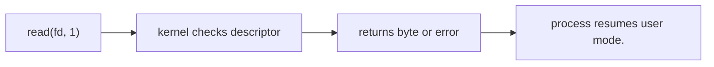

# A01.11 · kernel vs user mode

[Phase index](../README.md) · [Core] · 25–40 minutes

Prerequisite [A01.10](A01.10.md) · Next [A01.12](A01.12.md)

## 1. The problem & why it exists

A user process needs to read a file without controlling the storage device directly. Use the standard OS interface. An in-memory operation already permitted in user mode needs no syscall.

## 2. Visual mental model



```text
[01] read(fd, 1)
[02] kernel checks descriptor
[03] returns byte or error
[04] process resumes user mode.
```

Read the trace from the first state to the last. Each box labels an observation or a model state. Timing and resource use on a specific host require separate measurements.

## 3. Step-by-step mechanism & minimal dry-run

A syscall switches into a defined kernel entry point. The kernel checks the process's descriptor and permissions before accessing protected state.

**Trace.** read(fd, 1) -> kernel checks descriptor -> returns byte or error -> process resumes user mode.

**Boundary case.** Using a closed descriptor fails predictably. Validate resource ownership and keep the read within the lifetime of its handle.

## 4. Formal rigor & quantitative math

For n calls with fixed transition cost c and total data cost d, time is nc+d. At c=0.3 µs, 1000 calls add 300 µs. Batching reduces call count.

Use the modeled numbers first, then check your prediction with the [runnable example](../examples/A01.11.py). Where the example observes the OS, compare direction and units across three repetitions and keep the raw values. Treat any modeled latency as a worked input.

Check the arithmetic with NumPy after `uv sync --locked --extra math`.

```python
import numpy as np

actual = np.array(1000) * 0.3
np.testing.assert_allclose(actual, 300)
print(actual)
```

## 5. Progressive design

| Approach | Latency or output | Memory | Implementation effort | Cost | Failure to watch |
| --- | --- | --- | --- | --- | --- |
| Baseline experiment | Failure control in section 6 | Bounded fixture | Change one input or policy | Local CPU time | Using a closed descriptor fails predictably |
| Corrected experiment | Normal control in section 6 | Same fixture unless documented | Make the specific boundary explicit | Local CPU time | Validate the boundary again after deployment |

Read the two code paths in the [example](../examples/A01.11.py). Identify the state that differs and compare the output. Use the standard OS interface. An in-memory operation already permitted in user mode needs no syscall.

## 6. Safe local lab & controlled failure injection

Predict both modes on paper, then run from the repository root.

```sh
uv run python "01-architecture-A01-to-A20/A01-computer-systems-and-os/examples/A01.11.py"
uv run python "01-architecture-A01-to-A20/A01-computer-systems-and-os/examples/A01.11.py" --break
```

**Observe.** Expect b'K' versus EBADF (typically 9).

**Diagnose.** Identify the first divergent state in the trace. Using a closed descriptor fails predictably. Validate resource ownership and keep the read within the lifetime of its handle.

**Repair.** Rerun the normal control, then change only the deciding input or branch in a scratch copy and rerun both modes.

**Extend.** Write two bytes and compare two reads with one batched read.

**Cleanup.** The example exits on its own and cleans up any temporary files or handles. Remove the scratch copy after recording evidence.

## 7. Production & multi-cloud bridge

Collect filesystem errors at the API boundary and preserve errno in internal logs. Compare security and syscall restrictions under EKS, AKS and GKE workload profiles.

**Interview.** Why can a read call be slow even with a cheap mode switch?

<details>
<summary>Reveal Principal Answer & Trade-Offs</summary>

The kernel may wait for storage, network, or another resource.

</details>

## 8. Memory hook & mastery checkpoint

**Recall.** A syscall switches into a defined kernel entry point. Use the boundary case in section 3 to explain where the simple explanation stops.

1. Does a syscall grant arbitrary privilege?
2. Who validates the descriptor?
3. Can safe arithmetic run without a syscall?
4. What evidence should differ between normal and failure mode?
5. What is the experiment variation, and what must be held constant?

<details>
<summary>Check answers after attempting all five</summary>

1. No
2. The kernel
3. Yes
4. b'K' versus EBADF (typically 9)
5. Write two bytes and compare two reads with one batched read. Hold the runtime, input fixture and measurement method constant except for the stated change.

</details>
