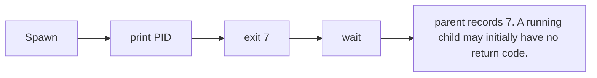

# A01.13 · process creation and lifetime

[Phase index](../README.md) · [Core] · 25–40 minutes

Prerequisite [A01.12](A01.12.md) · Next [A01.14](A01.14.md)

## 1. The problem & why it exists

A parent starts workers and leaves completed entries behind. Use subprocess.run for a synchronous job and a managed Popen when concurrent observation is needed.

## 2. Visual mental model



```text
[01] Spawn
[02] print PID
[03] exit 7
[04] wait
[05] parent records 7. A running child may initially have no return code.
```

Read the trace from the first state to the last. Each box labels an observation or a model state. Timing and resource use on a specific host require separate measurements.

## 3. Step-by-step mechanism & minimal dry-run

Creation establishes identity and resources. Execution runs until exit or signal. Waiting collects terminal status and reaps the child on POSIX.

**Trace.** Spawn -> print PID -> exit 7 -> wait -> parent records 7. A running child may initially have no return code.

**Boundary case.** Failing to wait can leave zombies until reaped. Use a timeout and ensure waiting also occurs after termination.

## 4. Formal rigor & quantitative math

For p workers each serving one job of duration t, ideal capacity is p/t jobs/s. Four at two seconds give two jobs/s. Retained child handles cost O(p) space.

Use the modeled numbers first, then check your prediction with the [runnable example](../examples/A01.13.py). Where the example observes the OS, compare direction and units across three repetitions and keep the raw values. Treat any modeled latency as a worked input.

Check the arithmetic with NumPy after `uv sync --locked --extra math`.

```python
import numpy as np

actual = np.array(4) / 2
np.testing.assert_allclose(actual, 2)
print(actual)
```

## 5. Progressive design

| Approach | Latency or output | Memory | Implementation effort | Cost | Failure to watch |
| --- | --- | --- | --- | --- | --- |
| Baseline experiment | Failure control in section 6 | Bounded fixture | Change one input or policy | Local CPU time | Failing to wait can leave zombies until reaped |
| Corrected experiment | Normal control in section 6 | Same fixture unless documented | Make the specific boundary explicit | Local CPU time | Validate the boundary again after deployment |

Read the two code paths in the [example](../examples/A01.13.py). Identify the state that differs and compare the output. Use subprocess.run for a synchronous job and a managed Popen when concurrent observation is needed.

## 6. Safe local lab & controlled failure injection

Predict both modes on paper, then run from the repository root.

```sh
uv run python "01-architecture-A01-to-A20/A01-computer-systems-and-os/examples/A01.13.py"
uv run python "01-architecture-A01-to-A20/A01-computer-systems-and-os/examples/A01.13.py" --break
```

**Observe.** Expect reaped 7 in both modes, an extra None before wait.

**Diagnose.** Identify the first divergent state in the trace. Failing to wait can leave zombies until reaped. Use a timeout and ensure waiting also occurs after termination.

**Repair.** Rerun the normal control, then change only the deciding input or branch in a scratch copy and rerun both modes.

**Extend.** Exit 0 and compare normal success with exit 7.

**Cleanup.** The example exits on its own and cleans up any temporary files or handles. Remove the scratch copy after recording evidence.

## 7. Production & multi-cloud bridge

A FastAPI worker supervisor should handle exit and reaping under shutdown. Test process lifetime under termination in EKS, AKS and GKE.

**Interview.** What does subprocess timeout actually govern?

<details>
<summary>Reveal Principal Answer & Trade-Offs</summary>

The wait or communication interval under the API, with explicit cleanup and descendant policy needed.

</details>

## 8. Memory hook & mastery checkpoint

**Recall.** Creation establishes identity and resources. Use the boundary case in section 3 to explain where the simple explanation stops.

1. Can an exited child need reaping?
2. What status does a normal exit 7 report?
3. Does PID alone identify an execution across time?
4. What evidence should differ between normal and failure mode?
5. What is the experiment variation, and what must be held constant?

<details>
<summary>Check answers after attempting all five</summary>

1. Yes
2. 7
3. No
4. reaped 7 in both modes, an extra None before wait
5. Exit 0 and compare normal success with exit 7. Hold the runtime, input fixture and measurement method constant except for the stated change.

</details>
