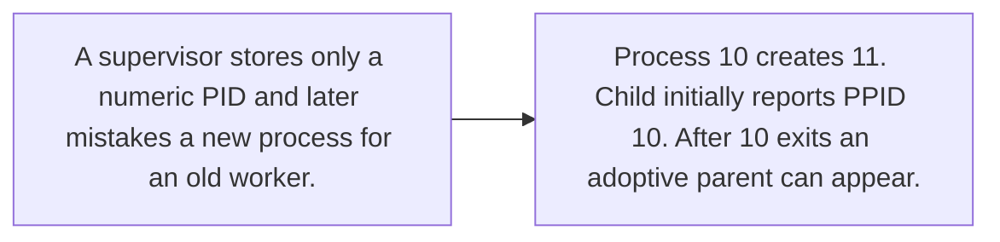

# A01.14 · PID/PPID and parent-child tree

[Phase index](../README.md) · [Core] · 25–40 minutes

Prerequisite [A01.13](A01.13.md) · Next [A01.15](A01.15.md)

## 1. The problem & why it exists

A supervisor stores only a numeric PID and later mistakes a new process for an old worker. Retain process handles where possible. Record start time and namespace with PID for observation.

## 2. Visual mental model



```text
[01] Process 10 creates 11. Child initially reports PPID 10. After 10 exits an adoptive parent can appear.
```

Read the trace from the first state to the last. Each box labels an observation or a model state. Timing and resource use on a specific host require separate measurements.

## 3. Step-by-step mechanism & minimal dry-run

A process has a PID and current parent PID as seen in a PID namespace. Reparenting can follow parent exit.

**Trace.** Process 10 creates 11. Child initially reports PPID 10. After 10 exits an adoptive parent can appear.

**Boundary case.** Assuming parent links are immutable produces stale trees. Snapshot timestamps and tolerate missing processes.

## 4. Formal rigor & quantitative math

For n processes, a parent map can be built with O(n) time and space. A tree with n nodes and r roots has n−r edges. At 12 and 2, there are 10.

Use the modeled numbers first, then check your prediction with the [runnable example](../examples/A01.14.py). Where the example observes the OS, compare direction and units across three repetitions and keep the raw values. Treat any modeled latency as a worked input.

Check the arithmetic with NumPy after `uv sync --locked --extra math`.

```python
import numpy as np

actual = np.subtract(12, 2)
np.testing.assert_allclose(actual, 10)
print(actual)
```

## 5. Progressive design

| Approach | Latency or output | Memory | Implementation effort | Cost | Failure to watch |
| --- | --- | --- | --- | --- | --- |
| Baseline experiment | Failure control in section 6 | Bounded fixture | Change one input or policy | Local CPU time | Assuming parent links are immutable produces stale trees |
| Corrected experiment | Normal control in section 6 | Same fixture unless documented | Make the specific boundary explicit | Local CPU time | Validate the boundary again after deployment |

Read the two code paths in the [example](../examples/A01.14.py). Identify the state that differs and compare the output. Retain process handles where possible. Record start time and namespace with PID for observation.

## 6. Safe local lab & controlled failure injection

Predict both modes on paper, then run from the repository root.

```sh
uv run python "01-architecture-A01-to-A20/A01-computer-systems-and-os/examples/A01.14.py"
uv run python "01-architecture-A01-to-A20/A01-computer-systems-and-os/examples/A01.14.py" --break
```

**Observe.** Expect correct parent True versus False.

**Diagnose.** Identify the first divergent state in the trace. Assuming parent links are immutable produces stale trees. Snapshot timestamps and tolerate missing processes.

**Repair.** Rerun the normal control, then change only the deciding input or branch in a scratch copy and rerun both modes.

**Extend.** Insert a grandchild and compare the two observed parent-child edges.

**Cleanup.** The example exits on its own and cleans up any temporary files or handles. Remove the scratch copy after recording evidence.

## 7. Production & multi-cloud bridge

Process identity recorded in container logs can differ from a host observer's PID. Record observer scope before comparing process telemetry on EKS, AKS and GKE.

**Interview.** When can two tools show different PIDs for the same task?

<details>
<summary>Reveal Principal Answer & Trade-Offs</summary>

When observing from different PID namespaces.

</details>

## 8. Memory hook & mastery checkpoint

**Recall.** A process has a PID and current parent PID as seen in a PID namespace. Use the boundary case in section 3 to explain where the simple explanation stops.

1. Does every process have visible parent metadata in a snapshot?
2. Can two running tasks have the same PID in different namespaces?
3. Why record start time?
4. What evidence should differ between normal and failure mode?
5. What is the experiment variation, and what must be held constant?

<details>
<summary>Check answers after attempting all five</summary>

1. No
2. Yes
3. To distinguish PID reuse
4. correct parent True versus False
5. Insert a grandchild and compare the two observed parent-child edges. Hold the runtime, input fixture and measurement method constant except for the stated change.

</details>

## Standards and implementation notes

The observer's PID namespace matters. A snapshot can omit a parent, and two observations with the same PID can refer to different lifetimes.

- [Linux proc_pid_status(5)](https://man7.org/linux/man-pages/man5/proc_pid_status.5.html)
- [Linux namespaces(7)](https://man7.org/linux/man-pages/man7/namespaces.7.html)
