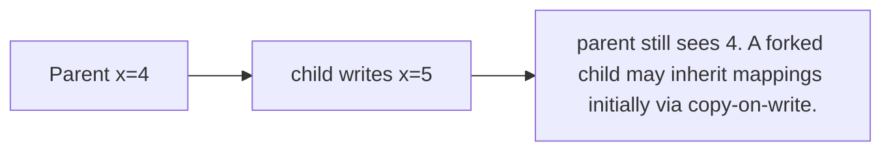

# A01.15 · process address space

[Phase index](../README.md) · [Core] · 25–40 minutes

Prerequisite [A01.14](A01.14.md) · Next [A01.16](A01.16.md)

## 1. The problem & why it exists

A worker writes a global variable and expects another process to see the assignment. Use a message or explicit shared mapping. Threads may be simpler when shared state is intentional.

## 2. Visual mental model



```text
[01] Parent x=4
[02] child writes x=5
[03] parent still sees 4. A forked child may inherit mappings initially via copy-on-write.
```

Read the trace from the first state to the last. Each box labels an observation or a model state. Timing and resource use on a specific host require separate measurements.

## 3. Step-by-step mechanism & minimal dry-run

Each process sees virtual mappings for code, data, heap, stacks and mapped regions. Equal virtual addresses may resolve to distinct backing pages.

**Trace.** Parent x=4 -> child writes x=5 -> parent still sees 4. A forked child may inherit mappings initially via copy-on-write.

**Boundary case.** Passing a process-local address over IPC cannot transfer object ownership. Send value data or offsets relative to an agreed mapping.

## 4. Formal rigor & quantitative math

For an address width v, the theoretical space is 2^v bytes. At 32 bits it is 4 GiB before reserved regions. Virtual size and resident bytes are distinct.

Use the modeled numbers first, then check your prediction with the [runnable example](../examples/A01.15.py). Where the example observes the OS, compare direction and units across three repetitions and keep the raw values. Treat any modeled latency as a worked input.

Check the arithmetic with NumPy after `uv sync --locked --extra math`.

```python
import numpy as np

actual = np.exp2(32) / 2**30
np.testing.assert_allclose(actual, 4)
print(actual)
```

## 5. Progressive design

| Approach | Latency or output | Memory | Implementation effort | Cost | Failure to watch |
| --- | --- | --- | --- | --- | --- |
| Baseline experiment | Failure control in section 6 | Bounded fixture | Change one input or policy | Local CPU time | Passing a process-local address over IPC cannot transfer object ownership |
| Corrected experiment | Normal control in section 6 | Same fixture unless documented | Make the specific boundary explicit | Local CPU time | Validate the boundary again after deployment |

Read the two code paths in the [example](../examples/A01.15.py). Identify the state that differs and compare the output. Use a message or explicit shared mapping. Threads may be simpler when shared state is intentional.

## 6. Safe local lab & controlled failure injection

Predict both modes on paper, then run from the repository root.

```sh
uv run python "01-architecture-A01-to-A20/A01-computer-systems-and-os/examples/A01.15.py"
uv run python "01-architecture-A01-to-A20/A01-computer-systems-and-os/examples/A01.15.py" --break
```

**Observe.** Expect parent value 4 in both cases, expectation changes.

**Diagnose.** Identify the first divergent state in the trace. Passing a process-local address over IPC cannot transfer object ownership. Send value data or offsets relative to an agreed mapping.

**Repair.** Rerun the normal control, then change only the deciding input or branch in a scratch copy and rerun both modes.

**Extend.** Return the child's value via stdout and compare it with the parent's binding.

**Cleanup.** The example exits on its own and cleans up any temporary files or handles. Remove the scratch copy after recording evidence.

## 7. Production & multi-cloud bridge

FastAPI workers need IPC or external state for shared application data. Worker multiplicity changes private memory on EKS, AKS and GKE.

**Interview.** Why can VIRT grow without RSS growth?

<details>
<summary>Reveal Principal Answer & Trade-Offs</summary>

Reserving address ranges need not populate resident frames.

</details>

## 8. Memory hook & mastery checkpoint

**Recall.** Each process sees virtual mappings for code, data, heap, stacks and mapped regions. Use the boundary case in section 3 to explain where the simple explanation stops.

1. Does equal virtual address imply shared physical memory?
2. Where do anonymous allocations appear?
3. Can IPC pass values between address spaces?
4. What evidence should differ between normal and failure mode?
5. What is the experiment variation, and what must be held constant?

<details>
<summary>Check answers after attempting all five</summary>

1. No
2. In a process mapping
3. Yes
4. parent value 4 in both cases, expectation changes
5. Return the child's value via stdout and compare it with the parent's binding. Hold the runtime, input fixture and measurement method constant except for the stated change.

</details>

## Standards and implementation notes

File mappings, private anonymous regions and shared regions can coexist in a process. A virtual address is meaningful in the context of that address space.

- [Linux page tables](https://docs.kernel.org/mm/page_tables.html)
- [Linux mmap(2)](https://man7.org/linux/man-pages/man2/mmap.2.html)
