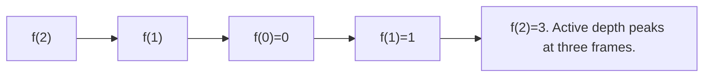

# A01.16 · stack frames and call stacks

[Phase index](../README.md) · [Core] · 25–40 minutes

Prerequisite [A01.15](A01.15.md) · Next [A01.17](A01.17.md)

## 1. The problem & why it exists

Recursive traversal crashes on a deeply nested input. Use a loop or an explicit stack for unbounded input. Recursion can suit bounded tree depth.

## 2. Visual mental model



```text
[01] f(2)
[02] f(1)
[03] f(0)=0
[04] f(1)=1
[05] f(2)=3. Active depth peaks at three frames.
```

Read the trace from the first state to the last. Each box labels an observation or a model state. Timing and resource use on a specific host require separate measurements.

## 3. Step-by-step mechanism & minimal dry-run

A call frame records execution state including locals and result continuation. Returning removes the active frame from the logical call stack.

**Trace.** f(2) -> f(1) -> f(0)=0 -> f(1)=1 -> f(2)=3. Active depth peaks at three frames.

**Boundary case.** A deep linear recursion hits Python's recursion limit. Rewrite as iteration or cap depth at the data boundary.

## 4. Formal rigor & quantitative math

For depth d and modeled f bytes/frame, live frame memory is df. At 400 and 128 B it is 50 KiB. A sum loop uses O(1) auxiliary variables.

Use the modeled numbers first, then check your prediction with the [runnable example](../examples/A01.16.py). Where the example observes the OS, compare direction and units across three repetitions and keep the raw values. Treat any modeled latency as a worked input.

Check the arithmetic with NumPy after `uv sync --locked --extra math`.

```python
import numpy as np

actual = np.array(400) * 128 / 1024
np.testing.assert_allclose(actual, 50)
print(actual)
```

## 5. Progressive design

| Approach | Latency or output | Memory | Implementation effort | Cost | Failure to watch |
| --- | --- | --- | --- | --- | --- |
| Baseline experiment | Failure control in section 6 | Bounded fixture | Change one input or policy | Local CPU time | A deep linear recursion hits Python's recursion limit |
| Corrected experiment | Normal control in section 6 | Same fixture unless documented | Make the specific boundary explicit | Local CPU time | Validate the boundary again after deployment |

Read the two code paths in the [example](../examples/A01.16.py). Identify the state that differs and compare the output. Use a loop or an explicit stack for unbounded input. Recursion can suit bounded tree depth.

## 6. Safe local lab & controlled failure injection

Predict both modes on paper, then run from the repository root.

```sh
uv run python "01-architecture-A01-to-A20/A01-computer-systems-and-os/examples/A01.16.py"
uv run python "01-architecture-A01-to-A20/A01-computer-systems-and-os/examples/A01.16.py" --break
```

**Observe.** Expect 3 versus recursion recovery at 50,005,000.

**Diagnose.** Identify the first divergent state in the trace. A deep linear recursion hits Python's recursion limit. Rewrite as iteration or cap depth at the data boundary.

**Repair.** Rerun the normal control, then change only the deciding input or branch in a scratch copy and rerun both modes.

**Extend.** Try bases n=0 and n=1, then use a bounded deep input.

**Cleanup.** The example exits on its own and cleans up any temporary files or handles. Remove the scratch copy after recording evidence.

## 7. Production & multi-cloud bridge

Bound recursive traversal of user input in API or retrieval pipelines. Use the same depth limits in Lambda, Azure Functions and Cloud Run requests.

**Interview.** When is an explicit stack still necessary?

<details>
<summary>Reveal Principal Answer & Trade-Offs</summary>

Branching traversal must retain pending work even when it avoids recursive frames.

</details>

## 8. Memory hook & mastery checkpoint

**Recall.** A call frame records execution state including locals and result continuation. Use the boundary case in section 3 to explain where the simple explanation stops.

1. How many calls for f(3) with base zero?
2. Is recursion limit a portable byte budget?
3. What resumes the caller?
4. What evidence should differ between normal and failure mode?
5. What is the experiment variation, and what must be held constant?

<details>
<summary>Check answers after attempting all five</summary>

1. Four
2. No
3. Its saved continuation
4. 3 versus recursion recovery at 50,005,000
5. Try bases n=0 and n=1, then use a bounded deep input. Hold the runtime, input fixture and measurement method constant except for the stated change.

</details>

## Standards and implementation notes

The Python frame is a language/runtime object. Its implementation, native stack use and byte cost vary. The 128-byte figure in the exercise is a model input.

- [Python data model](https://docs.python.org/3/reference/datamodel.html)
