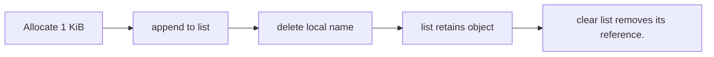

# A01.17 · heap allocation

[Phase index](../README.md) · [Core] · 25–40 minutes

Prerequisite [A01.16](A01.16.md) · Next [A01.18](A01.18.md)

## 1. The problem & why it exists

A service retains request buffers in a global list and memory keeps growing. Scope buffers to the request or bound the cache. Let the runtime manage ordinary allocation.

## 2. Visual mental model



```text
[01] Allocate 1 KiB
[02] append to list
[03] delete local name
[04] list retains object
[05] clear list removes its reference.
```

Read the trace from the first state to the last. Each box labels an observation or a model state. Timing and resource use on a specific host require separate measurements.

## 3. Step-by-step mechanism & minimal dry-run

Object allocation reserves storage and references determine reachability. An allocator may reuse freed arenas internally after objects are gone.

**Trace.** Allocate 1 KiB -> append to list -> delete local name -> list retains object -> clear list removes its reference.

**Boundary case.** Measuring RSS alone may confuse allocator retention with live object growth. Compare tracemalloc snapshots and a resident metric.

## 4. Formal rigor & quantitative math

For n retained buffers of payload b, payload is nb. 128×4 KiB is 512 KiB plus allocator overhead. Retaining them costs O(n) entries.

Use the modeled numbers first, then check your prediction with the [runnable example](../examples/A01.17.py). Where the example observes the OS, compare direction and units across three repetitions and keep the raw values. Treat any modeled latency as a worked input.

Check the arithmetic with NumPy after `uv sync --locked --extra math`.

```python
import numpy as np

actual = np.array(128) * 4096 / 1024
np.testing.assert_allclose(actual, 512)
print(actual)
```

## 5. Progressive design

| Approach | Latency or output | Memory | Implementation effort | Cost | Failure to watch |
| --- | --- | --- | --- | --- | --- |
| Baseline experiment | Failure control in section 6 | Bounded fixture | Change one input or policy | Local CPU time | Measuring RSS alone may confuse allocator retention with live object growth |
| Corrected experiment | Normal control in section 6 | Same fixture unless documented | Make the specific boundary explicit | Local CPU time | Validate the boundary again after deployment |

Read the two code paths in the [example](../examples/A01.17.py). Identify the state that differs and compare the output. Scope buffers to the request or bound the cache. Let the runtime manage ordinary allocation.

## 6. Safe local lab & controlled failure injection

Predict both modes on paper, then run from the repository root.

```sh
uv run python "01-architecture-A01-to-A20/A01-computer-systems-and-os/examples/A01.17.py"
uv run python "01-architecture-A01-to-A20/A01-computer-systems-and-os/examples/A01.17.py" --break
```

**Observe.** Expect traced bytes drop versus remaining approximately stable.

**Diagnose.** Identify the first divergent state in the trace. Measuring RSS alone may confuse allocator retention with live object growth. Compare tracemalloc snapshots and a resident metric.

**Repair.** Rerun the normal control, then change only the deciding input or branch in a scratch copy and rerun both modes.

**Extend.** Keep one alias to a cleared buffer and compare traced allocations.

**Cleanup.** The example exits on its own and cleans up any temporary files or handles. Remove the scratch copy after recording evidence.

## 7. Production & multi-cloud bridge

Bound in-process embedding caches and distinguish allocator retention from live entries. Compare traced allocations with container memory metrics in CloudWatch, Azure Monitor and Cloud Monitoring.

**Interview.** How do you distinguish a leak from a cache?

<details>
<summary>Reveal Principal Answer & Trade-Offs</summary>

Observe whether retained live objects plateau at a specified bound under repeated load.

</details>

## 8. Memory hook & mastery checkpoint

**Recall.** Object allocation reserves storage and references determine reachability. Use the boundary case in section 3 to explain where the simple explanation stops.

1. Does del on one name release an aliased object?
2. Does releasing an object guarantee RSS drops?
3. Which metric can isolate traced Python allocations?
4. What evidence should differ between normal and failure mode?
5. What is the experiment variation, and what must be held constant?

<details>
<summary>Check answers after attempting all five</summary>

1. No
2. No
3. tracemalloc
4. traced bytes drop versus remaining approximately stable
5. Keep one alias to a cleared buffer and compare traced allocations. Hold the runtime, input fixture and measurement method constant except for the stated change.

</details>
