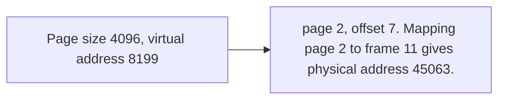

# A01.18 · virtual memory and page tables

[Phase index](../README.md) · [Core] · 25–40 minutes

Prerequisite [A01.17](A01.17.md) · Next [A01.19](A01.19.md)

## 1. The problem & why it exists

Scattered accesses to virtual addresses must resolve to physical frames before fetching data. Use OS-managed mappings. A small table suffices to model address translation.

## 2. Visual mental model



```text
[01] Page size 4096, virtual address 8199
[02] page 2, offset 7. Mapping page 2 to frame 11 gives physical address 45063.
```

Read the trace from the first state to the last. Each box labels an observation or a model state. Timing and resource use on a specific host require separate measurements.

## 3. Step-by-step mechanism & minimal dry-run

The address splits into a virtual page number and offset. A page table maps the page to a frame and carries flags such as permissions.

**Trace.** Page size 4096, virtual address 8199 -> page 2, offset 7. Mapping page 2 to frame 11 gives physical address 45063.

**Boundary case.** Treating absent entries as frame zero hides faults. Report missing pages distinctly from permission failures.

## 4. Formal rigor & quantitative math

For page size S and address a, page=floor(a/S) and offset=a mod S. A fixed-level walk costs O(levels). A dense table with n entries of e bytes costs ne bytes.

Use the modeled numbers first, then check your prediction with the [runnable example](../examples/A01.18.py). Where the example observes the OS, compare direction and units across three repetitions and keep the raw values. Treat any modeled latency as a worked input.

Check the arithmetic with NumPy after `uv sync --locked --extra math`.

```python
import numpy as np

actual = 11 * 4096 + np.remainder(8199, 4096)
np.testing.assert_allclose(actual, 45063)
print(actual)
```

## 5. Progressive design

| Approach | Latency or output | Memory | Implementation effort | Cost | Failure to watch |
| --- | --- | --- | --- | --- | --- |
| Baseline experiment | Failure control in section 6 | Bounded fixture | Change one input or policy | Local CPU time | Treating absent entries as frame zero hides faults |
| Corrected experiment | Normal control in section 6 | Same fixture unless documented | Make the specific boundary explicit | Local CPU time | Validate the boundary again after deployment |

Read the two code paths in the [example](../examples/A01.18.py). Identify the state that differs and compare the output. Use OS-managed mappings. A small table suffices to model address translation.

## 6. Safe local lab & controlled failure injection

Predict both modes on paper, then run from the repository root.

```sh
uv run python "01-architecture-A01-to-A20/A01-computer-systems-and-os/examples/A01.18.py"
uv run python "01-architecture-A01-to-A20/A01-computer-systems-and-os/examples/A01.18.py" --break
```

**Observe.** Expect 45063 versus unmapped page 2.

**Diagnose.** Identify the first divergent state in the trace. Treating absent entries as frame zero hides faults. Report missing pages distinctly from permission failures.

**Repair.** Rerun the normal control, then change only the deciding input or branch in a scratch copy and rerun both modes.

**Extend.** Map page 2 to frame 0 and verify the resulting address.

**Cleanup.** The example exits on its own and cleans up any temporary files or handles. Remove the scratch copy after recording evidence.

## 7. Production & multi-cloud bridge

A PostgreSQL mapping can reserve virtual ranges far beyond its currently resident bytes. Keep VIRT separate from resident metrics on EC2, Azure VMs and Compute Engine.

**Interview.** Why use multi-level tables?

<details>
<summary>Reveal Principal Answer & Trade-Offs</summary>

Sparse address spaces can omit entire unused ranges of lower-level tables.

</details>

## 8. Memory hook & mastery checkpoint

**Recall.** The address splits into a virtual page number and offset. Use the boundary case in section 3 to explain where the simple explanation stops.

1. What is the offset of 4097 at 4 KiB?
2. Does changing frame number alter offset?
3. Who resolves many TLB misses without a syscall?
4. What evidence should differ between normal and failure mode?
5. What is the experiment variation, and what must be held constant?

<details>
<summary>Check answers after attempting all five</summary>

1. 1
2. No
3. Hardware page-walk logic on many CPUs
4. 45063 versus unmapped page 2
5. Map page 2 to frame 0 and verify the resulting address. Hold the runtime, input fixture and measurement method constant except for the stated change.

</details>
