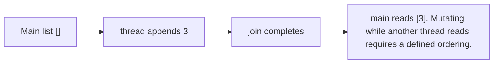

# A01.20 · threads and shared address space

[Phase index](../README.md) · [Core] · 25–40 minutes

Prerequisite [A01.19](A01.19.md) · Next [A01.21](A01.21.md)

## 1. The problem & why it exists

Two worker threads see changes to the same object, including unexpected partial state. Use a single owner and a queue if sharing is unnecessary. Protect compound shared invariants.

## 2. Visual mental model



```text
[01] Main list []
[02] thread appends 3
[03] join completes
[04] main reads [3]. Mutating while another thread reads requires a defined ordering.
```

Read the trace from the first state to the last. Each box labels an observation or a model state. Timing and resource use on a specific host require separate measurements.

## 3. Step-by-step mechanism & minimal dry-run

Threads share process mappings and descriptors. Each has its own call stack and scheduling state.

**Trace.** Main list [] -> thread appends 3 -> join completes -> main reads [3]. Mutating while another thread reads requires a defined ordering.

**Boundary case.** Reading before join can see the old state. Use a queue, event or join to establish ordering rather than sleeping a guessed interval.

## 4. Formal rigor & quantitative math

For T threads with reserved stack S bytes, reservation is approximately TS. Eight at 2 MiB reserve 16 MiB, with resident usage dependent on touches.

Use the modeled numbers first, then check your prediction with the [runnable example](../examples/A01.20.py). Where the example observes the OS, compare direction and units across three repetitions and keep the raw values. Treat any modeled latency as a worked input.

Check the arithmetic with NumPy after `uv sync --locked --extra math`.

```python
import numpy as np

actual = 8 * np.array(2)
np.testing.assert_allclose(actual, 16)
print(actual)
```

## 5. Progressive design

| Approach | Latency or output | Memory | Implementation effort | Cost | Failure to watch |
| --- | --- | --- | --- | --- | --- |
| Baseline experiment | Failure control in section 6 | Bounded fixture | Change one input or policy | Local CPU time | Reading before join can see the old state |
| Corrected experiment | Normal control in section 6 | Same fixture unless documented | Make the specific boundary explicit | Local CPU time | Validate the boundary again after deployment |

Read the two code paths in the [example](../examples/A01.20.py). Identify the state that differs and compare the output. Use a single owner and a queue if sharing is unnecessary. Protect compound shared invariants.

## 6. Safe local lab & controlled failure injection

Predict both modes on paper, then run from the repository root.

```sh
uv run python "01-architecture-A01-to-A20/A01-computer-systems-and-os/examples/A01.20.py"
uv run python "01-architecture-A01-to-A20/A01-computer-systems-and-os/examples/A01.20.py" --break
```

**Observe.** Expect [3] after join, earlier [] with break.

**Diagnose.** Identify the first divergent state in the trace. Reading before join can see the old state. Use a queue, event or join to establish ordering rather than sleeping a guessed interval.

**Repair.** Rerun the normal control, then change only the deciding input or branch in a scratch copy and rerun both modes.

**Extend.** Replace the shared list with a queue and compare when results become observable.

**Cleanup.** The example exits on its own and cleans up any temporary files or handles. Remove the scratch copy after recording evidence.

## 7. Production & multi-cloud bridge

Thread pools in a FastAPI service share globals and can race on compound state. Bound pools per replica on EKS, AKS and GKE.

**Interview.** Does CPython make all operations safe because of the GIL?

<details>
<summary>Reveal Principal Answer & Trade-Offs</summary>

Compound invariants need synchronization and free-threaded builds differ.

</details>

## 8. Memory hook & mastery checkpoint

**Recall.** Threads share process mappings and descriptors. Use the boundary case in section 3 to explain where the simple explanation stops.

1. Which is shared, heap or stack?
2. Does join create a second address space?
3. Can threads help overlapping I/O?
4. What evidence should differ between normal and failure mode?
5. What is the experiment variation, and what must be held constant?

<details>
<summary>Check answers after attempting all five</summary>

1. Heap mappings are shared, while each thread has its own stack
2. No
3. Yes
4. [3] after join, earlier [] with break
5. Replace the shared list with a queue and compare when results become observable. Hold the runtime, input fixture and measurement method constant except for the stated change.

</details>
