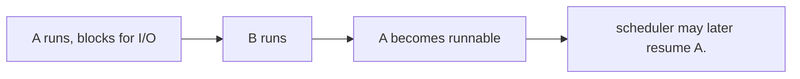

# A01.21 · context switching

[Phase index](../README.md) · [Core] · 25–40 minutes

Prerequisite [A01.20](A01.20.md) · Next [A01.22](A01.22.md)

## 1. The problem & why it exists

Adding workers increases runtime without adding throughput. Use bounded concurrency and measure wait and CPU time separately.

## 2. Visual mental model



```text
[01] A runs, blocks for I/O
[02] B runs
[03] A becomes runnable
[04] scheduler may later resume A.
```

Read the trace from the first state to the last. Each box labels an observation or a model state. Timing and resource use on a specific host require separate measurements.

## 3. Step-by-step mechanism & minimal dry-run

A context switch saves one task's execution state and restores another's. It can change address-space context and disrupt caches.

**Trace.** A runs, blocks for I/O -> B runs -> A becomes runnable -> scheduler may later resume A.

**Boundary case.** Treating all scheduler delay as CPU work hides contention. Compare process CPU time with elapsed time and switch counters.

## 4. Formal rigor & quantitative math

For n switches of mean c µs, direct cost is nc µs. 10000 at 2 µs cost 20 ms ignoring indirect effects.

Use the modeled numbers first, then check your prediction with the [runnable example](../examples/A01.21.py). Where the example observes the OS, compare direction and units across three repetitions and keep the raw values. Treat any modeled latency as a worked input.

Check the arithmetic with NumPy after `uv sync --locked --extra math`.

```python
import numpy as np

actual = np.array(10_000) * 2 / 1000
np.testing.assert_allclose(actual, 20)
print(actual)
```

## 5. Progressive design

| Approach | Latency or output | Memory | Implementation effort | Cost | Failure to watch |
| --- | --- | --- | --- | --- | --- |
| Baseline experiment | Failure control in section 6 | Bounded fixture | Change one input or policy | Local CPU time | Treating all scheduler delay as CPU work hides contention |
| Corrected experiment | Normal control in section 6 | Same fixture unless documented | Make the specific boundary explicit | Local CPU time | Validate the boundary again after deployment |

Read the two code paths in the [example](../examples/A01.21.py). Identify the state that differs and compare the output. Use bounded concurrency and measure wait and CPU time separately.

## 6. Safe local lab & controlled failure injection

Predict both modes on paper, then run from the repository root.

```sh
uv run python "01-architecture-A01-to-A20/A01-computer-systems-and-os/examples/A01.21.py"
uv run python "01-architecture-A01-to-A20/A01-computer-systems-and-os/examples/A01.21.py" --break
```

**Observe.** Expect compare wall and CPU seconds and switch counts.

**Diagnose.** Identify the first divergent state in the trace. Treating all scheduler delay as CPU work hides contention. Compare process CPU time with elapsed time and switch counters.

**Repair.** Rerun the normal control, then change only the deciding input or branch in a scratch copy and rerun both modes.

**Extend.** Repeat the sleep and CPU cases with larger bounded work and compare switch deltas.

**Cleanup.** The example exits on its own and cleans up any temporary files or handles. Remove the scratch copy after recording evidence.

## 7. Production & multi-cloud bridge

An overloaded async service can have long queue delay without using CPU during the whole request. Collect runnable delay and CPU alongside latency on EKS, AKS and GKE.

**Interview.** Which metric helps identify oversubscription?

<details>
<summary>Reveal Principal Answer & Trade-Offs</summary>

Runnable queue delay together with CPU usage and voluntary/involuntary switching.

</details>

## 8. Memory hook & mastery checkpoint

**Recall.** A context switch saves one task's execution state and restores another's. Use the boundary case in section 3 to explain where the simple explanation stops.

1. What kind of switch can sleep cause?
2. Does each syscall necessarily switch tasks?
3. Can switching have cache effects?
4. What evidence should differ between normal and failure mode?
5. What is the experiment variation, and what must be held constant?

<details>
<summary>Check answers after attempting all five</summary>

1. Voluntary
2. No
3. Yes
4. compare wall and CPU seconds and switch counts
5. Repeat the sleep and CPU cases with larger bounded work and compare switch deltas. Hold the runtime, input fixture and measurement method constant except for the stated change.

</details>
