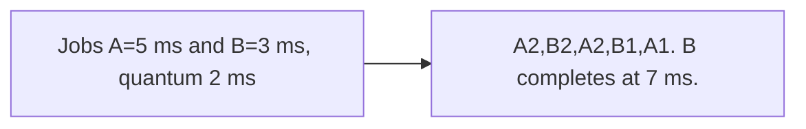

# A01.22 · scheduler and CPU timeslices

[Phase index](../README.md) · [Core] · 25–40 minutes

Prerequisite [A01.21](A01.21.md) · Next [A01.23](A01.23.md)

## 1. The problem & why it exists

An interactive request sits behind many runnable jobs on one CPU. Limit runnable work first. A scheduler simulation helps reason about fairness, though it cannot predict a specific Linux policy.

## 2. Visual mental model



```text
[01] Jobs A=5 ms and B=3 ms, quantum 2 ms
[02] A2,B2,A2,B1,A1. B completes at 7 ms.
```

Read the trace from the first state to the last. Each box labels an observation or a model state. Timing and resource use on a specific host require separate measurements.

## 3. Step-by-step mechanism & minimal dry-run

The scheduler chooses eligible tasks. A round-robin model rotates remaining work after a quantum.

**Trace.** Jobs A=5 ms and B=3 ms, quantum 2 ms -> A2,B2,A2,B1,A1. B completes at 7 ms.

**Boundary case.** Using a huge quantum turns the model into near-FIFO for short jobs. Smaller quanta improve response but can increase switching.

## 4. Formal rigor & quantitative math

For n always-ready tasks with quantum q and negligible switch cost, delay between turns is (n−1)q. Five at 2 ms yield 8 ms.

Use the modeled numbers first, then check your prediction with the [runnable example](../examples/A01.22.py). Where the example observes the OS, compare direction and units across three repetitions and keep the raw values. Treat any modeled latency as a worked input.

Check the arithmetic with NumPy after `uv sync --locked --extra math`.

```python
import numpy as np

actual = (np.array(5) - 1) * 2
np.testing.assert_allclose(actual, 8)
print(actual)
```

## 5. Progressive design

| Approach | Latency or output | Memory | Implementation effort | Cost | Failure to watch |
| --- | --- | --- | --- | --- | --- |
| Baseline experiment | Failure control in section 6 | Bounded fixture | Change one input or policy | Local CPU time | Using a huge quantum turns the model into near-FIFO for short jobs |
| Corrected experiment | Normal control in section 6 | Same fixture unless documented | Make the specific boundary explicit | Local CPU time | Validate the boundary again after deployment |

Read the two code paths in the [example](../examples/A01.22.py). Identify the state that differs and compare the output. Limit runnable work first. A scheduler simulation helps reason about fairness, though it cannot predict a specific Linux policy.

## 6. Safe local lab & controlled failure injection

Predict both modes on paper, then run from the repository root.

```sh
uv run python "01-architecture-A01-to-A20/A01-computer-systems-and-os/examples/A01.22.py"
uv run python "01-architecture-A01-to-A20/A01-computer-systems-and-os/examples/A01.22.py" --break
```

**Observe.** Expect five slices versus two.

**Diagnose.** Identify the first divergent state in the trace. Using a huge quantum turns the model into near-FIFO for short jobs. Smaller quanta improve response but can increase switching.

**Repair.** Rerun the normal control, then change only the deciding input or branch in a scratch copy and rerun both modes.

**Extend.** Change the quantum to 1 ms and mark first-run and completion times separately.

**Cleanup.** The example exits on its own and cleans up any temporary files or handles. Remove the scratch copy after recording evidence.

## 7. Production & multi-cloud bridge

Worker concurrency consumes runnable capacity under Kubernetes CPU constraints. Correlate quota period and latency bursts in EKS, AKS and GKE.

**Interview.** Why can quotas increase tail latency at moderate average usage?

<details>
<summary>Reveal Principal Answer & Trade-Offs</summary>

A burst can exhaust budget early in the accounting interval.

</details>

## 8. Memory hook & mastery checkpoint

**Recall.** The scheduler chooses eligible tasks. Use the boundary case in section 3 to explain where the simple explanation stops.

1. First-run delay of third task at 2 ms quantum?
2. Does nice set a portable fixed timeslice?
3. Does a blocked task consume a modeled quantum?
4. What evidence should differ between normal and failure mode?
5. What is the experiment variation, and what must be held constant?

<details>
<summary>Check answers after attempting all five</summary>

1. 4 ms
2. No
3. No
4. five slices versus two
5. Change the quantum to 1 ms and mark first-run and completion times separately. Hold the runtime, input fixture and measurement method constant except for the stated change.

</details>

## Standards and implementation notes

The runnable FIFO rotation is a model. Linux supports several policies, including real-time round robin. Fair-class scheduling in current kernels uses EEVDF concepts and is not equivalent to this queue.

- [Linux sched(7)](https://man7.org/linux/man-pages/man7/sched.7.html)
- [Linux EEVDF scheduler](https://docs.kernel.org/scheduler/sched-eevdf.html)
