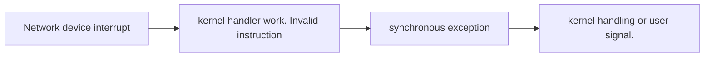

# A01.23 · interrupts and traps

[Phase index](../README.md) · [Core] · 25–40 minutes

Prerequisite [A01.22](A01.22.md) · Next [A01.24](A01.24.md)

## 1. The problem & why it exists

A program confuses a synchronous bad instruction with an asynchronous device event. Use exception and signal APIs for application-level handling. Classify the origin before assigning a recovery action.

## 2. Visual mental model



```text
[01] Network device interrupt
[02] kernel handler work. Invalid instruction
[03] synchronous exception
[04] kernel handling or user signal.
```

Read the trace from the first state to the last. Each box labels an observation or a model state. Timing and resource use on a specific host require separate measurements.

## 3. Step-by-step mechanism & minimal dry-run

An interrupt typically arrives asynchronously from hardware. An exception arises from the current instruction. Terminology for traps differs across architectures.

**Trace.** Network device interrupt -> kernel handler work. Invalid instruction -> synchronous exception -> kernel handling or user signal.

**Boundary case.** Assuming every interrupt maps to a user signal confuses layers. Trace kernel and user evidence independently.

## 4. Formal rigor & quantitative math

For rate r events/s and mean service time t s, utilization is rt in a simple single-core model. 10000×5 µs consumes 5% of one core.

Use the modeled numbers first, then check your prediction with the [runnable example](../examples/A01.23.py). Where the example observes the OS, compare direction and units across three repetitions and keep the raw values. Treat any modeled latency as a worked input.

Check the arithmetic with NumPy after `uv sync --locked --extra math`.

```python
import numpy as np

actual = np.array(10_000) * 5e-6
np.testing.assert_allclose(actual, 0.05)
print(actual)
```

## 5. Progressive design

| Approach | Latency or output | Memory | Implementation effort | Cost | Failure to watch |
| --- | --- | --- | --- | --- | --- |
| Baseline experiment | Failure control in section 6 | Bounded fixture | Change one input or policy | Local CPU time | Assuming every interrupt maps to a user signal confuses layers |
| Corrected experiment | Normal control in section 6 | Same fixture unless documented | Make the specific boundary explicit | Local CPU time | Validate the boundary again after deployment |

Read the two code paths in the [example](../examples/A01.23.py). Identify the state that differs and compare the output. Use exception and signal APIs for application-level handling. Classify the origin before assigning a recovery action.

## 6. Safe local lab & controlled failure injection

Predict both modes on paper, then run from the repository root.

```sh
uv run python "01-architecture-A01-to-A20/A01-computer-systems-and-os/examples/A01.23.py"
uv run python "01-architecture-A01-to-A20/A01-computer-systems-and-os/examples/A01.23.py" --break
```

**Observe.** Expect user signal flag versus Python arithmetic exception.

**Diagnose.** Identify the first divergent state in the trace. Assuming every interrupt maps to a user signal confuses layers. Trace kernel and user evidence independently.

**Repair.** Rerun the normal control, then change only the deciding input or branch in a scratch copy and rerun both modes.

**Extend.** Send the user signal twice and replace the flag with a local counter.

**Cleanup.** The example exits on its own and cleans up any temporary files or handles. Remove the scratch copy after recording evidence.

## 7. Production & multi-cloud bridge

Network-driven workloads can spend time in kernel handlers in addition to Python application code. Use like-for-like kernel observations across EC2, Azure VMs and Compute Engine.

**Interview.** Why coalesce interrupts?

<details>
<summary>Reveal Principal Answer & Trade-Offs</summary>

It reduces per-event overhead while adding delay for some packets.

</details>

## 8. Memory hook & mastery checkpoint

**Recall.** An interrupt typically arrives asynchronously from hardware. Use the boundary case in section 3 to explain where the simple explanation stops.

1. Is a divide fault tied to an instruction?
2. Is a NIC interrupt asynchronous to a given user instruction stream?
3. What does 20000×10 µs yield?
4. What evidence should differ between normal and failure mode?
5. What is the experiment variation, and what must be held constant?

<details>
<summary>Check answers after attempting all five</summary>

1. Yes
2. Generally yes
3. 20% of one core
4. user signal flag versus Python arithmetic exception
5. Send the user signal twice and replace the flag with a local counter. Hold the runtime, input fixture and measurement method constant except for the stated change.

</details>
