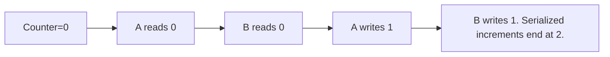

# A01.25 · race conditions and synchronization

[Phase index](../README.md) · [Principal] · 25–40 minutes

Prerequisite [A01.24](A01.24.md) · Next [A01.26](A01.26.md)

## 1. The problem & why it exists

A counter reports one completion for two concurrent jobs. Use a lock or aggregate isolated counts. Protect the whole read–modify–write sequence.

## 2. Visual mental model



```text
[01] Counter=0
[02] A reads 0
[03] B reads 0
[04] A writes 1
[05] B writes 1. Serialized increments end at 2.
```

Read the trace from the first state to the last. Each box labels an observation or a model state. Timing and resource use on a specific host require separate measurements.

## 3. Step-by-step mechanism & minimal dry-run

A lost update occurs if both threads read before either publishes its new value.

**Trace.** Counter=0 -> A reads 0 -> B reads 0 -> A writes 1 -> B writes 1. Serialized increments end at 2.

**Boundary case.** Forcing both readers to rendezvous reproduces the defect. Fix by locking read and write together, never the barrier wait.

## 4. Formal rigor & quantitative math

With n independent increments of one from c, invariant is c+n. The locked implementation has O(n) critical sections or fewer if aggregated.

Use the modeled numbers first, then check your prediction with the [runnable example](../examples/A01.25.py). Where the example observes the OS, compare direction and units across three repetitions and keep the raw values. Treat any modeled latency as a worked input.

Check the arithmetic with NumPy after `uv sync --locked --extra math`.

```python
import numpy as np

actual = 7 + np.sum(np.ones(5, dtype=int))
np.testing.assert_allclose(actual, 12)
print(actual)
```

## 5. Progressive design

| Approach | Latency or output | Memory | Implementation effort | Cost | Failure to watch |
| --- | --- | --- | --- | --- | --- |
| Baseline experiment | Failure control in section 6 | Bounded fixture | Change one input or policy | Local CPU time | Forcing both readers to rendezvous reproduces the defect |
| Corrected experiment | Normal control in section 6 | Same fixture unless documented | Make the specific boundary explicit | Local CPU time | Validate the boundary again after deployment |

Read the two code paths in the [example](../examples/A01.25.py). Identify the state that differs and compare the output. Use a lock or aggregate isolated counts. Protect the whole read–modify–write sequence.

## 6. Safe local lab & controlled failure injection

Predict both modes on paper, then run from the repository root.

```sh
uv run python "01-architecture-A01-to-A20/A01-computer-systems-and-os/examples/A01.25.py"
uv run python "01-architecture-A01-to-A20/A01-computer-systems-and-os/examples/A01.25.py" --break
```

**Observe.** Expect 2 versus 1.

**Diagnose.** Identify the first divergent state in the trace. Forcing both readers to rendezvous reproduces the defect. Fix by locking read and write together, never the barrier wait.

**Repair.** Rerun the normal control, then change only the deciding input or branch in a scratch copy and rerun both modes.

**Extend.** Start at 7 and compare the fully serialized and forced-overlap totals.

**Cleanup.** The example exits on its own and cleans up any temporary files or handles. Remove the scratch copy after recording evidence.

## 7. Production & multi-cloud bridge

Update shared counters with ownership or explicit synchronization in your worker process. Benchmark the same critical section under equivalent EKS, AKS and GKE CPU allocation.

**Interview.** When would per-worker counters beat one lock?

<details>
<summary>Reveal Principal Answer & Trade-Offs</summary>

When reads can aggregate tolerant snapshots and updates dominate.

</details>

## 8. Memory hook & mastery checkpoint

**Recall.** A lost update occurs if both threads read before either publishes its new value. Use the boundary case in section 3 to explain where the simple explanation stops.

1. Does locking only assignment fix stale reads?
2. What is the correct result after 5 increments from 7?
3. What property does the forced interleaving demonstrate?
4. What evidence should differ between normal and failure mode?
5. What is the experiment variation, and what must be held constant?

<details>
<summary>Check answers after attempting all five</summary>

1. No
2. 12
3. A lost update
4. 2 versus 1
5. Start at 7 and compare the fully serialized and forced-overlap totals. Hold the runtime, input fixture and measurement method constant except for the stated change.

</details>

## Standards and implementation notes

The forced barrier orders both stale reads before either write. It demonstrates a compound race independently of the scheduling order normally observed.

- [Python threading](https://docs.python.org/3/library/threading.html)
