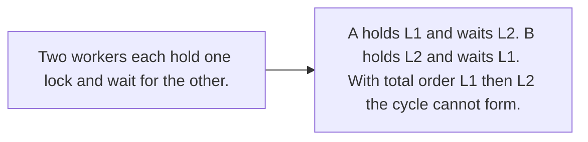

# A01.27 · deadlock/livelock/starvation

[Phase index](../README.md) · [Principal] · 25–40 minutes

Prerequisite [A01.26](A01.26.md) · Next [A01.28](A01.28.md)

## 1. The problem & why it exists

Two workers each hold one lock and wait for the other. Use one lock or assign a global lock order. Keep unrelated operations outside critical sections.

## 2. Visual mental model



```text
[01] A holds L1 and waits L2. B holds L2 and waits L1. With total order L1 then L2 the cycle cannot form.
```

Read the trace from the first state to the last. Each box labels an observation or a model state. Timing and resource use on a specific host require separate measurements.

## 3. Step-by-step mechanism & minimal dry-run

Deadlock forms a closed wait cycle. Livelock keeps changing state without completing work. Starvation denies some participant progress indefinitely.

**Trace.** A holds L1 and waits L2. B holds L2 and waits L1. With total order L1 then L2 the cycle cannot form.

**Boundary case.** Timeouts can bound waiting, while synchronized retries can repeat the conflict. Order acquisition and test contention with time-bounded probes.

## 4. Formal rigor & quantitative math

A wait-for graph with V vertices and E edges can be checked for cycles in O(V+E). For 2 workers and 2 edges, the two prerequisites point at one another.

Use the modeled numbers first, then check your prediction with the [runnable example](../examples/A01.27.py). Where the example observes the OS, compare direction and units across three repetitions and keep the raw values. Treat any modeled latency as a worked input.

Check the arithmetic with NumPy after `uv sync --locked --extra math`. In the two-worker illustration, the adjacency matrix has a 1 for each wait edge. Its square has two diagonal entries equal to 1, one for each two-step return to its origin.

```python
import numpy as np

actual = np.trace(np.linalg.matrix_power([[0, 1], [1, 0]], 2))
np.testing.assert_allclose(actual, 2)
print(actual)
```

## 5. Progressive design

| Approach | Latency or output | Memory | Implementation effort | Cost | Failure to watch |
| --- | --- | --- | --- | --- | --- |
| Baseline experiment | Failure control in section 6 | Bounded fixture | Change one input or policy | Local CPU time | Timeouts can bound waiting, while synchronized retries can repeat the conflict |
| Corrected experiment | Normal control in section 6 | Same fixture unless documented | Make the specific boundary explicit | Local CPU time | Validate the boundary again after deployment |

Read the two code paths in the [example](../examples/A01.27.py). Identify the state that differs and compare the output. Use one lock or assign a global lock order. Keep unrelated operations outside critical sections.

## 6. Safe local lab & controlled failure injection

Predict both modes on paper, then run from the repository root.

```sh
uv run python "01-architecture-A01-to-A20/A01-computer-systems-and-os/examples/A01.27.py"
uv run python "01-architecture-A01-to-A20/A01-computer-systems-and-os/examples/A01.27.py" --break
```

**Observe.** Expect no cycle versus cycle.

**Diagnose.** Identify the first divergent state in the trace. Timeouts can bound waiting, while synchronized retries can repeat the conflict. Order acquisition and test contention with time-bounded probes.

**Repair.** Rerun the normal control, then change only the deciding input or branch in a scratch copy and rerun both modes.

**Extend.** Add a third worker to the dependency map and test acyclic and cyclic graphs.

**Cleanup.** The example exits on its own and cleans up any temporary files or handles. Remove the scratch copy after recording evidence.

## 7. Production & multi-cloud bridge

A stalled task runner needs progress counters and diagnostics that distinguish wait cycles from retries. Correlate logs and timeout events through CloudWatch, Azure Monitor and Cloud Monitoring.

**Interview.** How distinguish livelock from deadlock?

<details>
<summary>Reveal Principal Answer & Trade-Offs</summary>

Sample progress counters plus stack/wait evidence, checking whether attempts continue without completed work.

</details>

## 8. Memory hook & mastery checkpoint

**Recall.** Deadlock forms a closed wait cycle. Use the boundary case in section 3 to explain where the simple explanation stops.

1. Can deadlock happen with CPU near zero?
2. Do constant retries prove progress?
3. What geometric feature identifies cyclic wait?
4. What evidence should differ between normal and failure mode?
5. What is the experiment variation, and what must be held constant?

<details>
<summary>Check answers after attempting all five</summary>

1. Yes
2. No
3. A directed cycle
4. no cycle versus cycle
5. Add a third worker to the dependency map and test acyclic and cyclic graphs. Hold the runtime, input fixture and measurement method constant except for the stated change.

</details>
