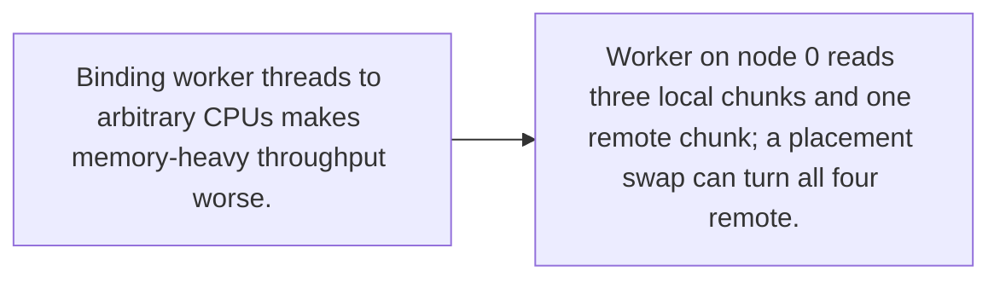

# A01.28 · CPU affinity and NUMA

[Phase index](../README.md) · [Principal] · 25–40 minutes

Prerequisite [A01.27](A01.27.md) · Next [A01.29](A01.29.md)

## 1. The problem & why it exists

Binding worker threads to arbitrary CPUs makes memory-heavy throughput worse. Leave affinity to the OS unless repeatable measurements justify placement. Co-locate work and memory only with topology evidence.

## 2. Visual mental model



```text
[01] Worker on node 0 reads three local chunks and one remote chunk; a placement swap can turn all four remote.
```

Read the trace from the first state to the last. Each box labels an observation or a model state. Timing and resource use on a specific host require separate measurements.

## 3. Step-by-step mechanism & minimal dry-run

Affinity constrains eligible CPUs. NUMA access cost depends on which node owns a physical page and where the CPU executes.

**Trace.** Worker on node 0 reads three local chunks and one remote chunk; a placement swap can turn all four remote.

**Boundary case.** Pinning a process to one CPU can bottleneck independent tasks. Inspect the current mask and avoid CPU IDs excluded by a container cpuset.

## 4. Formal rigor & quantitative math

For remote fraction f and local/remote latencies l,r, mean is (1−f)l+fr. At 25%, 80 and 140 ns give 95 ns.

Use the modeled numbers first, then check your prediction with the [runnable example](../examples/A01.28.py). Where the example observes the OS, compare direction and units across three repetitions and keep the raw values. Treat any modeled latency as a worked input.

Check the arithmetic with NumPy after `uv sync --locked --extra math`.

```python
import numpy as np

actual = np.dot([0.75, 0.25], [80, 140])
np.testing.assert_allclose(actual, 95)
print(actual)
```

## 5. Progressive design

| Approach | Latency or output | Memory | Implementation effort | Cost | Failure to watch |
| --- | --- | --- | --- | --- | --- |
| Baseline experiment | Failure control in section 6 | Bounded fixture | Change one input or policy | Local CPU time | Pinning a process to one CPU can bottleneck independent tasks |
| Corrected experiment | Normal control in section 6 | Same fixture unless documented | Make the specific boundary explicit | Local CPU time | Validate the boundary again after deployment |

Read the two code paths in the [example](../examples/A01.28.py). Identify the state that differs and compare the output. Leave affinity to the OS unless repeatable measurements justify placement. Co-locate work and memory only with topology evidence.

## 6. Safe local lab & controlled failure injection

Predict both modes on paper, then run from the repository root.

```sh
uv run python "01-architecture-A01-to-A20/A01-computer-systems-and-os/examples/A01.28.py"
uv run python "01-architecture-A01-to-A20/A01-computer-systems-and-os/examples/A01.28.py" --break
```

**Observe.** Expect eligible mask validates the first target on Linux, or 95 versus 140 ns in the model.

**Diagnose.** Identify the first divergent state in the trace. Pinning a process to one CPU can bottleneck independent tasks. Inspect the current mask and avoid CPU IDs excluded by a container cpuset.

**Repair.** Rerun the normal control, then change only the deciding input or branch in a scratch copy and rerun both modes.

**Extend.** Compare a one-element subset with the full Linux affinity mask.

**Cleanup.** The example exits on its own and cleans up any temporary files or handles. Remove the scratch copy after recording evidence.

## 7. Production & multi-cloud bridge

Align a native inference worker's CPU and memory placement only after verifying topology. Inspect presented NUMA topology before comparing EC2, Azure VMs and Compute Engine.

**Interview.** What can undermine first-touch placement?

<details>
<summary>Reveal Principal Answer & Trade-Offs</summary>

Initialization on one node followed by steady-state use on another, plus later migration.

</details>

## 8. Memory hook & mastery checkpoint

**Recall.** Affinity constrains eligible CPUs. Use the boundary case in section 3 to explain where the simple explanation stops.

1. Does CPU affinity itself relocate resident pages?
2. What is an eligible CPU mask?
3. Does a VM necessarily expose physical NUMA topology?
4. What evidence should differ between normal and failure mode?
5. What is the experiment variation, and what must be held constant?

<details>
<summary>Check answers after attempting all five</summary>

1. No
2. The set of CPUs a task may run on
3. No
4. eligible mask validates the first target on Linux, or 95 versus 140 ns in the model
5. Compare a one-element subset with the full Linux affinity mask. Hold the runtime, input fixture and measurement method constant except for the stated change.

</details>
