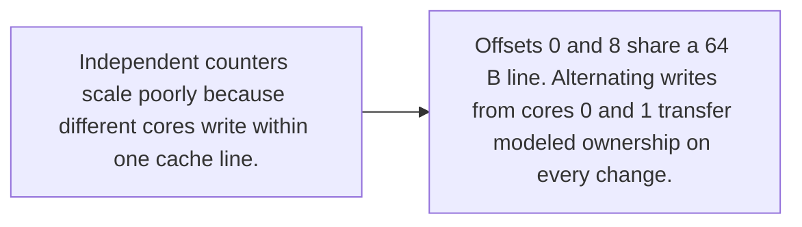

# A01.29 · cache hierarchy and false sharing

[Phase index](../README.md) · [Principal] · 25–40 minutes

Prerequisite [A01.28](A01.28.md) · Next [A01.30](A01.30.md)

## 1. The problem & why it exists

Independent counters scale poorly because different cores write within one cache line. Use per-worker aggregation first. Pad or align hot data only after validating coherence traffic.

## 2. Visual mental model



```text
[01] Offsets 0 and 8 share a 64 B line. Alternating writes from cores 0 and 1 transfer modeled ownership on every change.
```

Read the trace from the first state to the last. Each box labels an observation or a model state. Timing and resource use on a specific host require separate measurements.

## 3. Step-by-step mechanism & minimal dry-run

Coherence works at line granularity. Distinct values in the same line can trigger ownership transfers when separate cores write them.

**Trace.** Offsets 0 and 8 share a 64 B line. Alternating writes from cores 0 and 1 transfer modeled ownership on every change.

**Boundary case.** Object-level independence hides line contention. Move simulated counters to different lines and re-count transfers.

## 4. Formal rigor & quantitative math

For 2m alternating writes to one line starting with no owner, transfers between cores are 2m−1. At m=5 there are nine. Padding consumes extra bytes per counter.

Use the modeled numbers first, then check your prediction with the [runnable example](../examples/A01.29.py). Where the example observes the OS, compare direction and units across three repetitions and keep the raw values. Treat any modeled latency as a worked input.

Check the arithmetic with NumPy after `uv sync --locked --extra math`.

```python
import numpy as np

actual = np.count_nonzero(np.diff(np.tile([0, 1], 5)))
np.testing.assert_allclose(actual, 9)
print(actual)
```

## 5. Progressive design

| Approach | Latency or output | Memory | Implementation effort | Cost | Failure to watch |
| --- | --- | --- | --- | --- | --- |
| Baseline experiment | Failure control in section 6 | Bounded fixture | Change one input or policy | Local CPU time | Object-level independence hides line contention |
| Corrected experiment | Normal control in section 6 | Same fixture unless documented | Make the specific boundary explicit | Local CPU time | Validate the boundary again after deployment |

Read the two code paths in the [example](../examples/A01.29.py). Identify the state that differs and compare the output. Use per-worker aggregation first. Pad or align hot data only after validating coherence traffic.

## 6. Safe local lab & controlled failure injection

Predict both modes on paper, then run from the repository root.

```sh
uv run python "01-architecture-A01-to-A20/A01-computer-systems-and-os/examples/A01.29.py"
uv run python "01-architecture-A01-to-A20/A01-computer-systems-and-os/examples/A01.29.py" --break
```

**Observe.** Expect 0 versus 9 modeled ownership transfers.

**Diagnose.** Identify the first divergent state in the trace. Object-level independence hides line contention. Move simulated counters to different lines and re-count transfers.

**Repair.** Rerun the normal control, then change only the deciding input or branch in a scratch copy and rerun both modes.

**Extend.** Use offsets 0 and 63, then 0 and 64, and compare transfers.

**Cleanup.** The example exits on its own and cleans up any temporary files or handles. Remove the scratch copy after recording evidence.

## 7. Production & multi-cloud bridge

Native inference kernels can expose false sharing even when Python manages only orchestration. Use matched CPU classes and physical placement controls for EC2, Azure VMs and Compute Engine tests.

**Interview.** Why might padding fail?

<details>
<summary>Reveal Principal Answer & Trade-Offs</summary>

Actual allocation alignment or simultaneous operation placement may differ from assumptions, and larger footprints can hurt caching.

</details>

## 8. Memory hook & mastery checkpoint

**Recall.** Coherence works at line granularity. Use the boundary case in section 3 to explain where the simple explanation stops.

1. Which line contains offset 128 at 64 B?
2. Can values be logically independent and still contend?
3. Does Python object adjacency prove physical line placement?
4. What evidence should differ between normal and failure mode?
5. What is the experiment variation, and what must be held constant?

<details>
<summary>Check answers after attempting all five</summary>

1. Line 2
2. Yes
3. No
4. 0 versus 9 modeled ownership transfers
5. Use offsets 0 and 63, then 0 and 64, and compare transfers. Hold the runtime, input fixture and measurement method constant except for the stated change.

</details>

## Standards and implementation notes

False sharing depends on cache-line placement and concurrent writes. The exercise models ownership changes. Native profiling and checked alignment are needed to test a hardware performance claim.

- [Linux false-sharing guide](https://docs.kernel.org/kernel-hacking/false-sharing.html)
