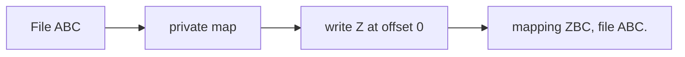

# A01.31 · mmap and copy-on-write

[Phase index](../README.md) · [Principal] · 25–40 minutes

Prerequisite [A01.30](A01.30.md) · Next [A01.32](A01.32.md)

## 1. The problem & why it exists

A reader modifies a mapped file and expects an investigation copy to remain private. Use ordinary reads for small files. Select private mapping for local edits without changing backing data.

## 2. Visual mental model



```text
[01] File ABC
[02] private map
[03] write Z at offset 0
[04] mapping ZBC, file ABC.
```

Read the trace from the first state to the last. Each box labels an observation or a model state. Timing and resource use on a specific host require separate measurements.

## 3. Step-by-step mechanism & minimal dry-run

A mapping exposes file offsets in virtual memory. Private writes can cause a page copy. Shared writes may propagate to the mapped file.

**Trace.** File ABC -> private map -> write Z at offset 0 -> mapping ZBC, file ABC.

**Boundary case.** Opening a writable shared mapping changes visibility and persistence behavior. Isolate experiments in a disposable temp file.

## 4. Formal rigor & quantitative math

For p distinct dirtied pages at size s, private copy budget is about ps bytes. Six at 4 KiB give 24 KiB. Sparse edits still pay per touched page.

Use the modeled numbers first, then check your prediction with the [runnable example](../examples/A01.31.py). Where the example observes the OS, compare direction and units across three repetitions and keep the raw values. Treat any modeled latency as a worked input.

Check the arithmetic with NumPy after `uv sync --locked --extra math`.

```python
import numpy as np

actual = np.array(6) * 4096 / 1024
np.testing.assert_allclose(actual, 24)
print(actual)
```

## 5. Progressive design

| Approach | Latency or output | Memory | Implementation effort | Cost | Failure to watch |
| --- | --- | --- | --- | --- | --- |
| Baseline experiment | Failure control in section 6 | Bounded fixture | Change one input or policy | Local CPU time | Opening a writable shared mapping changes visibility and persistence behavior |
| Corrected experiment | Normal control in section 6 | Same fixture unless documented | Make the specific boundary explicit | Local CPU time | Validate the boundary again after deployment |

Read the two code paths in the [example](../examples/A01.31.py). Identify the state that differs and compare the output. Use ordinary reads for small files. Select private mapping for local edits without changing backing data.

## 6. Safe local lab & controlled failure injection

Predict both modes on paper, then run from the repository root.

```sh
uv run python "01-architecture-A01-to-A20/A01-computer-systems-and-os/examples/A01.31.py"
uv run python "01-architecture-A01-to-A20/A01-computer-systems-and-os/examples/A01.31.py" --break
```

**Observe.** Expect private file ABC versus shared file ZBC.

**Diagnose.** Identify the first divergent state in the trace. Opening a writable shared mapping changes visibility and persistence behavior. Isolate experiments in a disposable temp file.

**Repair.** Rerun the normal control, then change only the deciding input or branch in a scratch copy and rerun both modes.

**Extend.** Modify the final byte instead and compare private and shared results.

**Cleanup.** The example exits on its own and cleans up any temporary files or handles. Remove the scratch copy after recording evidence.

## 7. Production & multi-cloud bridge

A memory-mapped retrieval index can trade startup time against first-touch latency. Validate backing storage semantics separately on EBS, Azure Managed Disks and Persistent Disk.

**Interview.** When can mmap surprise a process?

<details>
<summary>Reveal Principal Answer & Trade-Offs</summary>

Truncating a mapped file concurrently can invalidate access beyond its new end.

</details>

## 8. Memory hook & mastery checkpoint

**Recall.** A mapping exposes file offsets in virtual memory. Use the boundary case in section 3 to explain where the simple explanation stops.

1. Does private mapping modify the backing file on write?
2. Are private copies initially required for every mapped page?
3. Does a mapping imply the whole file is resident?
4. What evidence should differ between normal and failure mode?
5. What is the experiment variation, and what must be held constant?

<details>
<summary>Check answers after attempting all five</summary>

1. No
2. No
3. No
4. private file ABC versus shared file ZBC
5. Modify the final byte instead and compare private and shared results. Hold the runtime, input fixture and measurement method constant except for the stated change.

</details>
