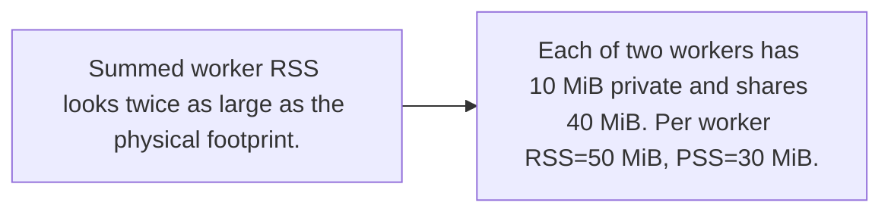

# A01.32 · memory accounting RSS/PSS

[Phase index](../README.md) · [Principal] · 25–40 minutes

Prerequisite [A01.31](A01.31.md) · Next [A01.33](A01.33.md)

## 1. The problem & why it exists

Summed worker RSS looks twice as large as the physical footprint. Track PSS for proportional attribution and cgroup usage for budget pressure. Use RSS for a single process's resident mappings.

## 2. Visual mental model



```text
[01] Each of two workers has 10 MiB private and shares 40 MiB. Per worker RSS=50 MiB, PSS=30 MiB.
```

Read the trace from the first state to the last. Each box labels an observation or a model state. Timing and resource use on a specific host require separate measurements.

## 3. Step-by-step mechanism & minimal dry-run

RSS counts resident mappings in full per process. PSS divides shared pages among the processes mapping them.

**Trace.** Each of two workers has 10 MiB private and shares 40 MiB. Per worker RSS=50 MiB, PSS=30 MiB.

**Boundary case.** Comparing summed RSS directly to a cgroup limit double-counts shared pages and omits other charges. Use smaps_rollup and cgroup evidence together.

## 4. Formal rigor & quantitative math

For private bytes p, shared bytes s and n equal sharers, RSS=p+s and PSS=p+s/n. Summed RSS is 100 MiB in the example and summed PSS is 60 MiB.

Use the modeled numbers first, then check your prediction with the [runnable example](../examples/A01.32.py). Where the example observes the OS, compare direction and units across three repetitions and keep the raw values. Treat any modeled latency as a worked input.

Check the arithmetic with NumPy after `uv sync --locked --extra math`.

```python
import numpy as np

actual = 2 * (10 + np.array([40, 40 / 2]))
np.testing.assert_allclose(actual, [100, 60])
print(actual)
```

## 5. Progressive design

| Approach | Latency or output | Memory | Implementation effort | Cost | Failure to watch |
| --- | --- | --- | --- | --- | --- |
| Baseline experiment | Failure control in section 6 | Bounded fixture | Change one input or policy | Local CPU time | Comparing summed RSS directly to a cgroup limit double-counts shared pages and omits other charges |
| Corrected experiment | Normal control in section 6 | Same fixture unless documented | Make the specific boundary explicit | Local CPU time | Validate the boundary again after deployment |

Read the two code paths in the [example](../examples/A01.32.py). Identify the state that differs and compare the output. Track PSS for proportional attribution and cgroup usage for budget pressure. Use RSS for a single process's resident mappings.

## 6. Safe local lab & controlled failure injection

Predict both modes on paper, then run from the repository root.

```sh
uv run python "01-architecture-A01-to-A20/A01-computer-systems-and-os/examples/A01.32.py"
uv run python "01-architecture-A01-to-A20/A01-computer-systems-and-os/examples/A01.32.py" --break
```

**Observe.** Expect modeled 60 versus 100 MiB.

**Diagnose.** Identify the first divergent state in the trace. Comparing summed RSS directly to a cgroup limit double-counts shared pages and omits other charges. Use smaps_rollup and cgroup evidence together.

**Repair.** Rerun the normal control, then change only the deciding input or branch in a scratch copy and rerun both modes.

**Extend.** Change the model to four sharers and compute the new totals.

**Cleanup.** The example exits on its own and cleans up any temporary files or handles. Remove the scratch copy after recording evidence.

## 7. Production & multi-cloud bridge

Compare worker PSS and workload cgroup memory before reducing PostgreSQL client concurrency. Keep the same accounting scope when reviewing CloudWatch, Azure Monitor and Cloud Monitoring.

**Interview.** Why can cgroup usage exceed summed PSS?

<details>
<summary>Reveal Principal Answer & Trade-Offs</summary>

Page cache and kernel memory charges differ from per-process proportional attribution.

</details>

## 8. Memory hook & mastery checkpoint

**Recall.** RSS counts resident mappings in full per process. Use the boundary case in section 3 to explain where the simple explanation stops.

1. PSS share of 12 MiB shared by 3?
2. Is peak RSS the same as current RSS?
3. Where can Linux expose per-process PSS?
4. What evidence should differ between normal and failure mode?
5. What is the experiment variation, and what must be held constant?

<details>
<summary>Check answers after attempting all five</summary>

1. 4 MiB
2. No
3. /proc/<pid>/smaps_rollup
4. modeled 60 versus 100 MiB
5. Change the model to four sharers and compute the new totals. Hold the runtime, input fixture and measurement method constant except for the stated change.

</details>

## Standards and implementation notes

Linux smaps reports RSS and proportional sharing by region. RSS from different interfaces can differ by measurement method, and peak RSS and current RSS answer different questions.

- [Linux proc_pid_smaps(5)](https://man7.org/linux/man-pages/man5/proc_pid_smaps.5.html)
- [Linux proc_pid_status(5)](https://man7.org/linux/man-pages/man5/proc_pid_status.5.html)
- [Linux getrusage(2)](https://man7.org/linux/man-pages/man2/getrusage.2.html)
