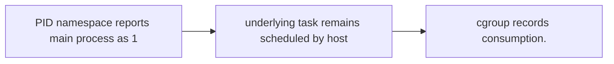

# A01.33 · cgroups and namespaces

[Phase index](../README.md) · [Principal] · 25–40 minutes

Prerequisite [A01.32](A01.32.md) · Next [A01.34](A01.34.md)

## 1. The problem & why it exists

A container sees its own process tree yet can still consume significant host CPU. Treat visibility and accounting as separate controls. Ordinary host processes can be accounted without new namespaces.

## 2. Visual mental model



```text
[01] PID namespace reports main process as 1
[02] underlying task remains scheduled by host
[03] cgroup records consumption.
```

Read the trace from the first state to the last. Each box labels an observation or a model state. Timing and resource use on a specific host require separate measurements.

## 3. Step-by-step mechanism & minimal dry-run

Namespaces change resource views. Cgroups account for and constrain groups of tasks. Containers combine these with other isolation controls.

**Trace.** PID namespace reports main process as 1 -> underlying task remains scheduled by host -> cgroup records consumption.

**Boundary case.** Assuming a private process list implies a CPU cap leaves overload unbounded. Read cgroup settings and the effective hierarchy.

## 4. Formal rigor & quantitative math

For budget Q µs per period P µs, ratio Q/P is equivalent CPU capacity. 50000/100000 yields 0.5 CPU. Children can be further constrained by parents.

Use the modeled numbers first, then check your prediction with the [runnable example](../examples/A01.33.py). Where the example observes the OS, compare direction and units across three repetitions and keep the raw values. Treat any modeled latency as a worked input.

Check the arithmetic with NumPy after `uv sync --locked --extra math`.

```python
import numpy as np

actual = np.array(50_000) / 100_000
np.testing.assert_allclose(actual, 0.5)
print(actual)
```

## 5. Progressive design

| Approach | Latency or output | Memory | Implementation effort | Cost | Failure to watch |
| --- | --- | --- | --- | --- | --- |
| Baseline experiment | Failure control in section 6 | Bounded fixture | Change one input or policy | Local CPU time | Assuming a private process list implies a CPU cap leaves overload unbounded |
| Corrected experiment | Normal control in section 6 | Same fixture unless documented | Make the specific boundary explicit | Local CPU time | Validate the boundary again after deployment |

Read the two code paths in the [example](../examples/A01.33.py). Identify the state that differs and compare the output. Treat visibility and accounting as separate controls. Ordinary host processes can be accounted without new namespaces.

## 6. Safe local lab & controlled failure injection

Predict both modes on paper, then run from the repository root.

```sh
uv run python "01-architecture-A01-to-A20/A01-computer-systems-and-os/examples/A01.33.py"
uv run python "01-architecture-A01-to-A20/A01-computer-systems-and-os/examples/A01.33.py" --break
```

**Observe.** Expect cgroup quota if available versus 0.5 CPU illustration.

**Diagnose.** Identify the first divergent state in the trace. Assuming a private process list implies a CPU cap leaves overload unbounded. Read cgroup settings and the effective hierarchy.

**Repair.** Rerun the normal control, then change only the deciding input or branch in a scratch copy and rerun both modes.

**Extend.** Compare cpu.max inside the limited L2 container and in your ordinary shell.

**Cleanup.** The example exits on its own and cleans up any temporary files or handles. Remove the scratch copy after recording evidence.

## 7. Production & multi-cloud bridge

Kubernetes workload isolation combines visibility boundaries and resource accounting. The Linux mechanisms are shared across EKS, AKS and GKE, with runtime and node configuration differences.

**Interview.** Why might /proc and cgroup paths look different from the host's?

<details>
<summary>Reveal Principal Answer & Trade-Offs</summary>

Mount and cgroup namespaces can change what paths are visible.

</details>

## 8. Memory hook & mastery checkpoint

**Recall.** Namespaces change resource views. Use the boundary case in section 3 to explain where the simple explanation stops.

1. Which mechanism controls a CPU quota?
2. Can namespaces affect PID visibility?
3. Is a namespace alone a security policy?
4. What evidence should differ between normal and failure mode?
5. What is the experiment variation, and what must be held constant?

<details>
<summary>Check answers after attempting all five</summary>

1. Cgroups
2. Yes
3. No
4. cgroup quota if available versus 0.5 CPU illustration
5. Compare cpu.max inside the limited L2 container and in your ordinary shell. Hold the runtime, input fixture and measurement method constant except for the stated change.

</details>
