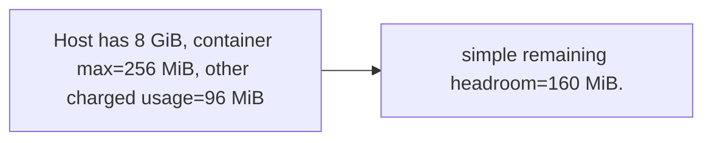

# A01.34 · container limits vs host resources

[Phase index](../README.md) · [Principal] · 25–40 minutes

Prerequisite [A01.33](A01.33.md) · Next [A01.35](A01.35.md)

## 1. The problem & why it exists

A heap autosizer uses visible host memory and exceeds the container limit. Use the effective workload budget and leave headroom. On a bare process without a workload limit, host metrics may inform sizing.

## 2. Visual mental model



```text
[01] Host has 8 GiB, container max=256 MiB, other charged usage=96 MiB
[02] simple remaining headroom=160 MiB.
```

Read the trace from the first state to the last. Each box labels an observation or a model state. Timing and resource use on a specific host require separate measurements.

## 3. Step-by-step mechanism & minimal dry-run

Cgroups can impose limits independent of host capacity. Ancestor limits, shared memory and charged file cache affect usable headroom.

**Trace.** Host has 8 GiB, container max=256 MiB, other charged usage=96 MiB -> simple remaining headroom=160 MiB.

**Boundary case.** Sizing from host totals overcommits. Compare effective limits with application memory configuration at startup.

## 4. Formal rigor & quantitative math

Approximate headroom at an applicable level as limit L minus usage U. Effective headroom across a hierarchy is the smallest applicable remainder, with reclaim and concurrent usage affecting it.

Use the modeled numbers first, then check your prediction with the [runnable example](../examples/A01.34.py). Where the example observes the OS, compare direction and units across three repetitions and keep the raw values. Treat any modeled latency as a worked input.

Check the arithmetic with NumPy after `uv sync --locked --extra math`.

```python
import numpy as np

actual = np.min(np.subtract([8192, 256], [1024, 96]))
np.testing.assert_allclose(actual, 160)
print(actual)
```

## 5. Progressive design

| Approach | Latency or output | Memory | Implementation effort | Cost | Failure to watch |
| --- | --- | --- | --- | --- | --- |
| Baseline experiment | Failure control in section 6 | Bounded fixture | Change one input or policy | Local CPU time | Sizing from host totals overcommits |
| Corrected experiment | Normal control in section 6 | Same fixture unless documented | Make the specific boundary explicit | Local CPU time | Validate the boundary again after deployment |

Read the two code paths in the [example](../examples/A01.34.py). Identify the state that differs and compare the output. Use the effective workload budget and leave headroom. On a bare process without a workload limit, host metrics may inform sizing.

## 6. Safe local lab & controlled failure injection

Predict both modes on paper, then run from the repository root.

```sh
uv run python "01-architecture-A01-to-A20/A01-computer-systems-and-os/examples/A01.34.py"
uv run python "01-architecture-A01-to-A20/A01-computer-systems-and-os/examples/A01.34.py" --break
```

**Observe.** Expect 160 versus 7168 MiB.

**Diagnose.** Identify the first divergent state in the trace. Sizing from host totals overcommits. Compare effective limits with application memory configuration at startup.

**Repair.** Rerun the normal control, then change only the deciding input or branch in a scratch copy and rerun both modes.

**Extend.** Add an ancestor with less remaining headroom than the leaf.

**Cleanup.** The example exits on its own and cleans up any temporary files or handles. Remove the scratch copy after recording evidence.

## 7. Production & multi-cloud bridge

Set FastAPI worker memory budgets from effective workload limits and known overhead. Compare node capacity with workload requests and limits across EKS, AKS and GKE.

**Interview.** Why can Kubernetes requests and limits lead to different outcomes?

<details>
<summary>Reveal Principal Answer & Trade-Offs</summary>

Requests influence placement and relative resource allocation, while limits can impose enforcement.

</details>

## 8. Memory hook & mastery checkpoint

**Recall.** Cgroups can impose limits independent of host capacity. Use the boundary case in section 3 to explain where the simple explanation stops.

1. Is CPU count the same as quota capacity?
2. What does cgroup v2 max mean in a limit file?
3. What does 256−96 yield?
4. What evidence should differ between normal and failure mode?
5. What is the experiment variation, and what must be held constant?

<details>
<summary>Check answers after attempting all five</summary>

1. No
2. No limit at that level
3. 160 MiB
4. 160 versus 7168 MiB
5. Add an ancestor with less remaining headroom than the leaf. Hold the runtime, input fixture and measurement method constant except for the stated change.

</details>
