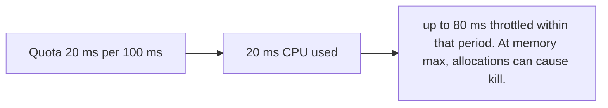

# A01.35 · CPU throttling and OOMKilled

[Phase index](../README.md) · [Principal] · 25–40 minutes

Prerequisite [A01.34](A01.34.md) · Next [A01.36](A01.36.md)

## 1. The problem & why it exists

A latency spike and a terminated worker both get blamed on high CPU. Use separate CPU and memory evidence. A larger CPU quota will not fix memory exhaustion.

## 2. Visual mental model



```text
[01] Quota 20 ms per 100 ms
[02] 20 ms CPU used
[03] up to 80 ms throttled within that period. At memory max, allocations can cause kill.
```

Read the trace from the first state to the last. Each box labels an observation or a model state. Timing and resource use on a specific host require separate measurements.

## 3. Step-by-step mechanism & minimal dry-run

Quota throttling pauses runnable tasks after budget exhaustion. A memory cgroup may reclaim or trigger an OOM kill if it cannot satisfy charges.

**Trace.** Quota 20 ms per 100 ms -> 20 ms CPU used -> up to 80 ms throttled within that period. At memory max, allocations can cause kill.

**Boundary case.** Exit 137 can come from any SIGKILL. Corroborate with memory.events or runtime OOMKilled metadata and inspect cpu.stat separately.

## 4. Formal rigor & quantitative math

A single-thread job needing 50 ms CPU needs ceil(50/20)=3 quota slices if it starts at a fresh period. Under idealized windows it completes at t=210 ms.

Use the modeled numbers first, then check your prediction with the [runnable example](../examples/A01.35.py). Where the example observes the OS, compare direction and units across three repetitions and keep the raw values. Treat any modeled latency as a worked input.

Check the arithmetic with NumPy after `uv sync --locked --extra math`.

```python
import numpy as np

actual = ((np.array(50) - 1) // 20) * 100 + ((50 - 1) % 20 + 1)
np.testing.assert_allclose(actual, 210)
print(actual)
```

## 5. Progressive design

| Approach | Latency or output | Memory | Implementation effort | Cost | Failure to watch |
| --- | --- | --- | --- | --- | --- |
| Baseline experiment | Failure control in section 6 | Bounded fixture | Change one input or policy | Local CPU time | Exit 137 can come from any SIGKILL |
| Corrected experiment | Normal control in section 6 | Same fixture unless documented | Make the specific boundary explicit | Local CPU time | Validate the boundary again after deployment |

Read the two code paths in the [example](../examples/A01.35.py). Identify the state that differs and compare the output. Use separate CPU and memory evidence. A larger CPU quota will not fix memory exhaustion.

## 6. Safe local lab & controlled failure injection

Predict both modes on paper, then run from the repository root.

```sh
uv run python "01-architecture-A01-to-A20/A01-computer-systems-and-os/examples/A01.35.py"
uv run python "01-architecture-A01-to-A20/A01-computer-systems-and-os/examples/A01.35.py" --break
```

**Observe.** Expect 210 versus 50 modeled ms.

**Diagnose.** Identify the first divergent state in the trace. Exit 137 can come from any SIGKILL. Corroborate with memory.events or runtime OOMKilled metadata and inspect cpu.stat separately.

**Repair.** Rerun the normal control, then change only the deciding input or branch in a scratch copy and rerun both modes.

**Extend.** Change work to 40 ms and check the exact-quota boundary.

**Cleanup.** The example exits on its own and cleans up any temporary files or handles. Remove the scratch copy after recording evidence.

## 7. Production & multi-cloud bridge

Capture restart reason and quota counters when Kubernetes tails spike. On EKS, AKS and GKE, confirm pod termination reason and resource counters before changing limits.

**Interview.** Why can OOMKilled happen while the node has free memory?

<details>
<summary>Reveal Principal Answer & Trade-Offs</summary>

The workload can hit its own enforceable memory limit first.

</details>

## 8. Memory hook & mastery checkpoint

**Recall.** Quota throttling pauses runnable tasks after budget exhaustion. Use the boundary case in section 3 to explain where the simple explanation stops.

1. Does exit 137 prove OOM?
2. Which file exposes throttling counters on cgroup v2?
3. What does 20 ms/100 ms equal?
4. What evidence should differ between normal and failure mode?
5. What is the experiment variation, and what must be held constant?

<details>
<summary>Check answers after attempting all five</summary>

1. No
2. cpu.stat
3. 0.2 CPU
4. 210 versus 50 modeled ms
5. Change work to 40 ms and check the exact-quota boundary. Hold the runtime, input fixture and measurement method constant except for the stated change.

</details>
