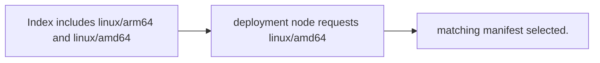

# A01.36 · ARM vs x86 and cross-architecture deployment

[Phase index](../README.md) · [Principal] · 25–40 minutes

Prerequisite [A01.35](A01.35.md) · Next [A01 labs and project gate](../README.md#practice-and-exit-gate)

## 1. The problem & why it exists

An image built on an ARM laptop fails on an x86 deployment node. Publish explicit target builds. Use emulation for compatibility checks and native benchmarks for performance.

## 2. Visual mental model



```text
[01] Index includes linux/arm64 and linux/amd64
[02] deployment node requests linux/amd64
[03] matching manifest selected.
```

Read the trace from the first state to the last. Each box labels an observation or a model state. Timing and resource use on a specific host require separate measurements.

## 3. Step-by-step mechanism & minimal dry-run

ISA, OS and ABI identify executable compatibility. An OCI index can point to a separate image for each supported platform.

**Trace.** Index includes linux/arm64 and linux/amd64 -> deployment node requests linux/amd64 -> matching manifest selected.

**Boundary case.** Shipping only linux/arm64 cannot satisfy a linux/amd64 lookup. Validate image platform metadata and run one smoke test per supported platform.

## 4. Formal rigor & quantitative math

For p platforms each with artifact size s and no shared blobs, storage is ps. Two 120 MiB variants occupy 240 MiB. Build time follows actual parallelism.

Use the modeled numbers first, then check your prediction with the [runnable example](../examples/A01.36.py). Where the example observes the OS, compare direction and units across three repetitions and keep the raw values. Treat any modeled latency as a worked input.

Check the arithmetic with NumPy after `uv sync --locked --extra math`.

```python
import numpy as np

actual = np.sum([120, 120])
np.testing.assert_allclose(actual, 240)
print(actual)
```

## 5. Progressive design

| Approach | Latency or output | Memory | Implementation effort | Cost | Failure to watch |
| --- | --- | --- | --- | --- | --- |
| Baseline experiment | Failure control in section 6 | Bounded fixture | Change one input or policy | Local CPU time | Shipping only linux/arm64 cannot satisfy a linux/amd64 lookup |
| Corrected experiment | Normal control in section 6 | Same fixture unless documented | Make the specific boundary explicit | Local CPU time | Validate the boundary again after deployment |

Read the two code paths in the [example](../examples/A01.36.py). Identify the state that differs and compare the output. Publish explicit target builds. Use emulation for compatibility checks and native benchmarks for performance.

## 6. Safe local lab & controlled failure injection

Predict both modes on paper, then run from the repository root.

```sh
uv run python "01-architecture-A01-to-A20/A01-computer-systems-and-os/examples/A01.36.py"
uv run python "01-architecture-A01-to-A20/A01-computer-systems-and-os/examples/A01.36.py" --break
```

**Observe.** Expect both targets covered versus amd64 missing.

**Diagnose.** Identify the first divergent state in the trace. Shipping only linux/arm64 cannot satisfy a linux/amd64 lookup. Validate image platform metadata and run one smoke test per supported platform.

**Repair.** Rerun the normal control, then change only the deciding input or branch in a scratch copy and rerun both modes.

**Extend.** Swap the available variant to amd64 and verify which target now fails.

**Cleanup.** The example exits on its own and cleans up any temporary files or handles. Remove the scratch copy after recording evidence.

## 7. Production & multi-cloud bridge

Test native dependencies and image manifests before moving inference workers across architectures. Publish per-platform manifests through ECR, ACR or Artifact Registry and test them on the target nodes.

**Interview.** Why might emulated integration tests pass while production performance misses targets?

<details>
<summary>Reveal Principal Answer & Trade-Offs</summary>

Instruction translation and different memory systems affect measurement.

</details>

## 8. Memory hook & mastery checkpoint

**Recall.** ISA, OS and ABI identify executable compatibility. Use the boundary case in section 3 to explain where the simple explanation stops.

1. What is Docker's x86-64 architecture label?
2. Which label commonly represents 64-bit ARM in OCI?
3. Can a matching architecture still have an ABI mismatch?
4. What evidence should differ between normal and failure mode?
5. What is the experiment variation, and what must be held constant?

<details>
<summary>Check answers after attempting all five</summary>

1. amd64
2. arm64
3. Yes
4. both targets covered versus amd64 missing
5. Swap the available variant to amd64 and verify which target now fails. Hold the runtime, input fixture and measurement method constant except for the stated change.

</details>

## Standards and implementation notes

A platform descriptor can include OS, architecture and variant. A matching manifest still needs an executable compatible with the target kernel and userspace ABI. Benchmark using native hardware where practical.

- [OCI image index](https://specs.opencontainers.org/image-spec/image-index/)
- [Arm A-profile architecture](https://developer.arm.com/Architectures/A-Profile%20Architecture)
- [Intel architecture manuals](https://www.intel.com/content/www/us/en/developer/articles/technical/intel-sdm.html)
