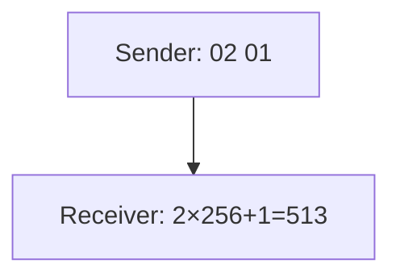

# A02.01 · bits-to-bytes serialization

[Phase index](../README.md) · [Foundation] · 25–40 minutes

Prerequisite [A01 exit gate](../../A01-computer-systems-and-os/README.md#practice-and-exit-gate) · Next [A02.02](A02.02.md)

## 1. The problem & why it exists

A client sends a 513-byte body and the receiver reads its length as 258.

For a single bounded record, a fixed-length message is simpler. A length prefix accommodates varying records at the cost of a parser and a cap.

## 2. Visual mental model



```text
01. Sender: 02 01
02. Receiver: 2×256+1=513
```

This trace isolates one boundary. For a deployed path, name the observer and capture the actual protocol, timing and configuration separately.

## 3. Step-by-step mechanism & minimal dry-run

A frame starts with an unsigned two-byte network-order length, followed by exactly that many bytes. TCP can split or coalesce frames, so read the prefix and payload to completion. Reject lengths outside the application budget before allocating.

**Dry-run.** Sender: 02 01 / Receiver: 2×256+1=513.

**Failure control.** Predict how the result changes if you reproduce the mistake from section 1. Use the two outputs in section 6 to locate its effect.

## 4. Formal rigor & quantitative math

By reversing the byte order, 02 01 becomes 2+256=258. A two-octet field can represent 0 through 65535. A decoder copies O(n) bytes for an n-byte body.

Check the worked quantities with NumPy after running `uv sync --locked --extra math`.

```python
import numpy as np

actual = np.dot([2, 1], [256, 1])
np.testing.assert_allclose(actual, 513)
print(actual)
```

## 5. Progressive design

Compare the two paths in the [runnable fixture](../examples/A02.01.py). Running the fixture uses a bounded in-process fixture.

| Path | Output evidence | Resource consideration | Failure to watch |
| --- | --- | --- | --- |
| Failure control | `False declared: 258` | Check whether the broken assumption changes time, bytes or retained state | A client sends a 513-byte body and the receiver reads its length as 258. |
| Normal control | `True declared: 513` | Same task size and local fixture | Apply the measured rule only within its modeled boundary |

## 6. Safe local lab & controlled failure injection

Predict both outputs, then run from the repository root.

```sh
uv run python "01-architecture-A01-to-A20/A02-networking-and-communication/examples/A02.01.py"
uv run python "01-architecture-A01-to-A20/A02-networking-and-communication/examples/A02.01.py" --break
```

**Observe.** Look for `True declared: 513` in the normal output and `False declared: 258` in the failure control.

**Diagnose and repair.** Identify the first incorrect boundary in the broken run. Switch back to the normal run and change the deciding input in a scratch copy. Encode 256, then try a zero-length body. Record normal, failure and repaired observations.

**Apply.** Connect the result to [L1](../labs/L1.md). The example exits without starting a persistent service. Remove scratch files after saving the evidence you need.

## 7. Production & multi-cloud bridge

Compare the declared count with bytes received, before JSON or protobuf decoding. Compare interface or routing evidence at the egress boundary in AWS VPC, Azure Virtual Network and Google Cloud VPC. Keep the namespace or network interface explicit.

<details>
<summary>Principal question and answer</summary>

**Question.** What survives sending one header in two writes?

The byte sequence, with no guarantee about the number of receiver reads. Compare the declared count with bytes received, before JSON or protobuf decoding.

</details>

## 8. Memory hook & mastery checkpoint

**Recall.** A frame starts with an unsigned two-byte network-order length, followed by exactly that many bytes. Explain its boundary using the failure control.

1. What survives sending one header in two writes?
2. What does 01 00 encode in network order?
3. Identify the observable boundary affected by the failing control.
4. Predict the normal output and the broken output before execution.
5. Change the input as directed in section 6. Recompute and justify your prediction.

<details>
<summary>Answers and reasoning</summary>

1. The byte sequence, with no guarantee about the number of receiver reads.
2. 256.
3. Compare the declared count with bytes received, before JSON or protobuf decoding.
4. Normal `True declared: 513`. Broken `False declared: 258`.
5. Use the relationship from section 4, then run your changed fixture with every other input held constant.

</details>

## Standards and implementation notes

Use a standard-endian qualified format and verify the decoded length before allocating. A TCP stream can split the length and body at any byte, including between the two prefix octets.

- [Python struct](https://docs.python.org/3/library/struct.html)
- [RFC 9293 · TCP](https://www.rfc-editor.org/rfc/rfc9293.html)
