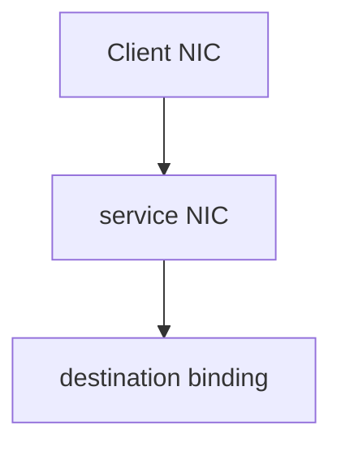

# A02.02 · network interface and NIC

[Phase index](../README.md) · [Foundation] · 25–40 minutes

Prerequisite [A02.01](A02.01.md) · Next [A02.03](A02.03.md)

## 1. The problem & why it exists

A backend listens on loopback and peers in another container cannot connect.

For same-process or same-namespace tests, loopback is sufficient. Bind services to the intended interface and use explicit access controls when expanding reachability.

## 2. Visual mental model



```text
01. Client NIC
02. service NIC
03. destination binding
```

This trace isolates one boundary. For a deployed path, name the observer and capture the actual protocol, timing and configuration separately.

## 3. Step-by-step mechanism & minimal dry-run

An interface is an OS endpoint with addresses, counters, flags and an MTU. A NIC is a device implementing interface operations. Loopback is software. veth pairs join namespaces without physical hardware.

**Dry-run.** Client NIC -> service NIC -> destination binding.

**Failure control.** Predict how the result changes if you reproduce the mistake from section 1. Use the two outputs in section 6 to locate its effect.

## 4. Formal rigor & quantitative math

A model with two interfaces each receiving 500 frames/s for 3 s sees 3000 frames total. Read counters twice and divide the delta by elapsed seconds.

Check the worked quantities with NumPy after running `uv sync --locked --extra math`.

```python
import numpy as np

actual = np.sum([500, 500]) * 3
np.testing.assert_allclose(actual, 3000)
print(actual)
```

## 5. Progressive design

Compare the two paths in the [runnable fixture](../examples/A02.02.py). Running the fixture uses local host interface enumeration plus an address model.

| Path | Output evidence | Resource consideration | Failure to watch |
| --- | --- | --- | --- |
| Failure control | `matches binding: False` | Check whether the broken assumption changes time, bytes or retained state | A backend listens on loopback and peers in another container cannot connect. |
| Normal control | `matches binding: True` | Same task size and local fixture | Apply the measured rule only within its modeled boundary |

## 6. Safe local lab & controlled failure injection

Predict both outputs, then run from the repository root.

```sh
uv run python "01-architecture-A01-to-A20/A02-networking-and-communication/examples/A02.02.py"
uv run python "01-architecture-A01-to-A20/A02-networking-and-communication/examples/A02.02.py" --break
```

**Observe.** Look for `matches binding: True` in the normal output and `matches binding: False` in the failure control.

**Diagnose and repair.** Identify the first incorrect boundary in the broken run. Switch back to the normal run and change the deciding input in a scratch copy. Compare host interface names with L1 container names. Record normal, failure and repaired observations.

**Apply.** Connect the result to [L1](../labs/L1.md). The example exits without starting a persistent service. Remove scratch files after saving the evidence you need.

## 7. Production & multi-cloud bridge

Inspect the interface and listener inside the service namespace before checking a load balancer. Compare interface or routing evidence at the egress boundary in AWS VPC, Azure Virtual Network and Google Cloud VPC. Keep the namespace or network interface explicit.

<details>
<summary>Principal question and answer</summary>

**Question.** What changes when a socket binds 0.0.0.0?

It listens on local IPv4 addresses subject to policy. Inspect the interface and listener inside the service namespace before checking a load balancer.

</details>

## 8. Memory hook & mastery checkpoint

**Recall.** An interface is an OS endpoint with addresses, counters, flags and an MTU. Explain its boundary using the failure control.

1. What changes when a socket binds 0.0.0.0?
2. Is lo a physical NIC?
3. Identify the observable boundary affected by the failing control.
4. Predict the normal output and the broken output before execution.
5. Change the input as directed in section 6. Recompute and justify your prediction.

<details>
<summary>Answers and reasoning</summary>

1. It listens on local IPv4 addresses subject to policy.
2. No.
3. Inspect the interface and listener inside the service namespace before checking a load balancer.
4. Normal `matches binding: True`. Broken `matches binding: False`.
5. Use the relationship from section 4, then run your changed fixture with every other input held constant.

</details>
