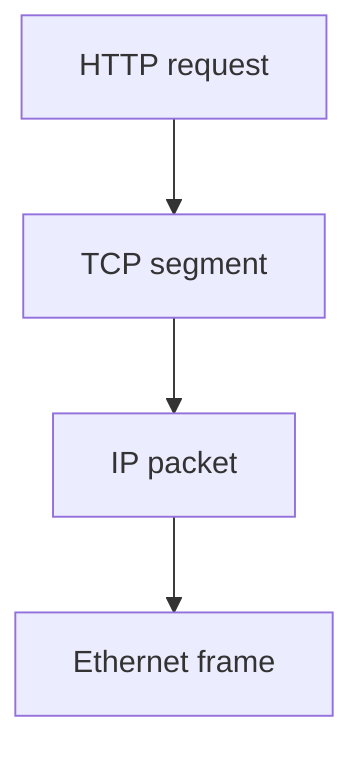

# A02.03 · OSI vs TCP/IP

[Phase index](../README.md) · [Foundation] · 25–40 minutes

Prerequisite [A02.02](A02.02.md) · Next [A02.04](A02.04.md)

## 1. The problem & why it exists

A team blames HTTP for a request that never made a TCP connection.

Probe the lowest boundary with unanswered evidence. Start with an HTTP client for an ordinary health check and split the layers after failure.

## 2. Visual mental model



```text
01. HTTP request
02. TCP segment
03. IP packet
04. Ethernet frame
```

This trace isolates one boundary. For a deployed path, name the observer and capture the actual protocol, timing and configuration separately.

## 3. Step-by-step mechanism & minimal dry-run

Layer models group responsibilities. Ethernet forwards a local frame, IP routes a packet, TCP delivers an ordered byte stream, and HTTP interprets requests. OSI layers 5–7 are typically grouped under application in the TCP/IP model.

**Dry-run.** HTTP request -> TCP segment -> IP packet -> Ethernet frame.

**Failure control.** Predict how the result changes if you reproduce the mistake from section 1. Use the two outputs in section 6 to locate its effect.

## 4. Formal rigor & quantitative math

For 100 B of HTTP data, 20 B base TCP, 20 B base IPv4 and 14 B Ethernet header, the captured untagged frame without FCS is 154 B. Real headers/options can change the total.

Check the worked quantities with NumPy after running `uv sync --locked --extra math`.

```python
import numpy as np

actual = np.sum([100, 20, 20, 14])
np.testing.assert_allclose(actual, 154)
print(actual)
```

## 5. Progressive design

Compare the two paths in the [runnable fixture](../examples/A02.03.py). Running the fixture uses a bounded in-process fixture.

| Path | Output evidence | Resource consideration | Failure to watch |
| --- | --- | --- | --- |
| Failure control | `140 captured` | Check whether the broken assumption changes time, bytes or retained state | A team blames HTTP for a request that never made a TCP connection. |
| Normal control | `154 captured` | Same task size and local fixture | Apply the measured rule only within its modeled boundary |

## 6. Safe local lab & controlled failure injection

Predict both outputs, then run from the repository root.

```sh
uv run python "01-architecture-A01-to-A20/A02-networking-and-communication/examples/A02.03.py"
uv run python "01-architecture-A01-to-A20/A02-networking-and-communication/examples/A02.03.py" --break
```

**Observe.** Look for `154 captured` in the normal output and `140 captured` in the failure control.

**Diagnose and repair.** Identify the first incorrect boundary in the broken run. Switch back to the normal run and change the deciding input in a scratch copy. Add 12 B of TCP options and recompute. Record normal, failure and repaired observations.

**Apply.** Connect the result to [L1](../labs/L1.md). The example exits without starting a persistent service. Remove scratch files after saving the evidence you need.

## 7. Production & multi-cloud bridge

Name the last verified layer from the client and separately for a proxy upstream. Compare interface or routing evidence at the egress boundary in AWS VPC, Azure Virtual Network and Google Cloud VPC. Keep the namespace or network interface explicit.

<details>
<summary>Principal question and answer</summary>

**Question.** Does an HTTP 503 prove a network connection existed?

Yes, to the HTTP hop that emitted it. Name the last verified layer from the client and separately for a proxy upstream.

</details>

## 8. Memory hook & mastery checkpoint

**Recall.** Layer models group responsibilities. Explain its boundary using the failure control.

1. Does an HTTP 503 prove a network connection existed?
2. Does DNS run at the link layer?
3. Identify the observable boundary affected by the failing control.
4. Predict the normal output and the broken output before execution.
5. Change the input as directed in section 6. Recompute and justify your prediction.

<details>
<summary>Answers and reasoning</summary>

1. Yes, to the HTTP hop that emitted it.
2. No, DNS is an application protocol.
3. Name the last verified layer from the client and separately for a proxy upstream.
4. Normal `154 captured`. Broken `140 captured`.
5. Use the relationship from section 4, then run your changed fixture with every other input held constant.

</details>

## Standards and implementation notes

Encapsulation and error attribution are more useful than memorizing a one-to-one layer mapping. A reverse proxy can terminate several protocol layers and originate its own errors.

- [RFC 1122 · Internet host communication layers](https://www.rfc-editor.org/rfc/rfc1122.html)
- [RFC 9110 · HTTP semantics](https://www.rfc-editor.org/rfc/rfc9110.html)
