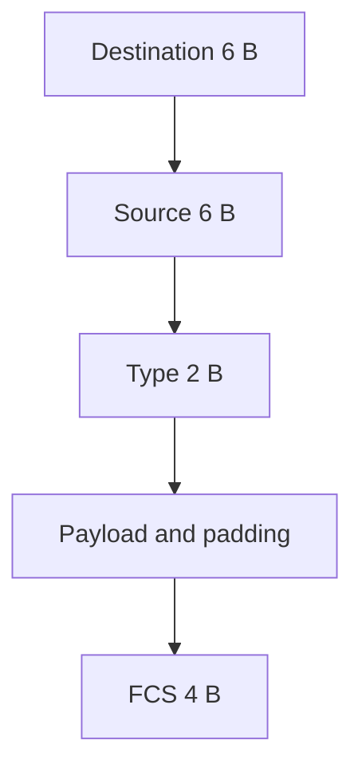

# A02.04 · Ethernet frames

[Phase index](../README.md) · [Foundation] · 25–40 minutes

Prerequisite [A02.03](A02.03.md) · Next [A02.05](A02.05.md)

## 1. The problem & why it exists

A capture shows 60 bytes where a hand calculation expects 64.

Decode EtherType before parsing payload. A raw packet capture needs its link type checked because Linux cooked capture differs from Ethernet II.

## 2. Visual mental model



```text
01. Destination 6 B
02. Source 6 B
03. Type 2 B
04. Payload and padding
05. FCS 4 B
```

This trace isolates one boundary. For a deployed path, name the observer and capture the actual protocol, timing and configuration separately.

## 3. Step-by-step mechanism & minimal dry-run

Ethernet II puts destination and source MACs first, then EtherType and payload. Padding meets minimum frame size. Capture adapters often omit the FCS, and VLAN tags can alter header length.

**Dry-run.** Destination 6 B -> Source 6 B -> Type 2 B -> Payload and padding -> FCS 4 B.

**Failure control.** Predict how the result changes if you reproduce the mistake from section 1. Use the two outputs in section 6 to locate its effect.

## 4. Formal rigor & quantitative math

For 30 payload bytes in an untagged frame, pad to 46 B. The frame is 14+46+4=64 B with FCS, 60 without. Preamble and inter-frame gap are outside this frame count.

Check the worked quantities with NumPy after running `uv sync --locked --extra math`.

```python
import numpy as np

actual = 14 + np.maximum(30, 46) + 4
np.testing.assert_allclose(actual, 64)
print(actual)
```

## 5. Progressive design

Compare the two paths in the [runnable fixture](../examples/A02.04.py). Running the fixture uses a bounded in-process fixture.

| Path | Output evidence | Resource consideration | Failure to watch |
| --- | --- | --- | --- |
| Failure control | `bytes: 44` | Check whether the broken assumption changes time, bytes or retained state | A capture shows 60 bytes where a hand calculation expects 64. |
| Normal control | `bytes: 60` | Same task size and local fixture | Apply the measured rule only within its modeled boundary |

## 6. Safe local lab & controlled failure injection

Predict both outputs, then run from the repository root.

```sh
uv run python "01-architecture-A01-to-A20/A02-networking-and-communication/examples/A02.04.py"
uv run python "01-architecture-A01-to-A20/A02-networking-and-communication/examples/A02.04.py" --break
```

**Observe.** Look for `bytes: 60` in the normal output and `bytes: 44` in the failure control.

**Diagnose and repair.** Identify the first incorrect boundary in the broken run. Switch back to the normal run and change the deciding input in a scratch copy. Try a 45 B payload, then 46 B. Record normal, failure and repaired observations.

**Apply.** Connect the result to [L1](../labs/L1.md). The example exits without starting a persistent service. Remove scratch files after saving the evidence you need.

## 7. Production & multi-cloud bridge

Keep capture link type, VLAN settings and FCS visibility with the trace. Compare interface or routing evidence at the egress boundary in AWS VPC, Azure Virtual Network and Google Cloud VPC. Keep the namespace or network interface explicit.

<details>
<summary>Principal question and answer</summary>

**Question.** What EtherType indicates IPv4?

0x0800. Keep capture link type, VLAN settings and FCS visibility with the trace.

</details>

## 8. Memory hook & mastery checkpoint

**Recall.** Ethernet II puts destination and source MACs first, then EtherType and payload. Explain its boundary using the failure control.

1. What EtherType indicates IPv4?
2. How many padding bytes for a 45 B payload?
3. Identify the observable boundary affected by the failing control.
4. Predict the normal output and the broken output before execution.
5. Change the input as directed in section 6. Recompute and justify your prediction.

<details>
<summary>Answers and reasoning</summary>

1. 0x0800.
2. One.
3. Keep capture link type, VLAN settings and FCS visibility with the trace.
4. Normal `bytes: 60`. Broken `bytes: 44`.
5. Use the relationship from section 4, then run your changed fixture with every other input held constant.

</details>
