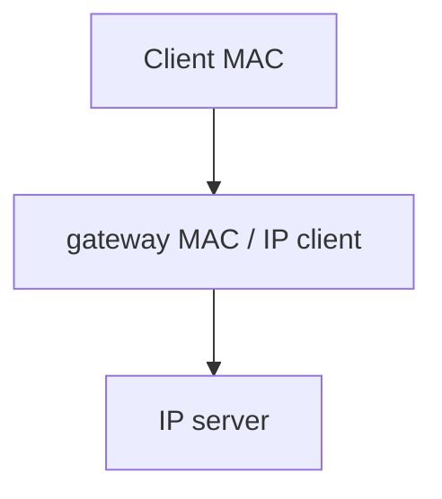

# A02.05 · MAC vs IP

[Phase index](../README.md) · [Foundation] · 25–40 minutes

Prerequisite [A02.04](A02.04.md) · Next [A02.06](A02.06.md)

## 1. The problem & why it exists

The destination MAC in a server-bound packet belongs to the gateway.

Use the route to decide which neighbor to resolve. Resolving a remote server's MAC from the client subnet is generally the wrong lookup.

## 2. Visual mental model



```text
01. Client MAC
02. gateway MAC / IP client
03. IP server
```

This trace isolates one boundary. For a deployed path, name the observer and capture the actual protocol, timing and configuration separately.

## 3. Step-by-step mechanism & minimal dry-run

IP identifies the network-layer destination while a link address identifies the next hop on this link. A router strips the incoming frame, decrements TTL and constructs a new outgoing link header.

**Dry-run.** Client MAC -> gateway MAC / IP client -> IP server.

**Failure control.** Predict how the result changes if you reproduce the mistake from section 1. Use the two outputs in section 6 to locate its effect.

## 4. Formal rigor & quantitative math

With k routed links and no tunnels, one IP packet is carried in k link-layer transmissions, ignoring retries. On two Ethernet links, two destination MAC choices are made.

Check the worked quantities with NumPy after running `uv sync --locked --extra math`.

```python
import numpy as np

actual = np.size(["gateway", "server"])
np.testing.assert_allclose(actual, 2)
print(actual)
```

## 5. Progressive design

Compare the two paths in the [runnable fixture](../examples/A02.05.py). Running the fixture uses a bounded in-process fixture.

| Path | Output evidence | Resource consideration | Failure to watch |
| --- | --- | --- | --- |
| Failure control | `link destination: None` | Check whether the broken assumption changes time, bytes or retained state | The destination MAC in a server-bound packet belongs to the gateway. |
| Normal control | `02:00:00:00:00:01` | Same task size and local fixture | Apply the measured rule only within its modeled boundary |

## 6. Safe local lab & controlled failure injection

Predict both outputs, then run from the repository root.

```sh
uv run python "01-architecture-A01-to-A20/A02-networking-and-communication/examples/A02.05.py"
uv run python "01-architecture-A01-to-A20/A02-networking-and-communication/examples/A02.05.py" --break
```

**Observe.** Look for `02:00:00:00:00:01` in the normal output and `link destination: None` in the failure control.

**Diagnose and repair.** Identify the first incorrect boundary in the broken run. Switch back to the normal run and change the deciding input in a scratch copy. Add an on-link destination to the neighbor table. Record normal, failure and repaired observations.

**Apply.** Connect the result to [L1](../labs/L1.md). The example exits without starting a persistent service. Remove scratch files after saving the evidence you need.

## 7. Production & multi-cloud bridge

Check routes and neighbor state where the actual egress occurs. Compare interface or routing evidence at the egress boundary in AWS VPC, Azure Virtual Network and Google Cloud VPC. Keep the namespace or network interface explicit.

<details>
<summary>Principal question and answer</summary>

**Question.** Which IP belongs in a normal packet sent to a remote server?

The server IP, unless translation or tunneling changes the observed packet. Check routes and neighbor state where the actual egress occurs.

</details>

## 8. Memory hook & mastery checkpoint

**Recall.** IP identifies the network-layer destination while a link address identifies the next hop on this link. Explain its boundary using the failure control.

1. Which IP belongs in a normal packet sent to a remote server?
2. Which MAC is resolved on the first link?
3. Identify the observable boundary affected by the failing control.
4. Predict the normal output and the broken output before execution.
5. Change the input as directed in section 6. Recompute and justify your prediction.

<details>
<summary>Answers and reasoning</summary>

1. The server IP, unless translation or tunneling changes the observed packet.
2. The next hop's link address.
3. Check routes and neighbor state where the actual egress occurs.
4. Normal `02:00:00:00:00:01`. Broken `link destination: None`.
5. Use the relationship from section 4, then run your changed fixture with every other input held constant.

</details>
