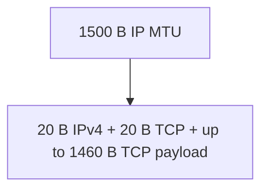

# A02.06 · packets and MTU

[Phase index](../README.md) · [Foundation] · 25–40 minutes

Prerequisite [A02.05](A02.05.md) · Next [A02.07](A02.07.md)

## 1. The problem & why it exists

Tiny requests succeed through a tunnel while larger responses stall.

Measure size-dependent failure before changing settings. For a fixed local protocol, a conservative datagram bound costs efficiency but avoids fragmentation dependence.

## 2. Visual mental model



```text
01. 1500 B IP MTU
02. 20 B IPv4 + 20 B TCP + up to 1460 B TCP payload
```

This trace isolates one boundary. For a deployed path, name the observer and capture the actual protocol, timing and configuration separately.

## 3. Step-by-step mechanism & minimal dry-run

MTU limits layer-3 packet size on a link. TCP MSS is a payload bound for a segment. IPv4 and IPv6 differ on router fragmentation. Path MTU discovery needs usable feedback or packetization-layer probing.

**Dry-run.** 1500 B IP MTU -> 20 B IPv4 + 20 B TCP + up to 1460 B TCP payload.

**Failure control.** Predict how the result changes if you reproduce the mistake from section 1. Use the two outputs in section 6 to locate its effect.

## 4. Formal rigor & quantitative math

A tunnel with 80 B overhead inside a 1500 B outer IP limit leaves 1420 B inner MTU. With base IPv4/TCP headers, the inner payload bound is 1380 B.

Check the worked quantities with NumPy after running `uv sync --locked --extra math`.

```python
import numpy as np

actual = np.subtract(1500, 80 + 20 + 20)
np.testing.assert_allclose(actual, 1380)
print(actual)
```

## 5. Progressive design

Compare the two paths in the [runnable fixture](../examples/A02.06.py). Running the fixture uses a bounded in-process fixture.

| Path | Output evidence | Resource consideration | Failure to watch |
| --- | --- | --- | --- |
| Failure control | `1460 fits: False` | Check whether the broken assumption changes time, bytes or retained state | Tiny requests succeed through a tunnel while larger responses stall. |
| Normal control | `1380 fits: True` | Same task size and local fixture | Apply the measured rule only within its modeled boundary |

## 6. Safe local lab & controlled failure injection

Predict both outputs, then run from the repository root.

```sh
uv run python "01-architecture-A01-to-A20/A02-networking-and-communication/examples/A02.06.py"
uv run python "01-architecture-A01-to-A20/A02-networking-and-communication/examples/A02.06.py" --break
```

**Observe.** Look for `1380 fits: True` in the normal output and `1460 fits: False` in the failure control.

**Diagnose and repair.** Identify the first incorrect boundary in the broken run. Switch back to the normal run and change the deciding input in a scratch copy. Increase outer overhead to 100 B and recompute. Record normal, failure and repaired observations.

**Apply.** Connect the result to [L1](../labs/L1.md). The example exits without starting a persistent service. Remove scratch files after saving the evidence you need.

## 7. Production & multi-cloud bridge

Test a size ladder through any tunnel or overlay before blaming application throughput. Compare interface or routing evidence at the egress boundary in AWS VPC, Azure Virtual Network and Google Cloud VPC. Keep the namespace or network interface explicit.

<details>
<summary>Principal question and answer</summary>

**Question.** Does an MTU of 1500 include the Ethernet header?

No, in the IP MTU convention used here. Test a size ladder through any tunnel or overlay before blaming application throughput.

</details>

## 8. Memory hook & mastery checkpoint

**Recall.** MTU limits layer-3 packet size on a link. Explain its boundary using the failure control.

1. Does an MTU of 1500 include the Ethernet header?
2. What payload is available at 1280 B IPv6 MTU with base IPv6/TCP headers?
3. Identify the observable boundary affected by the failing control.
4. Predict the normal output and the broken output before execution.
5. Change the input as directed in section 6. Recompute and justify your prediction.

<details>
<summary>Answers and reasoning</summary>

1. No, in the IP MTU convention used here.
2. 1220 B.
3. Test a size ladder through any tunnel or overlay before blaming application throughput.
4. Normal `1380 fits: True`. Broken `1460 fits: False`.
5. Use the relationship from section 4, then run your changed fixture with every other input held constant.

</details>

## Standards and implementation notes

IPv4 PMTUD uses the Don't Fragment bit and suitable ICMP feedback. IPv6 routers do not fragment packets. Packetization-layer discovery can use probes when control messages are unavailable.

- [RFC 1191 · IPv4 path MTU discovery](https://www.rfc-editor.org/rfc/rfc1191.txt)
- [RFC 8201 · IPv6 path MTU discovery](https://www.rfc-editor.org/rfc/rfc8201.html)
- [RFC 8899 · Datagram PLPMTUD](https://www.rfc-editor.org/rfc/rfc8899.html)
