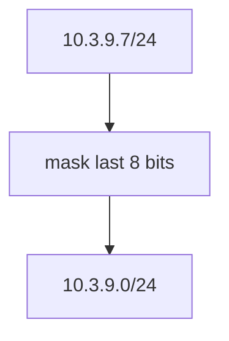

# A02.07 · IP addresses and CIDR

[Phase index](../README.md) · [Foundation] · 25–40 minutes

Prerequisite [A02.06](A02.06.md) · Next [A02.08](A02.08.md)

## 1. The problem & why it exists

A route configured as 10.3.9.7/24 silently represents a different network than expected.

Use a strict parser for route declarations and an interface-address parser for hosts with prefixes.

## 2. Visual mental model



```text
01. 10.3.9.7/24
02. mask last 8 bits
03. 10.3.9.0/24
```

This trace isolates one boundary. For a deployed path, name the observer and capture the actual protocol, timing and configuration separately.

## 3. Step-by-step mechanism & minimal dry-run

A prefix of /p fixes the p leading bits. The remaining address bits select members of that prefix. A route should normally use the canonical network address.

**Dry-run.** 10.3.9.7/24 -> mask last 8 bits -> 10.3.9.0/24.

**Failure control.** Predict how the result changes if you reproduce the mistake from section 1. Use the two outputs in section 6 to locate its effect.

## 4. Formal rigor & quantitative math

IPv4 /24 has 2^(32−24)=256 addresses. Classic broadcast subnets often have 254 assignable host addresses. /31 point-to-point and /32 host routes differ.

Check the worked quantities with NumPy after running `uv sync --locked --extra math`.

```python
import numpy as np

actual = np.left_shift(1, 32 - 24)
np.testing.assert_allclose(actual, 256)
print(actual)
```

## 5. Progressive design

Compare the two paths in the [runnable fixture](../examples/A02.07.py). Running the fixture uses a bounded in-process fixture.

| Path | Output evidence | Resource consideration | Failure to watch |
| --- | --- | --- | --- |
| Failure control | `host bits set` | Check whether the broken assumption changes time, bytes or retained state | A route configured as 10.3.9.7/24 silently represents a different network than expected. |
| Normal control | `addresses: 256` | Same task size and local fixture | Apply the measured rule only within its modeled boundary |

## 6. Safe local lab & controlled failure injection

Predict both outputs, then run from the repository root.

```sh
uv run python "01-architecture-A01-to-A20/A02-networking-and-communication/examples/A02.07.py"
uv run python "01-architecture-A01-to-A20/A02-networking-and-communication/examples/A02.07.py" --break
```

**Observe.** Look for `addresses: 256` in the normal output and `host bits set` in the failure control.

**Diagnose and repair.** Identify the first incorrect boundary in the broken run. Switch back to the normal run and change the deciding input in a scratch copy. Try /31 and /32. Record normal, failure and repaired observations.

**Apply.** Connect the result to [L1](../labs/L1.md). The example exits without starting a persistent service. Remove scratch files after saving the evidence you need.

## 7. Production & multi-cloud bridge

Keep infrastructure prefix validation separate from service-access policy. Compare interface or routing evidence at the egress boundary in AWS VPC, Azure Virtual Network and Google Cloud VPC. Keep the namespace or network interface explicit.

<details>
<summary>Principal question and answer</summary>

**Question.** Does 10.3.10.1 belong to 10.3.9.0/24?

No. Keep infrastructure prefix validation separate from service-access policy.

</details>

## 8. Memory hook & mastery checkpoint

**Recall.** A prefix of /p fixes the p leading bits. Explain its boundary using the failure control.

1. Does 10.3.10.1 belong to 10.3.9.0/24?
2. How many addresses are in an IPv6 /64?
3. Identify the observable boundary affected by the failing control.
4. Predict the normal output and the broken output before execution.
5. Change the input as directed in section 6. Recompute and justify your prediction.

<details>
<summary>Answers and reasoning</summary>

1. No.
2. 2^64.
3. Keep infrastructure prefix validation separate from service-access policy.
4. Normal `addresses: 256`. Broken `host bits set`.
5. Use the relationship from section 4, then run your changed fixture with every other input held constant.

</details>

## Standards and implementation notes

Prefix size counts addresses before subnet-specific reservations. Cloud providers can reserve additional addresses. Network and interface parsers have distinct uses.

- [RFC 4632 · CIDR](https://www.rfc-editor.org/rfc/rfc4632.html)
- [AWS VPC route tables](https://docs.aws.amazon.com/vpc/latest/userguide/VPC_Route_Tables.html)
- [Azure virtual network routing](https://learn.microsoft.com/en-us/azure/virtual-network/virtual-networks-udr-overview)
- [Google Cloud VPC routes](https://cloud.google.com/vpc/docs/routes)
