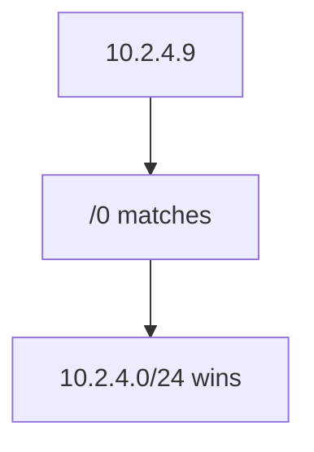

# A02.08 · subnets and routing

[Phase index](../README.md) · [Foundation] · 25–40 minutes

Prerequisite [A02.07](A02.07.md) · Next [A02.09](A02.09.md)

## 1. The problem & why it exists

Traffic takes a private peer instead of the default egress gateway.

Use a default only as a fallback. Inspect the effective route rather than checking existence of any matching entry.

## 2. Visual mental model



```text
01. 10.2.4.9
02. /0 matches
03. 10.2.4.0/24 wins
```

This trace isolates one boundary. For a deployed path, name the observer and capture the actual protocol, timing and configuration separately.

## 3. Step-by-step mechanism & minimal dry-run

Forwarding typically chooses the longest matching prefix in the selected routing table. Policy rules can select that table before lookup. Equal-length candidates require policy, metrics or multipath behavior.

**Dry-run.** 10.2.4.9 -> /0 matches -> 10.2.4.0/24 wins.

**Failure control.** Predict how the result changes if you reproduce the mistake from section 1. Use the two outputs in section 6 to locate its effect.

## 4. Formal rigor & quantitative math

For 10.2.4.9, /24 matches 24 bits and beats a matching /16 and /0. A simple scan of n routes uses O(n) comparisons; prefix data structures avoid a full scan.

Check the worked quantities with NumPy after running `uv sync --locked --extra math`.

```python
import numpy as np

actual = np.max([0, 16, 24])
np.testing.assert_allclose(actual, 24)
print(actual)
```

## 5. Progressive design

Compare the two paths in the [runnable fixture](../examples/A02.08.py). Running the fixture uses a bounded in-process fixture.

| Path | Output evidence | Resource consideration | Failure to watch |
| --- | --- | --- | --- |
| Failure control | `next hop: default` | Check whether the broken assumption changes time, bytes or retained state | Traffic takes a private peer instead of the default egress gateway. |
| Normal control | `next hop: peer` | Same task size and local fixture | Apply the measured rule only within its modeled boundary |

## 6. Safe local lab & controlled failure injection

Predict both outputs, then run from the repository root.

```sh
uv run python "01-architecture-A01-to-A20/A02-networking-and-communication/examples/A02.08.py"
uv run python "01-architecture-A01-to-A20/A02-networking-and-communication/examples/A02.08.py" --break
```

**Observe.** Look for `next hop: peer` in the normal output and `next hop: default` in the failure control.

**Diagnose and repair.** Identify the first incorrect boundary in the broken run. Switch back to the normal run and change the deciding input in a scratch copy. Add a matching host route /32. Record normal, failure and repaired observations.

**Apply.** Connect the result to [L1](../labs/L1.md). The example exits without starting a persistent service. Remove scratch files after saving the evidence you need.

## 7. Production & multi-cloud bridge

Check the return route too when one direction connects but replies vanish. Compare interface or routing evidence at the egress boundary in AWS VPC, Azure Virtual Network and Google Cloud VPC. Keep the namespace or network interface explicit.

<details>
<summary>Principal question and answer</summary>

**Question.** Will 10.2.5.1 match 10.2.4.0/24?

No. Check the return route too when one direction connects but replies vanish.

</details>

## 8. Memory hook & mastery checkpoint

**Recall.** Forwarding typically chooses the longest matching prefix in the selected routing table. Explain its boundary using the failure control.

1. Will 10.2.5.1 match 10.2.4.0/24?
2. What precedes lookup on systems with policy routing?
3. Identify the observable boundary affected by the failing control.
4. Predict the normal output and the broken output before execution.
5. Change the input as directed in section 6. Recompute and justify your prediction.

<details>
<summary>Answers and reasoning</summary>

1. No.
2. Choosing the routing table under the applicable policy.
3. Check the return route too when one direction connects but replies vanish.
4. Normal `next hop: peer`. Broken `next hop: default`.
5. Use the relationship from section 4, then run your changed fixture with every other input held constant.

</details>
