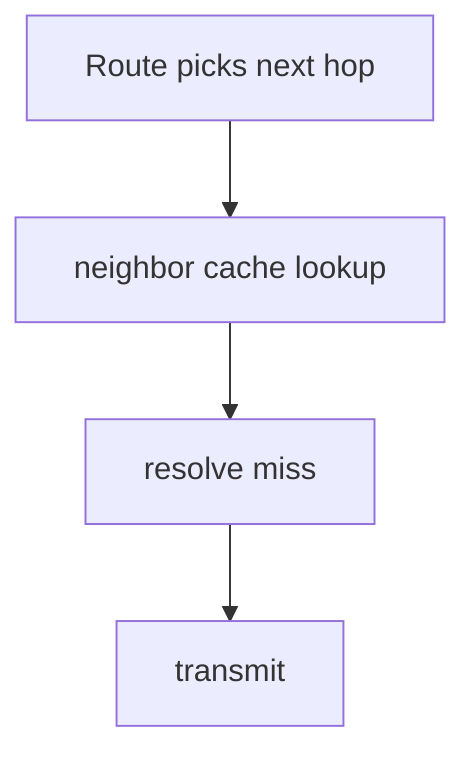

# A02.09 · ARP/neighbor discovery

[Phase index](../README.md) · [Foundation] · 25–40 minutes

Prerequisite [A02.08](A02.08.md) · Next [A02.10](A02.10.md)

## 1. The problem & why it exists

Local delivery fails after a gateway interface is replaced.

Use the kernel's neighbor state. Static entries need lifecycle coordination and are rarely necessary for ordinary hosts.

## 2. Visual mental model



```text
01. Route picks next hop
02. neighbor cache lookup
03. resolve miss
04. transmit
```

This trace isolates one boundary. For a deployed path, name the observer and capture the actual protocol, timing and configuration separately.

## 3. Step-by-step mechanism & minimal dry-run

IPv4 ARP resolves local neighbor IP addresses to link addresses. IPv6 Neighbor Discovery uses ICMPv6 messages and solicited-node multicast. Neighbor caches reduce repeated resolution and have reachability state.

**Dry-run.** Route picks next hop -> neighbor cache lookup -> resolve miss -> transmit.

**Failure control.** Predict how the result changes if you reproduce the mistake from section 1. Use the two outputs in section 6 to locate its effect.

## 4. Formal rigor & quantitative math

At 100 packets/s for 30 s, all toward one healthy neighbor, 3000 sends can share a resolved entry until refresh. A naive resolution before every packet costs 3000 queries in that model.

Check the worked quantities with NumPy after running `uv sync --locked --extra math`.

```python
import numpy as np

actual = 100 * np.array(30)
np.testing.assert_allclose(actual, 3000)
print(actual)
```

## 5. Progressive design

Compare the two paths in the [runnable fixture](../examples/A02.09.py). Running the fixture uses a bounded in-process fixture.

| Path | Output evidence | Resource consideration | Failure to watch |
| --- | --- | --- | --- |
| Failure control | `gateway: False` | Check whether the broken assumption changes time, bytes or retained state | Local delivery fails after a gateway interface is replaced. |
| Normal control | `gateway: True` | Same task size and local fixture | Apply the measured rule only within its modeled boundary |

## 6. Safe local lab & controlled failure injection

Predict both outputs, then run from the repository root.

```sh
uv run python "01-architecture-A01-to-A20/A02-networking-and-communication/examples/A02.09.py"
uv run python "01-architecture-A01-to-A20/A02-networking-and-communication/examples/A02.09.py" --break
```

**Observe.** Look for `gateway: True` in the normal output and `gateway: False` in the failure control.

**Diagnose and repair.** Identify the first incorrect boundary in the broken run. Switch back to the normal run and change the deciding input in a scratch copy. Start with an empty neighbor cache. Record normal, failure and repaired observations.

**Apply.** Connect the result to [L1](../labs/L1.md). The example exits without starting a persistent service. Remove scratch files after saving the evidence you need.

## 7. Production & multi-cloud bridge

Inspect neighbor state at the actual next-hop boundary and correlate failed transitions. Compare interface or routing evidence at the egress boundary in AWS VPC, Azure Virtual Network and Google Cloud VPC. Keep the namespace or network interface explicit.

<details>
<summary>Principal question and answer</summary>

**Question.** Does ARP cross routers to find a remote host?

No. Inspect neighbor state at the actual next-hop boundary and correlate failed transitions.

</details>

## 8. Memory hook & mastery checkpoint

**Recall.** IPv4 ARP resolves local neighbor IP addresses to link addresses. Explain its boundary using the failure control.

1. Does ARP cross routers to find a remote host?
2. Is IPv6 ND just the same ARP wire protocol?
3. Identify the observable boundary affected by the failing control.
4. Predict the normal output and the broken output before execution.
5. Change the input as directed in section 6. Recompute and justify your prediction.

<details>
<summary>Answers and reasoning</summary>

1. No.
2. No.
3. Inspect neighbor state at the actual next-hop boundary and correlate failed transitions.
4. Normal `gateway: True`. Broken `gateway: False`.
5. Use the relationship from section 4, then run your changed fixture with every other input held constant.

</details>

## Standards and implementation notes

Address resolution and reachability checks differ. IPv6 ND also includes router discovery and reachability state. A stale neighbor entry differs from a DNS cache.

- [RFC 826 · ARP](https://www.rfc-editor.org/rfc/rfc826.html)
- [RFC 4861 · IPv6 Neighbor Discovery](https://www.rfc-editor.org/rfc/rfc4861.html)
