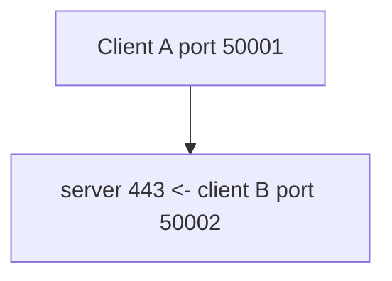

# A02.10 · ports and sockets

[Phase index](../README.md) · [Foundation] · 25–40 minutes

Prerequisite [A02.09](A02.09.md) · Next [A02.11](A02.11.md)

## 1. The problem & why it exists

Two connections share one server port but deliver bytes to different clients.

A single listener is enough to accept many connections. Bound the number of active sockets before increasing descriptor limits.

## 2. Visual mental model



```text
01. Client A port 50001
02. server 443 <- client B port 50002
```

This trace isolates one boundary. For a deployed path, name the observer and capture the actual protocol, timing and configuration separately.

## 3. Step-by-step mechanism & minimal dry-run

A listener binds protocol, local address and port. Accepted TCP connections have local and remote address/port pairs. UDP endpoint behavior differs and may use connected or unconnected sockets.

**Dry-run.** Client A port 50001 -> server 443 <- client B port 50002.

**Failure control.** Predict how the result changes if you reproduce the mistake from section 1. Use the two outputs in section 6 to locate its effect.

## 4. Formal rigor & quantitative math

Two clients using distinct source ports have two distinct TCP tuples even with one destination address and port. Each accepted application socket typically uses one FD.

Check the worked quantities with NumPy after running `uv sync --locked --extra math`.

```python
import numpy as np

actual = np.unique([50001, 50002]).size
np.testing.assert_allclose(actual, 2)
print(actual)
```

## 5. Progressive design

Compare the two paths in the [runnable fixture](../examples/A02.10.py). Running the fixture uses real loopback sockets.

| Path | Output evidence | Resource consideration | Failure to watch |
| --- | --- | --- | --- |
| Failure control | `connections: 1` | Check whether the broken assumption changes time, bytes or retained state | Two connections share one server port but deliver bytes to different clients. |
| Normal control | `connections: 2` | Same task size and local fixture | Apply the measured rule only within its modeled boundary |

## 6. Safe local lab & controlled failure injection

Predict both outputs, then run from the repository root.

```sh
uv run python "01-architecture-A01-to-A20/A02-networking-and-communication/examples/A02.10.py"
uv run python "01-architecture-A01-to-A20/A02-networking-and-communication/examples/A02.10.py" --break
```

**Observe.** Look for `connections: 2` in the normal output and `connections: 1` in the failure control.

**Diagnose and repair.** Identify the first incorrect boundary in the broken run. Switch back to the normal run and change the deciding input in a scratch copy. Log both endpoints for each accepted socket. Record normal, failure and repaired observations.

**Apply.** Connect the result to [L1](../labs/L1.md). The example exits without starting a persistent service. Remove scratch files after saving the evidence you need.

## 7. Production & multi-cloud bridge

Track listener versus active connection count and the source of each limit. When comparing managed services on AWS, Azure and Google Cloud, keep DNS, transport, TLS and upstream timing separate and check the actual supported settings.

<details>
<summary>Principal question and answer</summary>

**Question.** Does closing an accepted socket close the listening socket?

No. Track listener versus active connection count and the source of each limit.

</details>

## 8. Memory hook & mastery checkpoint

**Recall.** A listener binds protocol, local address and port. Explain its boundary using the failure control.

1. Does closing an accepted socket close the listening socket?
2. Can TCP port 53 and UDP port 53 coexist?
3. Identify the observable boundary affected by the failing control.
4. Predict the normal output and the broken output before execution.
5. Change the input as directed in section 6. Recompute and justify your prediction.

<details>
<summary>Answers and reasoning</summary>

1. No.
2. Yes, they are different transports.
3. Track listener versus active connection count and the source of each limit.
4. Normal `connections: 2`. Broken `connections: 1`.
5. Use the relationship from section 4, then run your changed fixture with every other input held constant.

</details>

## Standards and implementation notes

A TCP listener and its accepted sockets have different roles. Keep each endpoint's tuple and resource ownership visible when classifying failures.

- [RFC 9293 · TCP](https://www.rfc-editor.org/rfc/rfc9293.html)
- [Python socket](https://docs.python.org/3/library/socket.html)
