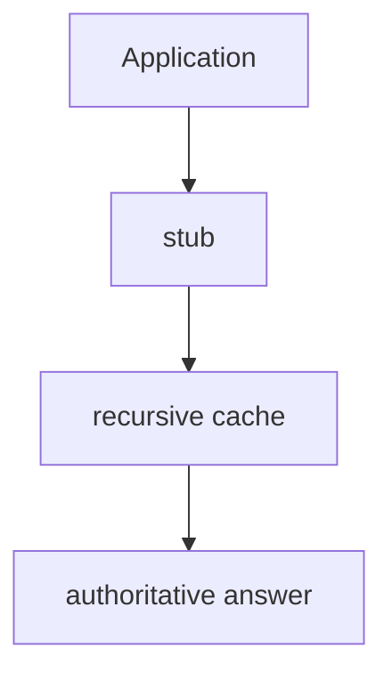

# A02.11 · DNS resolution and caching

[Phase index](../README.md) · [Core] · 25–40 minutes

Prerequisite [A02.10](A02.10.md) · Next [A02.12](A02.12.md)

## 1. The problem & why it exists

A service changes its address but clients keep reaching the old backend.

Use cached DNS for ordinary discovery. For a migration, account for multiple layers of caching and existing connections.

## 2. Visual mental model



```text
01. Application
02. stub
03. recursive cache
04. authoritative answer
```

This trace isolates one boundary. For a deployed path, name the observer and capture the actual protocol, timing and configuration separately.

## 3. Step-by-step mechanism & minimal dry-run

A stub often delegates to a recursive resolver. The recursive resolver queries authoritative data and caches records for their TTL, subject to policy. Application caches can add another residence time.

**Dry-run.** Application -> stub -> recursive cache -> authoritative answer.

**Failure control.** Predict how the result changes if you reproduce the mistake from section 1. Use the two outputs in section 6 to locate its effect.

## 4. Formal rigor & quantitative math

Given a cached answer at t=0 with TTL 30, a lookup at t=29 can use it; t=30 requires refresh in an exact-expiry model. Repeated lookups before expiry reduce upstream load.

Check the worked quantities with NumPy after running `uv sync --locked --extra math`.

```python
import numpy as np

actual = np.less([29, 30], 30)
np.testing.assert_allclose(actual, [True, False])
print(actual)
```

## 5. Progressive design

Compare the two paths in the [runnable fixture](../examples/A02.11.py). Running the fixture uses a bounded in-process fixture.

| Path | Output evidence | Resource consideration | Failure to watch |
| --- | --- | --- | --- |
| Failure control | `192.0.2.2` | Check whether the broken assumption changes time, bytes or retained state | A service changes its address but clients keep reaching the old backend. |
| Normal control | `192.0.2.3` | Same task size and local fixture | Apply the measured rule only within its modeled boundary |

## 6. Safe local lab & controlled failure injection

Predict both outputs, then run from the repository root.

```sh
uv run python "01-architecture-A01-to-A20/A02-networking-and-communication/examples/A02.11.py"
uv run python "01-architecture-A01-to-A20/A02-networking-and-communication/examples/A02.11.py" --break
```

**Observe.** Look for `192.0.2.3` in the normal output and `192.0.2.2` in the failure control.

**Diagnose and repair.** Identify the first incorrect boundary in the broken run. Switch back to the normal run and change the deciding input in a scratch copy. Run at t=29 then t=31. Record normal, failure and repaired observations.

**Apply.** Connect the result to [L1](../labs/L1.md). The example exits without starting a persistent service. Remove scratch files after saving the evidence you need.

## 7. Production & multi-cloud bridge

Log resolution time and selected address separately from connection behavior. When comparing managed services on AWS, Azure and Google Cloud, keep DNS, transport, TLS and upstream timing separate and check the actual supported settings.

<details>
<summary>Principal question and answer</summary>

**Question.** Does negative caching exist?

Yes, with rules distinct from positive answers. Log resolution time and selected address separately from connection behavior.

</details>

## 8. Memory hook & mastery checkpoint

**Recall.** A stub often delegates to a recursive resolver. Explain its boundary using the failure control.

1. Does negative caching exist?
2. Does TTL expiry close a live TCP socket?
3. Identify the observable boundary affected by the failing control.
4. Predict the normal output and the broken output before execution.
5. Change the input as directed in section 6. Recompute and justify your prediction.

<details>
<summary>Answers and reasoning</summary>

1. Yes, with rules distinct from positive answers.
2. No.
3. Log resolution time and selected address separately from connection behavior.
4. Normal `192.0.2.3`. Broken `192.0.2.2`.
5. Use the relationship from section 4, then run your changed fixture with every other input held constant.

</details>

## Standards and implementation notes

Track the authoritative answer, resolver expiration, client-level cache and existing socket lifetime independently. DNS also supports TCP; a UDP-only test covers one path.

- [RFC 1034 · DNS concepts](https://www.rfc-editor.org/rfc/rfc1034.html)
- [RFC 2308 · Negative caching](https://www.rfc-editor.org/rfc/rfc2308.html)
- [RFC 7766 · DNS over TCP](https://www.rfc-editor.org/rfc/rfc7766.html)
- [RFC 9520 · Negative caching of DNS resolution failures](https://www.rfc-editor.org/rfc/rfc9520.html)
