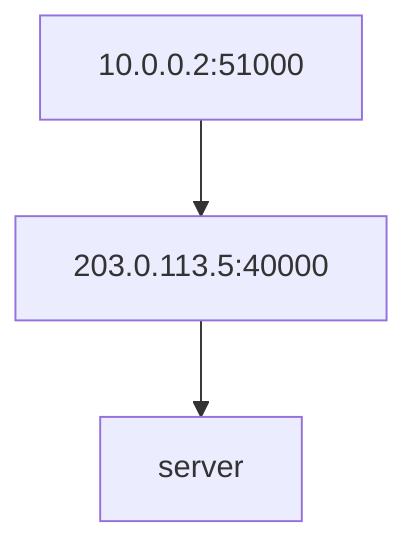

# A02.12 · NAT and PAT

[Phase index](../README.md) · [Core] · 25–40 minutes

Prerequisite [A02.11](A02.11.md) · Next [A02.13](A02.13.md)

## 1. The problem & why it exists

Two private clients use the same source port through one public egress address.

Avoid NAT when direct private routing meets policy. For egress NAT, count gateway mapping capacity independently of local FD capacity.

## 2. Visual mental model



```text
01. 10.0.0.2:51000
02. 203.0.113.5:40000
03. server
```

This trace isolates one boundary. For a deployed path, name the observer and capture the actual protocol, timing and configuration separately.

## 3. Step-by-step mechanism & minimal dry-run

A NAT gateway rewrites selected IP addresses; PAT can also rewrite ports to distinguish flows. Reverse mapping needs enough tuple context and state lifetime.

**Dry-run.** 10.0.0.2:51000 -> 203.0.113.5:40000 -> server.

**Failure control.** Predict how the result changes if you reproduce the mistake from section 1. Use the two outputs in section 6 to locate its effect.

## 4. Formal rigor & quantitative math

In a simplified gateway with one public IP and 1000 usable external ports for one destination, at most 1000 simultaneous mappings fit that allocation. Real sharing rules vary by endpoint filtering and mapping strategy.

Check the worked quantities with NumPy after running `uv sync --locked --extra math`.

```python
import numpy as np

actual = np.arange(40000, 41000).size
np.testing.assert_allclose(actual, 1000)
print(actual)
```

## 5. Progressive design

Compare the two paths in the [runnable fixture](../examples/A02.12.py). Running the fixture uses a bounded in-process fixture.

| Path | Output evidence | Resource consideration | Failure to watch |
| --- | --- | --- | --- |
| Failure control | `mappings: 1` | Check whether the broken assumption changes time, bytes or retained state | Two private clients use the same source port through one public egress address. |
| Normal control | `mappings: 2` | Same task size and local fixture | Apply the measured rule only within its modeled boundary |

## 6. Safe local lab & controlled failure injection

Predict both outputs, then run from the repository root.

```sh
uv run python "01-architecture-A01-to-A20/A02-networking-and-communication/examples/A02.12.py"
uv run python "01-architecture-A01-to-A20/A02-networking-and-communication/examples/A02.12.py" --break
```

**Observe.** Look for `mappings: 2` in the normal output and `mappings: 1` in the failure control.

**Diagnose and repair.** Identify the first incorrect boundary in the broken run. Switch back to the normal run and change the deciding input in a scratch copy. Try three clients and a two-port budget. Record normal, failure and repaired observations.

**Apply.** Connect the result to [L1](../labs/L1.md). The example exits without starting a persistent service. Remove scratch files after saving the evidence you need.

## 7. Production & multi-cloud bridge

Measure destination-specific connection churn and port use before raising worker concurrency. Compare interface or routing evidence at the egress boundary in AWS VPC, Azure Virtual Network and Google Cloud VPC. Keep the namespace or network interface explicit.

<details>
<summary>Principal question and answer</summary>

**Question.** Which device needs the translation state for replies?

The gateway or a device sharing its state. Measure destination-specific connection churn and port use before raising worker concurrency.

</details>

## 8. Memory hook & mastery checkpoint

**Recall.** A NAT gateway rewrites selected IP addresses; PAT can also rewrite ports to distinguish flows. Explain its boundary using the failure control.

1. Which device needs the translation state for replies?
2. Does source NAT require changing a port every time?
3. Identify the observable boundary affected by the failing control.
4. Predict the normal output and the broken output before execution.
5. Change the input as directed in section 6. Recompute and justify your prediction.

<details>
<summary>Answers and reasoning</summary>

1. The gateway or a device sharing its state.
2. No.
3. Measure destination-specific connection churn and port use before raising worker concurrency.
4. Normal `mappings: 2`. Broken `mappings: 1`.
5. Use the relationship from section 4, then run your changed fixture with every other input held constant.

</details>

## Standards and implementation notes

Inside address translation and port translation each change what the opposite side sees. Source-port reuse and mapping capacity depend on the implementation and remote endpoint.

- [RFC 3022 · Traditional NAT](https://www.rfc-editor.org/rfc/rfc3022.html)
- [RFC 4787 · UDP NAT behavior](https://www.rfc-editor.org/rfc/rfc4787.html)
