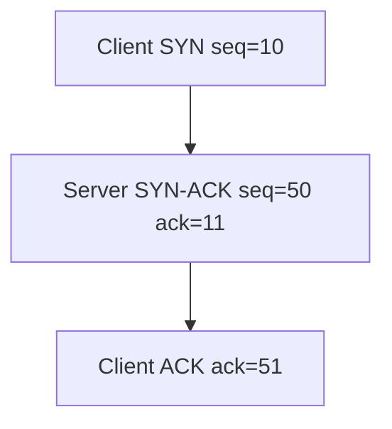

# A02.13 · TCP three-way handshake

[Phase index](../README.md) · [Core] · 25–40 minutes

Prerequisite [A02.12](A02.12.md) · Next [A02.14](A02.14.md)

## 1. The problem & why it exists

A client starts an application deadline before the connection is established.

Reuse appropriate connections when repeated handshakes dominate. First verify the listener and return path on a fresh connection.

## 2. Visual mental model



```text
01. Client SYN seq=10
02. Server SYN-ACK seq=50 ack=11
03. Client ACK ack=51
```

This trace isolates one boundary. For a deployed path, name the observer and capture the actual protocol, timing and configuration separately.

## 3. Step-by-step mechanism & minimal dry-run

SYN proposes the client's initial sequence number. SYN-ACK acknowledges the SYN and supplies the server's initial number. The final ACK completes the normal exchange.

**Dry-run.** Client SYN seq=10 -> Server SYN-ACK seq=50 ack=11 -> Client ACK ack=51.

**Failure control.** Predict how the result changes if you reproduce the mistake from section 1. Use the two outputs in section 6 to locate its effect.

## 4. Formal rigor & quantitative math

A normal handshake costs roughly one RTT before ordinary client data. At 60 ms RTT, it contributes about 60 ms plus local processing. SYN consumes one sequence number.

Check the worked quantities with NumPy after running `uv sync --locked --extra math`.

```python
import numpy as np

actual = np.add([10, 50], 1)
np.testing.assert_allclose(actual, [11, 51])
print(actual)
```

## 5. Progressive design

Compare the two paths in the [runnable fixture](../examples/A02.13.py). Running the fixture uses a bounded in-process fixture.

| Path | Output evidence | Resource consideration | Failure to watch |
| --- | --- | --- | --- |
| Failure control | `model: False` | Check whether the broken assumption changes time, bytes or retained state | A client starts an application deadline before the connection is established. |
| Normal control | `model: True` | Same task size and local fixture | Apply the measured rule only within its modeled boundary |

## 6. Safe local lab & controlled failure injection

Predict both outputs, then run from the repository root.

```sh
uv run python "01-architecture-A01-to-A20/A02-networking-and-communication/examples/A02.13.py"
uv run python "01-architecture-A01-to-A20/A02-networking-and-communication/examples/A02.13.py" --break
```

**Observe.** Look for `model: True` in the normal output and `model: False` in the failure control.

**Diagnose and repair.** Identify the first incorrect boundary in the broken run. Switch back to the normal run and change the deciding input in a scratch copy. Change the server initial sequence number. Record normal, failure and repaired observations.

**Apply.** Connect the result to [L1](../labs/L1.md). The example exits without starting a persistent service. Remove scratch files after saving the evidence you need.

## 7. Production & multi-cloud bridge

Separate DNS and connect duration in your request timeline. When comparing managed services on AWS, Azure and Google Cloud, keep DNS, transport, TLS and upstream timing separate and check the actual supported settings.

<details>
<summary>Principal question and answer</summary>

**Question.** Can a SYN-ACK alone prove the final ACK arrived?

No. Separate DNS and connect duration in your request timeline.

</details>

## 8. Memory hook & mastery checkpoint

**Recall.** SYN proposes the client's initial sequence number. Explain its boundary using the failure control.

1. Can a SYN-ACK alone prove the final ACK arrived?
2. What ACK acknowledges server SYN seq 50?
3. Identify the observable boundary affected by the failing control.
4. Predict the normal output and the broken output before execution.
5. Change the input as directed in section 6. Recompute and justify your prediction.

<details>
<summary>Answers and reasoning</summary>

1. No.
2. 51.
3. Separate DNS and connect duration in your request timeline.
4. Normal `model: True`. Broken `model: False`.
5. Use the relationship from section 4, then run your changed fixture with every other input held constant.

</details>
