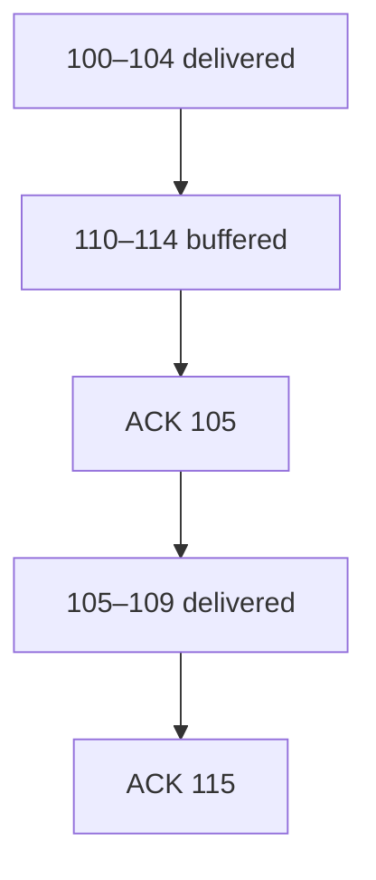

# A02.14 · sequence numbers, ACKs, retransmission and flow control

[Phase index](../README.md) · [Core] · 25–40 minutes

Prerequisite [A02.13](A02.13.md) · Next [A02.15](A02.15.md)

## 1. The problem & why it exists

The sender sees repeated ACK 105 although it already sent bytes past 105.

Use the operating system's TCP implementation. For diagnosis, inspect hole, retransmission, advertised window and congestion evidence separately.

## 2. Visual mental model



```text
01. 100–104 delivered
02. 110–114 buffered
03. ACK 105
04. 105–109 delivered
05. ACK 115
```

This trace isolates one boundary. For a deployed path, name the observer and capture the actual protocol, timing and configuration separately.

## 3. Step-by-step mechanism & minimal dry-run

A cumulative ACK identifies the next byte needed. A segment beyond a hole cannot advance it. Retransmission fills loss. The advertised receive window protects the receiver; congestion control protects the path.

**Dry-run.** 100–104 delivered -> 110–114 buffered -> ACK 105 -> 105–109 delivered -> ACK 115.

**Failure control.** Predict how the result changes if you reproduce the mistake from section 1. Use the two outputs in section 6 to locate its effect.

## 4. Formal rigor & quantitative math

If rwnd is 12 KiB and cwnd is 8 KiB, new in-flight data is bounded by 8 KiB minus outstanding bytes. At 3 KiB outstanding, 5 KiB remains under these simple limits.

Check the worked quantities with NumPy after running `uv sync --locked --extra math`.

```python
import numpy as np

actual = np.minimum(12, 8) - 3
np.testing.assert_allclose(actual, 5)
print(actual)
```

## 5. Progressive design

Compare the two paths in the [runnable fixture](../examples/A02.14.py). Running the fixture uses a bounded in-process fixture.

| Path | Output evidence | Resource consideration | Failure to watch |
| --- | --- | --- | --- |
| Failure control | `expected: 115` | Check whether the broken assumption changes time, bytes or retained state | The sender sees repeated ACK 105 although it already sent bytes past 105. |
| Normal control | `expected: 105` | Same task size and local fixture | Apply the measured rule only within its modeled boundary |

## 6. Safe local lab & controlled failure injection

Predict both outputs, then run from the repository root.

```sh
uv run python "01-architecture-A01-to-A20/A02-networking-and-communication/examples/A02.14.py"
uv run python "01-architecture-A01-to-A20/A02-networking-and-communication/examples/A02.14.py" --break
```

**Observe.** Look for `expected: 105` in the normal output and `expected: 115` in the failure control.

**Diagnose and repair.** Identify the first incorrect boundary in the broken run. Switch back to the normal run and change the deciding input in a scratch copy. Add the segment spanning bytes 105–109. Record normal, failure and repaired observations.

**Apply.** Connect the result to [L1](../labs/L1.md). The example exits without starting a persistent service. Remove scratch files after saving the evidence you need.

## 7. Production & multi-cloud bridge

Differentiate a receiver advertising a small window from network loss before scaling senders. When comparing managed services on AWS, Azure and Google Cloud, keep DNS, transport, TLS and upstream timing separate and check the actual supported settings.

<details>
<summary>Principal question and answer</summary>

**Question.** Does ACK 105 confirm byte 105?

No, it identifies 105 as the next expected byte. Differentiate a receiver advertising a small window from network loss before scaling senders.

</details>

## 8. Memory hook & mastery checkpoint

**Recall.** A cumulative ACK identifies the next byte needed. Explain its boundary using the failure control.

1. Does ACK 105 confirm byte 105?
2. What does rwnd protect?
3. Identify the observable boundary affected by the failing control.
4. Predict the normal output and the broken output before execution.
5. Change the input as directed in section 6. Recompute and justify your prediction.

<details>
<summary>Answers and reasoning</summary>

1. No, it identifies 105 as the next expected byte.
2. Receive-buffer capacity.
3. Differentiate a receiver advertising a small window from network loss before scaling senders.
4. Normal `expected: 105`. Broken `expected: 115`.
5. Use the relationship from section 4, then run your changed fixture with every other input held constant.

</details>
