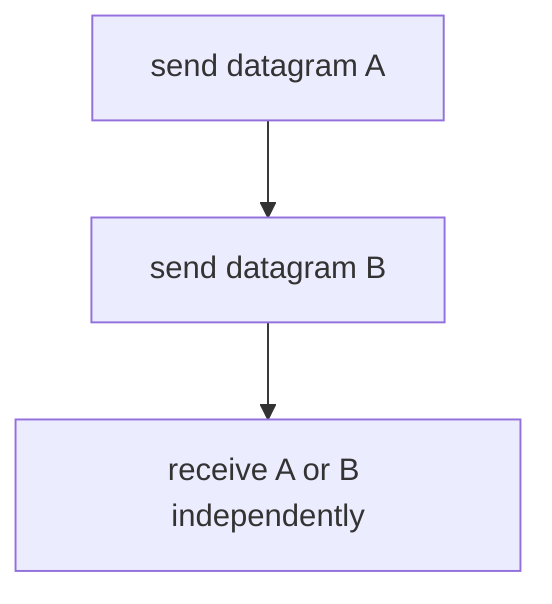

# A02.15 · UDP datagrams

[Phase index](../README.md) · [Core] · 25–40 minutes

Prerequisite [A02.14](A02.14.md) · Next [A02.16](A02.16.md)

## 1. The problem & why it exists

A receiver treats two datagrams as one continuous message stream.

Use TCP when ordered reliable bytes are the desired abstraction. UDP can suit independent time-sensitive messages when the application handles needed loss semantics.

## 2. Visual mental model



```text
01. send datagram A
02. send datagram B
03. receive A or B independently
```

This trace isolates one boundary. For a deployed path, name the observer and capture the actual protocol, timing and configuration separately.

## 3. Step-by-step mechanism & minimal dry-run

UDP preserves datagram boundaries. Each receive consumes a datagram. With an undersized buffer some APIs report truncation while excess payload is discarded. UDP does not supply ordering, acknowledgement or retransmission.

**Dry-run.** send datagram A -> send datagram B -> receive A or B independently.

**Failure control.** Predict how the result changes if you reproduce the mistake from section 1. Use the two outputs in section 6 to locate its effect.

## 4. Formal rigor & quantitative math

The base UDP header is 8 B. With IPv4 MTU 1500 and a 20 B base IP header, 1472 B fits without fragmentation at that link. Tunnels and path limits can reduce it.

Check the worked quantities with NumPy after running `uv sync --locked --extra math`.

```python
import numpy as np

actual = 1500 - np.sum([20, 8])
np.testing.assert_allclose(actual, 1472)
print(actual)
```

## 5. Progressive design

Compare the two paths in the [runnable fixture](../examples/A02.15.py). Running the fixture uses real loopback sockets.

| Path | Output evidence | Resource consideration | Failure to watch |
| --- | --- | --- | --- |
| Failure control | `b'AB' b'DEF'` | Check whether the broken assumption changes time, bytes or retained state | A receiver treats two datagrams as one continuous message stream. |
| Normal control | `b'ABC' b'DEF'` | Same task size and local fixture | Apply the measured rule only within its modeled boundary |

## 6. Safe local lab & controlled failure injection

Predict both outputs, then run from the repository root.

```sh
uv run python "01-architecture-A01-to-A20/A02-networking-and-communication/examples/A02.15.py"
uv run python "01-architecture-A01-to-A20/A02-networking-and-communication/examples/A02.15.py" --break
```

**Observe.** Look for `b'ABC' b'DEF'` in the normal output and `b'AB' b'DEF'` in the failure control.

**Diagnose and repair.** Identify the first incorrect boundary in the broken run. Switch back to the normal run and change the deciding input in a scratch copy. Send a one-byte first datagram and inspect the second. Record normal, failure and repaired observations.

**Apply.** Connect the result to [L1](../labs/L1.md). The example exits without starting a persistent service. Remove scratch files after saving the evidence you need.

## 7. Production & multi-cloud bridge

Never infer application delivery from a successful local send alone. When comparing managed services on AWS, Azure and Google Cloud, keep DNS, transport, TLS and upstream timing separate and check the actual supported settings.

<details>
<summary>Principal question and answer</summary>

**Question.** Does UDP preserve transmission order?

It preserves boundaries but does not promise arrival order. Never infer application delivery from a successful local send alone.

</details>

## 8. Memory hook & mastery checkpoint

**Recall.** UDP preserves datagram boundaries. Explain its boundary using the failure control.

1. Does UDP preserve transmission order?
2. Which payload fits the example MTU with an IPv6 base header?
3. Identify the observable boundary affected by the failing control.
4. Predict the normal output and the broken output before execution.
5. Change the input as directed in section 6. Recompute and justify your prediction.

<details>
<summary>Answers and reasoning</summary>

1. It preserves boundaries but does not promise arrival order.
2. 1452 B.
3. Never infer application delivery from a successful local send alone.
4. Normal `b'ABC' b'DEF'`. Broken `b'AB' b'DEF'`.
5. Use the relationship from section 4, then run your changed fixture with every other input held constant.

</details>

## Standards and implementation notes

UDP's length covers its header and payload. The socket API can truncate a datagram passed to a short buffer, and a later receive starts with the next datagram.

- [RFC 768 · UDP](https://www.rfc-editor.org/rfc/rfc768.html)
- [Python socket](https://docs.python.org/3/library/socket.html)
