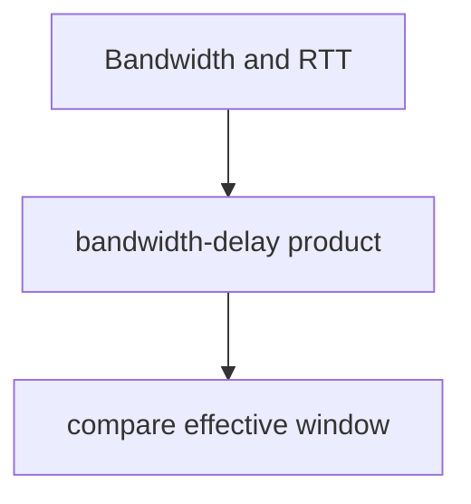

# A02.16 · TCP congestion control

[Phase index](../README.md) · [Core] · 25–40 minutes

Prerequisite [A02.15](A02.15.md) · Next [A02.17](A02.17.md)

## 1. The problem & why it exists

A high-bandwidth service transfers slowly over a distant path.

Use OS defaults before tuning. Diagnose link capacity, RTT, cwnd, rwnd and application limits with matching units.

## 2. Visual mental model



```text
01. Bandwidth and RTT
02. bandwidth-delay product
03. compare effective window
```

This trace isolates one boundary. For a deployed path, name the observer and capture the actual protocol, timing and configuration separately.

## 3. Step-by-step mechanism & minimal dry-run

Congestion control maintains an estimate of safe in-flight traffic, influenced by signals such as ACKs, delay, loss or ECN depending on algorithm. Flow control is a separate receiver limit.

**Dry-run.** Bandwidth and RTT -> bandwidth-delay product -> compare effective window.

**Failure control.** Predict how the result changes if you reproduce the mistake from section 1. Use the two outputs in section 6 to locate its effect.

## 4. Formal rigor & quantitative math

At 100 Mb/s and 40 ms RTT, BDP is 4,000,000 bits or 500,000 B. A 64,000 B effective window at that RTT caps ideal throughput at 12.8 Mb/s.

Check the worked quantities with NumPy after running `uv sync --locked --extra math`.

```python
import numpy as np

actual = 100_000_000 * np.array(0.04) / 8
np.testing.assert_allclose(actual, 500000)
print(actual)
```

## 5. Progressive design

Compare the two paths in the [runnable fixture](../examples/A02.16.py). Running the fixture uses a bounded in-process fixture.

| Path | Output evidence | Resource consideration | Failure to watch |
| --- | --- | --- | --- |
| Failure control | `12.8 Mb/s` | Check whether the broken assumption changes time, bytes or retained state | A high-bandwidth service transfers slowly over a distant path. |
| Normal control | `100.0 Mb/s` | Same task size and local fixture | Apply the measured rule only within its modeled boundary |

## 6. Safe local lab & controlled failure injection

Predict both outputs, then run from the repository root.

```sh
uv run python "01-architecture-A01-to-A20/A02-networking-and-communication/examples/A02.16.py"
uv run python "01-architecture-A01-to-A20/A02-networking-and-communication/examples/A02.16.py" --break
```

**Observe.** Look for `100.0 Mb/s` in the normal output and `12.8 Mb/s` in the failure control.

**Diagnose and repair.** Identify the first incorrect boundary in the broken run. Switch back to the normal run and change the deciding input in a scratch copy. Double RTT and recompute both window rates. Record normal, failure and repaired observations.

**Apply.** Connect the result to [L1](../labs/L1.md). The example exits without starting a persistent service. Remove scratch files after saving the evidence you need.

## 7. Production & multi-cloud bridge

A larger window only helps if it is the bottleneck and the path can sustain the traffic. When comparing managed services on AWS, Azure and Google Cloud, keep DNS, transport, TLS and upstream timing separate and check the actual supported settings.

<details>
<summary>Principal question and answer</summary>

**Question.** What happens to BDP if RTT doubles at fixed bandwidth?

It doubles. A larger window only helps if it is the bottleneck and the path can sustain the traffic.

</details>

## 8. Memory hook & mastery checkpoint

**Recall.** Congestion control maintains an estimate of safe in-flight traffic, influenced by signals such as ACKs, delay, loss or ECN depending on algorithm. Explain its boundary using the failure control.

1. What happens to BDP if RTT doubles at fixed bandwidth?
2. Does every TCP algorithm halve cwnd on every loss?
3. Identify the observable boundary affected by the failing control.
4. Predict the normal output and the broken output before execution.
5. Change the input as directed in section 6. Recompute and justify your prediction.

<details>
<summary>Answers and reasoning</summary>

1. It doubles.
2. No.
3. A larger window only helps if it is the bottleneck and the path can sustain the traffic.
4. Normal `100.0 Mb/s`. Broken `12.8 Mb/s`.
5. Use the relationship from section 4, then run your changed fixture with every other input held constant.

</details>
