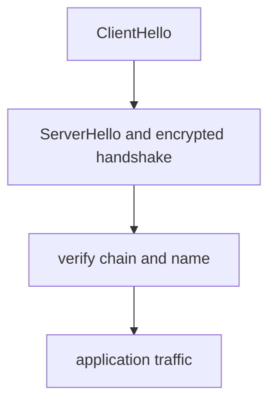

# A02.17 · TLS handshake and certificates

[Phase index](../README.md) · [Core] · 25–40 minutes

Prerequisite [A02.16](A02.16.md) · Next [A02.18](A02.18.md)

## 1. The problem & why it exists

A TLS connection encrypts bytes but fails identity verification.

Use a trusted local CA for development and check the name. Disabling verification discards the identity check.

## 2. Visual mental model



```text
01. ClientHello
02. ServerHello and encrypted handshake
03. verify chain and name
04. application traffic
```

This trace isolates one boundary. For a deployed path, name the observer and capture the actual protocol, timing and configuration separately.

## 3. Step-by-step mechanism & minimal dry-run

TLS negotiates cryptographic parameters and keys. On a normal full TLS 1.3 handshake the server proves certificate possession, and the client independently verifies trust chain, validity and the intended name.

**Dry-run.** ClientHello -> ServerHello and encrypted handshake -> verify chain and name -> application traffic.

**Failure control.** Predict how the result changes if you reproduce the mistake from section 1. Use the two outputs in section 6 to locate its effect.

## 4. Formal rigor & quantitative math

At 40 ms RTT, one TLS 1.3 handshake RTT plus one fresh TCP handshake RTT is approximately 80 ms before ordinary request data, excluding DNS and local processing.

Check the worked quantities with NumPy after running `uv sync --locked --extra math`.

```python
import numpy as np

actual = np.sum([40, 40])
np.testing.assert_allclose(actual, 80)
print(actual)
```

## 5. Progressive design

Compare the two paths in the [runnable fixture](../examples/A02.17.py). Running the fixture uses a bounded in-process fixture.

| Path | Output evidence | Resource consideration | Failure to watch |
| --- | --- | --- | --- |
| Failure control | `trust: False verifies hostname: False` | Check whether the broken assumption changes time, bytes or retained state | A TLS connection encrypts bytes but fails identity verification. |
| Normal control | `trust: True verifies hostname: True` | Same task size and local fixture | Apply the measured rule only within its modeled boundary |

## 6. Safe local lab & controlled failure injection

Predict both outputs, then run from the repository root.

```sh
uv run python "01-architecture-A01-to-A20/A02-networking-and-communication/examples/A02.17.py"
uv run python "01-architecture-A01-to-A20/A02-networking-and-communication/examples/A02.17.py" --break
```

**Observe.** Look for `trust: True verifies hostname: True` in the normal output and `trust: False verifies hostname: False` in the failure control.

**Diagnose and repair.** Identify the first incorrect boundary in the broken run. Switch back to the normal run and change the deciding input in a scratch copy. Keep verification on and compare valid versus mismatched SAN in L2. Record normal, failure and repaired observations.

**Apply.** Connect the result to [L2](../labs/L2.md). The example exits without starting a persistent service. Remove scratch files after saving the evidence you need.

## 7. Production & multi-cloud bridge

Record the verification error and the TLS peer name separately from the IP address. When comparing managed services on AWS, Azure and Google Cloud, keep DNS, transport, TLS and upstream timing separate and check the actual supported settings.

<details>
<summary>Principal question and answer</summary>

**Question.** Does trusting a CA make every hostname valid?

No. Record the verification error and the TLS peer name separately from the IP address.

</details>

## 8. Memory hook & mastery checkpoint

**Recall.** TLS negotiates cryptographic parameters and keys. Explain its boundary using the failure control.

1. Does trusting a CA make every hostname valid?
2. Is encryption alone an identity check?
3. Identify the observable boundary affected by the failing control.
4. Predict the normal output and the broken output before execution.
5. Change the input as directed in section 6. Recompute and justify your prediction.

<details>
<summary>Answers and reasoning</summary>

1. No.
2. No.
3. Record the verification error and the TLS peer name separately from the IP address.
4. Normal `trust: True verifies hostname: True`. Broken `trust: False verifies hostname: False`.
5. Use the relationship from section 4, then run your changed fixture with every other input held constant.

</details>
