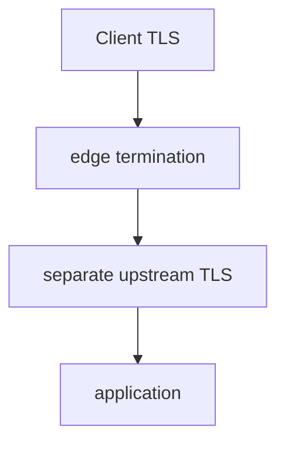

# A02.18 · TLS termination and mTLS

[Phase index](../README.md) · [Core] · 25–40 minutes

Prerequisite [A02.17](A02.17.md) · Next [A02.19](A02.19.md)

## 1. The problem & why it exists

The edge authenticates a client, but the upstream believes the edge's connection is the client connection.

Use plain HTTP upstream only in a controlled local exercise. In production decide separately which hops require authenticated encryption and who may assert identity.

## 2. Visual mental model



```text
01. Client TLS
02. edge termination
03. separate upstream TLS
04. application
```

This trace isolates one boundary. For a deployed path, name the observer and capture the actual protocol, timing and configuration separately.

## 3. Step-by-step mechanism & minimal dry-run

Termination ends one TLS session at the proxy. Re-encryption is a separate session. mTLS additionally authenticates the client presented to that session. Forwarded identity needs a trusted, explicit application mechanism.

**Dry-run.** Client TLS -> edge termination -> separate upstream TLS -> application.

**Failure control.** Predict how the result changes if you reproduce the mistake from section 1. Use the two outputs in section 6 to locate its effect.

**Part A · TLS sessions.** Draw client → proxy and proxy → upstream as separate connections. For each hop, record the verified server identity and trust roots. An upstream HTTP connection has no TLS peer.

**Part B · Mutual authentication.** A server that requires client authentication verifies the client's proof and configured chain policy for that connection. If the proxy presents its own certificate upstream, that peer authenticates the proxy. Propagating the original identity requires a trusted mechanism that rejects client-forged identity metadata.

## 4. Formal rigor & quantitative math

Two fresh TLS handshakes lead to two network timing contributions if serialized. With edge RTT 40 ms and upstream RTT 4 ms, the TLS-only sum is about 44 ms.

Check the worked quantities with NumPy after running `uv sync --locked --extra math`.

```python
import numpy as np

actual = np.sum([40, 4])
np.testing.assert_allclose(actual, 44)
print(actual)
```

## 5. Progressive design

Compare the two paths in the [runnable fixture](../examples/A02.18.py). Running the fixture uses a bounded in-process fixture.

| Path | Output evidence | Resource consideration | Failure to watch |
| --- | --- | --- | --- |
| Failure control | `certificate: False` | Check whether the broken assumption changes time, bytes or retained state | The edge authenticates a client, but the upstream believes the edge's connection is the client connection. |
| Normal control | `certificate: True` | Same task size and local fixture | Apply the measured rule only within its modeled boundary |

## 6. Safe local lab & controlled failure injection

Predict both outputs, then run from the repository root.

```sh
uv run python "01-architecture-A01-to-A20/A02-networking-and-communication/examples/A02.18.py"
uv run python "01-architecture-A01-to-A20/A02-networking-and-communication/examples/A02.18.py" --break
```

**Observe.** Look for `certificate: True` in the normal output and `certificate: False` in the failure control.

**Diagnose and repair.** Identify the first incorrect boundary in the broken run. Switch back to the normal run and change the deciding input in a scratch copy. Require a client certificate at one hop at a time. Record normal, failure and repaired observations.

**Apply.** Connect the result to [L2](../labs/L2.md). The example exits without starting a persistent service. Remove scratch files after saving the evidence you need.

## 7. Production & multi-cloud bridge

Track independent certificate rotation and trust policies on both hops. At a load-balancing boundary, compare AWS Application Load Balancer, Azure Application Gateway and Google Cloud Application Load Balancer behavior for the exact route and protocol.

<details>
<summary>Principal question and answer</summary>

**Question.** Who sees the original client certificate after termination?

The terminating endpoint, unless it forwards identity under a defined trust contract. Track independent certificate rotation and trust policies on both hops.

</details>

## 8. Memory hook & mastery checkpoint

**Recall.** Termination ends one TLS session at the proxy. Explain its boundary using the failure control.

1. Who sees the original client certificate after termination?
2. Does upstream mTLS authenticate the original client by default?
3. Identify the observable boundary affected by the failing control.
4. Predict the normal output and the broken output before execution.
5. Change the input as directed in section 6. Recompute and justify your prediction.

<details>
<summary>Answers and reasoning</summary>

1. The terminating endpoint, unless it forwards identity under a defined trust contract.
2. No, the upstream sees its own TLS peer.
3. Track independent certificate rotation and trust policies on both hops.
4. Normal `certificate: True`. Broken `certificate: False`.
5. Use the relationship from section 4, then run your changed fixture with every other input held constant.

</details>

## Standards and implementation notes

A terminating proxy is the TLS peer of the client. Backend certificate policy and the use of client certificates on the upstream connection are separate configuration decisions.

- [RFC 8446 · TLS 1.3](https://www.rfc-editor.org/rfc/rfc8446.html)
- [RFC 9525 · TLS service identity](https://www.rfc-editor.org/rfc/rfc9525.html)
- [NGINX proxy directives](https://nginx.org/en/docs/http/ngx_http_proxy_module.html)
