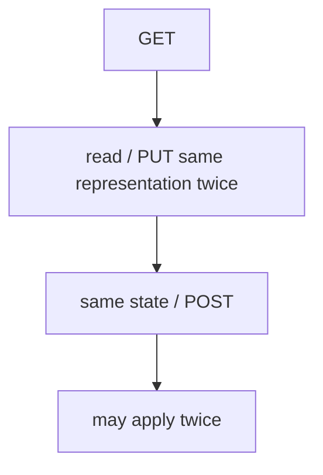

# A02.19 · HTTP methods and semantics

[Phase index](../README.md) · [Core] · 25–40 minutes

Prerequisite [A02.18](A02.18.md) · Next [A02.20](A02.20.md)

## 1. The problem & why it exists

A client retries an action after losing the response and runs it twice.

For a simple fetch use GET. For an additive command use a documented idempotency key or deduplicating protocol before automatic replay.

## 2. Visual mental model



```text
01. GET
02. read / PUT same representation twice
03. same state / POST
04. may apply twice
```

This trace isolates one boundary. For a deployed path, name the observer and capture the actual protocol, timing and configuration separately.

## 3. Step-by-step mechanism & minimal dry-run

HTTP method semantics describe the intended effect. Safe methods are read-oriented. Idempotent methods can be repeated with the same intended server effect, even if status and logs differ. Individual endpoints can violate the contract.

**Dry-run.** GET -> read / PUT same representation twice -> same state / POST -> may apply twice.

**Failure control.** Predict how the result changes if you reproduce the mistake from section 1. Use the two outputs in section 6 to locate its effect.

## 4. Formal rigor & quantitative math

Two identical adds of 3 to a balance of 10 end at 16; setting the balance to 13 twice ends at 13. A retry policy needs the endpoint contract.

Check the worked quantities with NumPy after running `uv sync --locked --extra math`.

```python
import numpy as np

actual = 10 + np.sum([3, 3])
np.testing.assert_allclose(actual, 16)
print(actual)
```

## 5. Progressive design

Compare the two paths in the [runnable fixture](../examples/A02.19.py). Running the fixture uses a bounded in-process fixture.

| Path | Output evidence | Resource consideration | Failure to watch |
| --- | --- | --- | --- |
| Failure control | `state: 16` | Check whether the broken assumption changes time, bytes or retained state | A client retries an action after losing the response and runs it twice. |
| Normal control | `state: 13` | Same task size and local fixture | Apply the measured rule only within its modeled boundary |

## 6. Safe local lab & controlled failure injection

Predict both outputs, then run from the repository root.

```sh
uv run python "01-architecture-A01-to-A20/A02-networking-and-communication/examples/A02.19.py"
uv run python "01-architecture-A01-to-A20/A02-networking-and-communication/examples/A02.19.py" --break
```

**Observe.** Look for `state: 13` in the normal output and `state: 16` in the failure control.

**Diagnose and repair.** Identify the first incorrect boundary in the broken run. Switch back to the normal run and change the deciding input in a scratch copy. Change the initial state and repeat the same effect twice. Record normal, failure and repaired observations.

**Apply.** Connect the result to [L4](../labs/L4.md). The example exits without starting a persistent service. Remove scratch files after saving the evidence you need.

## 7. Production & multi-cloud bridge

Review retries through proxies as well as application clients. At a load-balancing boundary, compare AWS Application Load Balancer, Azure Application Gateway and Google Cloud Application Load Balancer behavior for the exact route and protocol.

<details>
<summary>Principal question and answer</summary>

**Question.** Is DELETE idempotent even if a retry returns 404?

The intended deletion can be idempotent despite a different response. Review retries through proxies as well as application clients.

</details>

## 8. Memory hook & mastery checkpoint

**Recall.** HTTP method semantics describe the intended effect. Explain its boundary using the failure control.

1. Is DELETE idempotent even if a retry returns 404?
2. Is every POST necessarily unsafe to retry?
3. Identify the observable boundary affected by the failing control.
4. Predict the normal output and the broken output before execution.
5. Change the input as directed in section 6. Recompute and justify your prediction.

<details>
<summary>Answers and reasoning</summary>

1. The intended deletion can be idempotent despite a different response.
2. It depends on the documented endpoint behavior and safeguards.
3. Review retries through proxies as well as application clients.
4. Normal `state: 13`. Broken `state: 16`.
5. Use the relationship from section 4, then run your changed fixture with every other input held constant.

</details>

## Standards and implementation notes

Safety and idempotence describe intended request semantics. They do not promise identical responses, logs or side effects incidental to servicing a request.

- [RFC 9110 · HTTP semantics](https://www.rfc-editor.org/rfc/rfc9110.html)
